# SynTutor real-world NLP reliability remediation

## Verified baseline

The starting checkout was `main` at `d5aeaf5de98c45abbf2d97f19a6092a24d4ba44c` with Cycle 7–8 work already in the working directory. The tracked starting diff had SHA-256 `37a4970e77b35d7dde4bf018601bb541e7904be73a0f7c9dbd0c02ca37f5eabe`. The final tracked production diff under `server/` and `web/` had SHA-256 `f57cb67a04907c3dd66dc7ba560bf8b541a66105dc53d0ee344c4671748c5bdd`. The earlier audits, corpus predictions and in-progress source changes were preserved. See the [continuous progress log](SYNTUTOR_CONTINUOUS_RELIABILITY_PROGRESS.md), [Cycle 8 report](SYNTUTOR_CYCLE8_GENERALIZATION_AND_RELIABILITY.md) and [dataset inventory](technical_evaluation/EVALUATION_DATASET_INVENTORY.md).

No SynTutor service was listening on the chosen port initially. The reproduction used Flask at `127.0.0.1:8768` from `server/webapp.py`, first with PID `40315` and finally with PID `42526` from the edited checkout. Chromium requested `/api/parse` on the same origin with candidate XAI enabled. The harness compared the bodies and SHA-256 hashes of the HTML, main module, configuration, explanation, UI and correction modules against the checkout and checked `Cache-Control: no-store`. It isolated third-party authentication and CDN requests. It used the real Python models, tree generation, rule and correction pipelines, JSON service and browser renderer. See the [baseline browser capture](technical_evaluation/real_world_reliability/before-browser.json) and [final browser capture](technical_evaluation/real_world_reliability/after-browser.json).

| Runtime component | Observed local version or configuration |
| --- | --- |
| Host | macOS arm64, Python 3.11.17. The repository specifies Python 3.12 for deployment. |
| spaCy | 3.8.16 with `en_core_web_md` 3.8.0, POS, dependency, morphology and NER components |
| Benepar | 0.2.0 with `benepar_en3`, weights SHA-256 `fc465e820f8a62ffc6c23cb7d2ceed61f41d29d1930d471df301f17d3dbb4822` |
| Advisory model | `textattack/roberta-base-CoLA` cached revision `3ccf3a400f2fa75ff257eac171047603ffbe84f1`, detector tolerance `0.20` |
| Dependencies | Torch 2.15.0, Transformers 4.46.3, NLTK 3.10.4, lemminflect 0.2.3, inflect 7.6.0, SymSpellPy 6.10.2, jsonschema 4.26.0 |
| Transports and browser | Flask 3.1.3, FastAPI 0.165.0, Node 26.12.0 and Playwright 1.64.1 with cached Chromium |
| Reproduction flags | `HF_HUB_OFFLINE=1 TRANSFORMERS_OFFLINE=1 TOKENIZERS_PARALLELISM=false`. No model, tokenizer behavior or detector threshold changed. |

## Reproduction and learner-facing outcomes

| Submitted text | Baseline API and browser | Final behavior |
| --- | --- | --- |
| `I am ate an apple yesterday.` | spaCy and Benepar tagged `ate` as `VBN` and spaCy attached `am` as `auxpass` despite the overt object. FINAL-D1 found an incompatible gap and returned a working tree. The matrix still reported `C-BE-PAST` and validated `I ate an apple yesterday.` The browser displayed a blanket unavailable message. | The tree remains provisional. The browser explains the simple past, progressive `-ing` and passive past participle requirements. It presents the validated surface revision as one option for the intended simple past. |
| `If you dont know.` | The parser produced `do/RB nt/RB know/VB`. spaCy dependencies identified an auxiliary and negation. The matrix incorrectly described a missing finite verb, generated illustrative `runs` and `is running` prose and buried the fragment diagnosis under another root error. The working tree labeled both pieces as adverbs. | The original token and parse strings survive. The working tree marks the supported local auxiliary evidence and leaves the misspelled negative marker overt. The browser explains `do`, `n’t` and `know`, then qualifies the isolated conditional as a conversational fragment that needs a main clause in formal writing. The spelling is actionable and a sentence-wide rewrite is withheld. |
| `If you dont know, ask Naomi.` | A valid imperative was diagnosed as lacking a finite main verb and no repair was returned. | The conditional has an overt imperative main clause. The apostrophe is the only finding and the validated revision preserves negation. |
| `They demolished.` | A working tree was available, with uncertain structural evidence. | The working tree is explicitly provisional and the result is inconclusive in the browser. The raw matrix diagnostics remain inspectable in the API. |
| `Naomi 😊 will go later.` | The API uses Unicode code-point offsets and the DOM expects UTF-16 offsets. Using the raw offsets directly can truncate the selected sentence after the emoji. | Browser selection uses converted offsets. The source string and API offsets are preserved. |
| `🙂?!` | A fragment-style grammatical error could be returned for an input without words. | The API returns a recoverable 422 and the browser clears the previous analysis. |

The exact responses are archived as [baseline auxiliary](technical_evaluation/real_world_reliability/before-auxiliary.json.gz), [baseline contraction](technical_evaluation/real_world_reliability/before-contraction.json.gz), [final auxiliary](technical_evaluation/real_world_reliability/after-auxiliary.json.gz) and [final contraction](technical_evaluation/real_world_reliability/after-contraction.json.gz). Each includes the original model tokens, parser candidate, grammar checks, verdict, authority metadata, correction and explanation output.

## Execution map and failure modes

`Flask / stdlib → build_payload → spaCy + Benepar → FINAL-D1 + Cambridge + matrix/licensing → CoLA advisory → correction validation → XAI → API + browser`

| Boundary | Preconditions and output | Failure modes, fallback and risk |
| --- | --- | --- |
| Transport and validation | A JSON object, string input and valid sentence index/profile. The response is the selected sentence and document sentence ranges. | Malformed or oversized requests receive 400/413. Whitespace or text without English-script word evidence receives 422. An analysis exception receives 503. Latin-script language identification remains limited. |
| spaCy tokenization, morphology and dependencies | The input is copied into parser-compatible whitespace with a back-map to source offsets. The result carries token categories, dependencies and POS. | Unusual names, fragmented contractions, punctuation, code-switching and compounds can be split or mistagged. Local cases require corroboration, and Unicode source offsets are retained. The API rejects a mismatched lexical yield before attaching unrelated evidence. |
| Benepar constituency | The spaCy span supplies a Penn-tagged candidate with token coverage. | Count equality alone cannot establish word alignment. A component failure can make the parse unusable. Candidate categories can disagree with morphology and dependencies. |
| Burton–Roberts FINAL-D1 | A source-aligned candidate must satisfy the profile and tree validator. | Failed projection can retain a schema-valid working tree. A dependency-backed, past-only auxiliary incompatibility prevents canonical presentation. Gap, movement, coordination and attachment remain incomplete. Working trees may retain uncertain constituents. |
| Cambridge evaluator and raw-token XAI | Source, variety and human-review gates condition which claims can run. | Disabled candidates do not create verified errors. Canonical failure leaves token observations and any independently supportable legacy checks. Synthetic reviewed fixtures exercise gates. |
| Deterministic matrix and licensing | Constituents, exact token covers and lexical/morphological witnesses determine local findings. | False positives can follow from a wrong parser POS, nominal sense or dependency. Rules can miss context-sensitive ambiguity, argument structure, binding and noncanonical syntax. Checker exceptions remain separate from violations. |
| Advisory acceptability | The fixed CoLA model supplies a confidence score. | Rejection may make a clean analysis inconclusive. It cannot create a rule finding. Offline or failed inference leaves the rules result. Domain and dialect biases persist. |
| Corrections | Candidate edits have node spans and must pass the bounded spelling, morphology, negation, corruption and reanalysis checks. | A favorable reparse is compatible with a different meaning. The pipeline now withholds repairs for ambiguous auxiliary combinations and confines prose-derived edits to their evidence span. Ambiguous word senses and unannotated meaning changes remain review risks. |
| XAI | Canonical explanations use witnessed tree positions and reviewed authority where required. | A failed canonical projection leaves local deterministic findings and an independently labeled tree status. The browser suppresses arbitrary legacy prose on provisional node selection. Automated grounding tests cannot establish linguistic quality. |
| API and browser | The payload retains its canonical envelope, statuses and existing channels. | Rendering uses selected local evidence and source-derived spans. Technical and incomplete states are distinct. DOM offsets are derived separately from Python offsets. HTTP errors clear stale analysis. A 60-second browser timeout gives the learner a recoverable message. Explicit submissions supersede pending requests. |
| Educational integrations | Existing lessons, quizzes, builder and scoring retain their authority and schemas. | The available Node unit/DB gates cover quiz, lesson and builder functionality. Two browser suites assume a desktop Builder sidebar entry that is absent from the starting markup. |

## Risk-ranked defect ledger

| ID and severity | Reproduction, components and cause | Fix and controls | Verification and remaining risk |
| --- | --- | --- | --- |
| RW-01 High | Open `If you dont know.` and select the VP. spaCy’s dependency evidence diverged from `RB` tags. A plain lexical verb was conflated with a missing finite predicate. The matrix root indiscriminately labeled the SBAR as missing a verb. | Corroborate the contraction with dependency and constituent evidence. Distinguish formal completeness from missing verb morphology. Test no-apostrophe, apostrophe, typographic apostrophe, imperative, subordinate and mandative controls. | API and browser reproduce and verify the fix. For `A cant is a kind of slope.`, both tree status and wording remain inconclusive because the parser split the noun without enough contraction evidence. The spelling stays intact. |
| RW-02 High | `I am ate an apple yesterday.` plus inverted, negative and passive variants. The raw matrix finding could be hidden or duplicated, and a mistagged `VBN` could receive a canonical passive tree. | Match a dependency-linked form of `be` to an attested past-only form. Preserve the local finding and prevent canonical promotion. Retain valid progressive, passive, syncretic and pseudo-cleft controls. Bound deletion to a defensible affirmative simple-past reading. | Browser and API verified. `The apple was ate yesterday.` now withholds a sentence-wide repair while keeping the diagnostic. The rule does not cover every unavailable verb paradigm. |
| RW-03 High | `My favorite color is rose.` previously became `My favorite color is a rose.` `She rides a unicycle.` was changed to `an unicycle`. | Countability now respects an overt color predication frame. Article pronunciation exceptions include the unicycle family. Count nouns such as bare `apple` and vowel-onset `an umbrella` protect the opposite cases. | Model-backed word and sentence controls passed. Countability and dialect-sensitive article choice need more references. |
| RW-04 High | `qudit` could be rewritten to `audit` on word frequency and edit distance. Technical mass nouns and POS-mistagged names could trigger article insertion. `iPhone` and lower-case names could be capitalized automatically. | Require a dominant close dictionary candidate, POS/dependency compatibility, and absence of name evidence. Accept documented mass uses. Preserve name orthography when spaCy provides corroborating evidence. | Probes cover Filipino and international names, brands, specialized terms and legitimate edits such as `recieved` to `received`. Unknown words still sometimes produce an unverified result. |
| RW-05 High | Prose-driven edits could search outside the flagged span. Candidate validation accepted the first parse in a proposed multi-sentence revision. | Scope prose extraction to backed spans, protect recognized names, require one candidate sentence and cap validation at 24 candidate combinations. | Negative control proves an edit to a repeated or unrelated position is rejected. Multi-error repair can be withheld when the supported candidate falls outside the budget. |
| RW-06 High | Clicking a provisional tree showed a generic unavailable explanation next to unreviewed matrix text. Subordinate and auxiliary evidence did not survive in the visible result. | Render supported findings in a partial-analysis state and keep the tree notice separate. Preserve grammatical terminology in the vetted messages. | Real browser and API payloads agree. The visible scope covers the audited auxiliary, contraction, fragment and curated spelling mechanisms. Other legacy findings still need independent applicability review. |
| RW-09 High | Withhold the first real API response and submit a second sentence. The in-flight gate dropped the second submission and allowed the earlier analysis back onto the page. | Let explicit submissions supersede the current request. Keep automatic correction rechecks queued. | Chromium delays the first response, verifies the newer request and checks that the latest input and tree remain paired after the older result arrives. |
| RW-07 Medium | Curly terminal quotes caused false punctuation errors. Nonword input could acquire an ungrammatical verdict. `/api/words` could crash on valid JSON of the wrong type. | Handle closing quote marks, validate unsupported or oversized input before expensive inference, validate word JSON shape and preserve best-effort lexical tagging. | Verified in Flask tests and browser. Latin-script unsupported-language inputs and code-switching still need calibrated handling. |
| RW-08 Medium | A supplementary-plane character shifted tree/textarea selection and highlights. A failed request could leave earlier correction state in memory. | Convert to UTF-16 at DOM boundaries. Clear prior diagnostics and correction context on failure. Bound waiting time. | Chromium checked the complete selected Unicode sentence and cleared analysis on a subsequent 422. |

## Grammar and input coverage

The application probes include finite/non-finite distinctions, tense, aspect, passive and progressive auxiliaries, modals, do-support, negation, inversion, complement and imperative clauses, conditionals, comparative clauses, article phonology, mass/count, names, clitic spelling, quotation, multiple simultaneous issues and lexical uncertainty. The live parser suites also exercise agreement, relative and interrogative dependencies, adjuncts, polarity, coordination, ellipsis, raising, control, tough constructions, gaps and islands. The V4 diagnostic artifact reports metrics by construction. Its JFLEG slice tests naturally occurring learner writing. Good coverage of these suites does not imply robust support for every attachment or dialect. See [probe labels and categories](technical_evaluation/real_world_reliability/diagnostic_cases.json) and [V4 construction metrics](technical_evaluation/real_world_reliability/v4-diagnostic-metrics.json).

Proper-name controls include Naomi, Amihan, José-Luis, Nguyễn, DLSU-D, Dasmariñas, MacBook, OpenAI, iPhone and `X Æ A-12`. The implementation uses POS, constituent and named-entity observations as applicable. There is no request-specific name whitelist. The orthography controls include omitted apostrophes, transposition, duplication, Unicode apostrophes, capitalization, lexical overlap with `cant`, and specialist terms such as `qudit` and `epifluorescence`. Whole-token spellings and captured contractions remain visible in the original student string.

The deterministic regression matrix substitutes auxiliaries, inflections, names, Unicode, spacing, line breaks and punctuation. It audits source slices, finding node references, provisional authority and no false repairs on selected grammatical controls. Flask tests exercise request shape, empty and punctuation-only input, wholly non-Latin text, excessive size, selected sentence offsets, word lookup and simulated model failure. The bounded runs do not establish behavior under production load, outage duration or every parser failure shape.

## Measurements

### Real-world diagnostic probes

The 73 probes were selected to expose failure mechanisms and neighboring grammatical constructions. The author labels cover 62 cases. The remaining 11 include unsupported input, register, lexical meaning or discourse-dependent readings. Results from these cases informed changes. They are diagnostic.

| Measure | Starting checkout | Final checkout |
| --- | ---: | ---: |
| False ungrammatical verdicts on 34 labeled grammatical controls | 11 | 0 |
| Inconclusive verdicts on those controls | 0 | 4 |
| Detected ungrammatical examples out of 28 labeled errors | 27 | 28 |
| Canonical / provisional / unresolved without tree / unsupported | 46 / 23 / 4 / 0 | 42 / 27 / 2 / 2 |
| Returned sentence repairs | 18 | 16 |
| Returned sentence repairs on labeled grammatical controls | 2 | 0 |

```mermaid
xychart-beta
    title "Development probes before and after remediation"
    x-axis ["False error verdicts", "False repairs", "Canonical trees", "Working trees"]
    y-axis "Cases" 0 --> 50
    bar [11, 2, 46, 23]
    bar [0, 0, 42, 27]
```



The first bar series is the baseline. The second is the final run. None of the 69 final canonical or working trees failed schema validation. The 71 parsed probes had zero source token-slice mismatches. The final 62 labeled cases had 58 decisive hybrid outcomes and four inconclusive outcomes. The 16 revisions passed the automated morphosyntax and artifact audit, including the polarity checks. Their meaning preservation remains unmeasured by independent reviewers. The measured warm full-payload latency was 188 ms median and 384 ms p95 over the 71 successful probes. This single pass was not a controlled before/after latency comparison. See [baseline probes](technical_evaluation/real_world_reliability/before-probes.json.gz), [final probes](technical_evaluation/real_world_reliability/after-probes.json.gz), [category metrics](technical_evaluation/real_world_reliability/probe-metrics.json) and [correction audit](technical_evaluation/real_world_reliability/correction-audit.json).

### Current versus historical V4

The frozen V4 file retained SHA-256 `1d468942f7e9886039fa1c77df55668609e1cac1b70fcbcda0da8f2c0f0b4fe6`. V4 was independent for the historic locked run. Its labels and cases informed this work, so the new run is diagnostic. V1–V3 also remain historical or diagnostic. No new independent final evaluation was run.

| V4 slice and scoring | Accuracy | Precision | Recall | F1 | Specificity | FP / FN | Decisive coverage |
| --- | ---: | ---: | ---: | ---: | ---: | ---: | ---: | ---: |
| Primary 260, rules strict | 85.00% | 94.17% | 74.62% | 83.26% | 95.38% | 6 / 33 | 100% strict scoring |
| Primary 260, hybrid decisive | 89.12% | 94.17% | 82.91% | 88.18% | 95.08% | 6 / 20 | 91.92% |
| CoLA 100, rules strict | 61.00% | 86.67% | 26.00% | 40.00% | 96.00% | 2 / 37 | 100% strict scoring |
| Natural learner JFLEG 20, rules strict | 80.00% | 80.00% | 80.00% | 80.00% | 80.00% | 2 / 2 | 100% strict scoring |

The primary rules false-positive and false-negative rates were 4.62% and 25.38%. Strict scoring counts abstentions as non-positive results and includes three rules-only abstentions. Hybrid decisive scoring omits 21 abstentions. Compared with the historical V4 predictions, the rules recover one valid article choice in BLiMP and leave one JFLEG error inconclusive after withholding a weak spelling inference involving `brang`. That learner sentence still contains a problematic `easy to me` construction. Historical JFLEG strict accuracy was 85.00%. CoLA recall remains 26.00%. The available corpus and family breakdown exposes these tradeoffs. See [historical results](SYNTUTOR_CYCLE8_GENERALIZATION_AND_RELIABILITY.md), [current predictions](technical_evaluation/real_world_reliability/v4-diagnostic-predictions.csv) and [current metrics](technical_evaluation/real_world_reliability/v4-diagnostic-metrics.json).

### Structural quality

The lookup-bypassed textbook census matched the historical results across 216 published references. There were 200 canonical trees, 16 working trees, no execution errors and 185 word-yield alignments against the references. Full labeled precision/recall/F1 were 55.16%/88.67%/68.01%, with 72.21% unlabeled F1 and 32 exact matches. The triangle-aware scores were 79.43%/88.67%/83.80%, with 88.96% unlabeled F1 and 98 exact matches. These are structural scores over aligned trees. On diagnostic V4, JFLEG yielded 12 canonical and eight working trees, with all 12 canonical trees valid against the schema. JFLEG structural F1 and exact agreement require learner-writing reference trees. See [textbook scores and per-record results](technical_evaluation/real_world_reliability/textbook-parseval.json).

## Explanation and correction review

Both reported inputs went from zero useful browser-level explanations of the relevant issue to an actionable explanation alongside the provisional tree. The specific grammatical checks address actual local roles in the input. The API continues to distinguish authority through `book_verified`, canonical status and reviewed Cambridge channels. An unavailable canonical XAI paragraph can coexist with independently supported matrix evidence. Unverified candidates remain available for diagnosis in the JSON and are excluded from the relevant learner claims.

The correction audit applies the earlier independent automated morphosyntax, polarity and artifact checks to each returned probe revision. Repairs with ambiguous tense, voice, register or intended main clause can remain withheld even when a local change is straightforward. A reparse and advisory score cannot certify intended meaning. The [review worksheet](technical_evaluation/real_world_reliability/human-review.csv) leaves all ratings blank. Reviewers should inspect each original, highlight the rule and evidence span, compare canonical or working tree attachment to their reference, and rate linguistic accuracy, grammar-rule applicability, correction validity, meaning preservation, minimality, explanation clarity and educational usefulness independently. Report disagreements and unsupported readings explicitly. No human ratings or inter-rater scores were collected.

## Model warnings

The default T5 tokenizer legacy notice records the behavior in use. The `T5TokenizerFast` notice is a batching-performance recommendation. The `past_key_values` tuple notice identifies deprecation for a future Transformers upgrade. RoBERTa’s unused pooler weights were logged while the task-specific classifier loaded and scored both live cases. The observed warnings coexisted with successful parser health, constituency output and classification. They are distinct from the reproduced analysis failures. The `torch_struct` `arg_constraints` warning appeared in test output and did not prevent model-backed tests from running.

## Verification and reproducibility

| Status | Gate |
| --- | --- |
| Passed | 948 Python tests with parser-required CGEL probes, Flask, stdlib HTTP, FastAPI, correction, canonical projection, XAI, and the new real-world regressions. The initial sandboxed baseline run hit four socket-binding setup errors. Loopback authorization cleared that constraint. |
| Passed | Chromium against a fresh local Flask process, covering both original reports, a passive control, the no-finding working tree, Unicode selection, rejected-input recovery, loading and out-of-order submissions. |
| Passed | Node lesson, quiz, assessment, builder, tree/correction, node-map and source-evidence suites, including PGlite migration and isolation checks. Standalone corrector and matrix remediation scripts passed. Historical metrics passed all 74 integrity checks. |
| Failed | The existing `test_quiz_v2_browser.js` requires `builder` directly after `tutor`. The existing `test_builder_generator_browser.mjs` times out on `.sidebar-item[data-view="builder"]`. The same sidebar routes are absent at the starting `HEAD` and in the current HTML. The test scripts reached their navigation gates. |
| Skipped | Separate Python Playwright walkthroughs require a Python package absent from the repository environment. The new live-browser test uses the available Node Playwright installation. |
| Unmeasured | Production deployment parity, external PTB PARSEVAL, independent human ratings and new untouched benchmark generalization. |

```sh
HF_HUB_OFFLINE=1 TRANSFORMERS_OFFLINE=1 TOKENIZERS_PARALLELISM=false \
  SYNTUTOR_PORT=8768 .venv/bin/python -u server/webapp.py

QUIZ_V2_PLAYWRIGHT_MODULE=/path/to/playwright/index.mjs \
  SYNTUTOR_TEST_ARTIFACTS=/tmp/syntutor-browser node scripts/test_real_world_nlp_browser.mjs

CGEL_REQUIRE_PARSER=1 HF_HUB_OFFLINE=1 TRANSFORMERS_OFFLINE=1 TOKENIZERS_PARALLELISM=false \
  PYTHONPATH=server .venv/bin/python -m unittest discover -s server -p 'test_*.py'

HF_HUB_OFFLINE=1 TRANSFORMERS_OFFLINE=1 TOKENIZERS_PARALLELISM=false \
  .venv/bin/python docs/audits/technical_evaluation/run_real_world_reliability.py /tmp/syntutor-audit

.venv/bin/python docs/audits/technical_evaluation/verify_metrics.py
```

## Remaining limitations and priorities

1. Collect independent expert ratings of natural learner analyses, including provisional explanation and correction meaning. The earlier holdouts and these probes have informed development. A future independent test needs new source provenance, adjudication, overlap checks, frozen files and locked runtime before inspection.
2. Prioritize Latin-script language scope and code-switching. `Bonjour tout le monde.` and `Salamat po, Naomi.` can still attract speculative legacy diagnostics. Their actual language and intent need better evidence than unfamiliar tokens or dictionary absence. Inconclusive browser copy helps when no supported local finding survives.
3. Review the remaining argument-structure, attachment and learner-normalization gaps. `She read teh book.` can still acquire a secondary missing-article finding from the original candidate despite the spelling repair validating. No hypothetical retry silently replaces the original analysis. The diagnostic JFLEG recall loss and surviving article/preposition false positives warrant targeted adjudication.
4. Continue structural evaluation with independent learner-writing trees. The textbook census still shows extra nominal/bar levels and low full exact agreement. The 20 JFLEG sentences measure coverage only. Textbook examples cannot establish learner-writing structural accuracy.
5. Repair the two stale browser-suite assumptions through an explicitly scoped educational integration update. The current remediation stays within NLP analysis, evidence and recovery behavior. Verify deployment-runtime Python 3.12, browser timeout behavior under real outages, and concurrent cold-start cost before generalizing local runtime observations.
