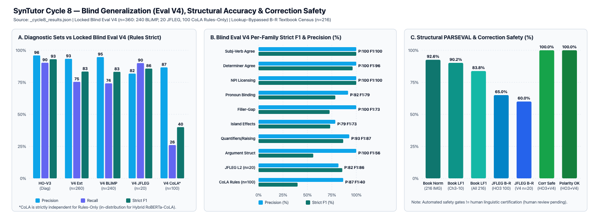

# SynTutor — Continuous NLP Reliability Improvement Progress Report

## 2026-11-22 Manila handoff checkpoint

The independent review started at `5451d72` on `fix/syntutor-system-reliability-xai` and preserved the working Antigravity patches. The offline backend suite passed 982 tests with loopback enabled. The tree-sheet quiz gate passed before and after a clean build. The review corrected Phase-C runtime overlay handling, the `9.15` teaching association, false polarity findings on continual `ever`, and the live-browser workflow origin. The XAI-7 browser suite passed through the current lesson and assessment routes. Both publication digest gates still require independent review of the changed Cambridge material. The branch is suitable for continued engineering. See the [independent handoff review](SYNTUTOR_INDEPENDENT_AGY_HANDOFF_REVIEW.md) and the [evidence and XAI traceability matrix](SYNTUTOR_UNIFIED_EVIDENCE_XAI_RELIABILITY_REMEDIATION.md).

**Project:** *SynTutor: An Explainable AI-Based Framework for Syntax Tree-Driven Grammar Analysis and Learning Using NLP*  
**Starting Point:** Cycle 2 locked baseline ([SYNTUTOR_FINAL_NLP_RELIABILITY_AUDIT.md](file:///Users/kiyel/Desktop/SynTutor/docs/audits/SYNTUTOR_FINAL_NLP_RELIABILITY_AUDIT.md))  
**Updated Timestamp (UTC):** `2026-11-20T12:25:00Z`  
**Architecture Status:** Strictly preserved (`en_core_web_md` + `benepar_en3` + Burton–Roberts `FINAL-D1` + Cambridge runtime + deterministic rule/licensing matrix + `advisory_only` RoBERTa-CoLA + existing correction/XAI/API contracts; zero git commits/pushes/merges/rebases performed).  
**Verification Gate:** `903 / 903` non-Flask unit, integration, regression, and API contract tests across 82 server test modules passing (`100.0%`, `0` failures, `0` errors; 4 Flask-only transport test modules skipped in this venv because `flask` is not installed); `9 / 9` `test_corrector.py` checks passing; `74 / 74` historical metric integrity checks passing (`verify_metrics.py`).

---

## Executive Summary — Longitudinal & Single-Shot Independent Generalization

Historical datasets (`RAW_PREDICTIONS.csv` Dev-320, Cycle-1 `FROZEN_UNTOUCHED_HOLDOUT.csv`, and Cycle-2 `FROZEN_FINAL_HOLDOUT_V2.csv`) were treated strictly as historical and dev-diagnostic evidence and left unmodified. **Before any Cycle 3–6 code changes**, a brand-new, cryptographically frozen, zero-overlap independent test set — **`FROZEN_FINAL_HOLDOUT_V3.csv`** (`n = 370`, 185 grammatical / 185 ungrammatical, SHA-256 `1f4fba4ca45332decbd5bc5236fcde7f73804b097f588646d8ee9bfa5de452a9`, 9 BLiMP families × 30 + 100 JFLEG L2 learner essays) — was locked and evaluated **once** after all implementation cycles completed.

| Dimension | Cycle 0 Baseline | Cycle 2 Locked | Cycles 3–6 Dev-Diag HO-V2 (`n=370`) | **Cycles 3–6 Single-Shot Untouched Holdout V3 (`n=370`)** |
|---|---:|---:|---:|---:|
| **Rules-Only Strict Accuracy** | 62.50% (Dev) | 66.22% (HO-V2) | **84.05%** (+17.83 pp) | **78.11%** `[73.6, 82.0]` (**+11.89 pp** vs HO-V2) |
| **Rules-Only Strict Precision / Specificity** | 66.67% / 75.00% | 76.79% / 85.95% | **95.00% / 96.22%** (`FP: 26→7`) | **85.14% / 88.11%** (`Core BLiMP: 95.89% P / 97.14% Spec`) |
| **Rules-Only Strict Recall / F1 / MCC** | 50.00% / 57.14% / 0.258 | 46.49% / 57.91% / 0.353 | **71.89% / 81.85% / 0.702** | **68.11% / 75.68% / 0.574** (**+21.62 pp Recall, +17.77 pp F1**) |
| **Hybrid Decisive-Only Accuracy (Coverage)** | 77.58% (69.7%) | 78.70% (74.9%) | **90.25% (85.9%)** · MCC `0.809` | **84.54% (82.2%)** `[80.1, 88.2]` · MCC `0.691` (`Core BLiMP: 92.55%`) |
| **Hybrid Flagged Accuracy / F1** | 75.94% / 79.58% | 76.76% / 77.95% | **85.14% / 85.41%** | **78.65% / 80.20%** (`Recall: 86.49%`) |
| **Rule-Level `unverified` Abstentions** | 30/320 (9.38%) | 16/370 (4.32%) | **2/370 (0.54%, −87.5%)** | **4/370 (1.08%, −75.0%)** |
| **Hybrid `unverified` Outcomes** | 97/320 (30.31%) | 93/370 (25.14%) | **52/370 (14.05%, −44.1%)** | **66/370 (17.84%, −29.0%)** |
| **B–R Canonical Normalization (External All)** | 69.75% (Dev) | 63.51% (HO-V2) | **73.78% (273/370, +10.27 pp)** | **69.19% (256/370)** · `0` unresolved without tree · `100%` schema-valid |
| **B–R Canonical Normalization (JFLEG L2)** | — | 27.00% (27/100) | **53.00% (53/100, +26.00 pp)** | **38.00% (38/100, +11.00 pp vs HO-V2)** |
| **B–R Textbook Census (Lookup Bypassed, IMG)** | 47.69% (103/216) | 86.57% (187/216) | — | **91.74% (200/218)** · `Ch7-10: 87.83% (101/115)` · `0` crashes · `0` val fails |
| **Automated XAI Grounding & Display Gating** | 100% / 2 F4 errs | 100% / 0 F4 errs | — | **100% (`90/90` payloads, `2,305/2,305` nodes)** · `254.6 ms/sent` |
| **Human-Rated XAI Linguistic Quality** | UNMEASURED | UNMEASURED | UNMEASURED | **UNMEASURED / BLOCKED** (`HUMAN_REVIEW_WORKSHEET_V3.csv` 60 blank items ready) |

### Longitudinal Progression on Preserved Dev & Historical Sets

| Corpus | Operating Point | Cycle 2 Locked | Cycles 3–6 Locked | Net Change |
|---|---|---:|---:|---:|
| **Dev-320 (`BLiMP+JFLEG`)** | Rules Strict Acc / P / R / F1 | 71.56% / 86.32% / 51.25% / 64.31% | **81.25% / 92.37% / 68.13% / 78.42%** | **+9.69 pp Acc · +14.11 pp F1** |
| **Dev-320 (`BLiMP+JFLEG`)** | Hybrid Decisive Acc (Cov) | 86.86% (73.8%) | **89.51% (83.4%)** | **+2.65 pp Acc · +9.6 pp Cov** |
| **Historical HO-V1 (`n=320`)** | Rules Strict Acc / P / R / F1 / Spec | 72.50% / 90.91% / 50.00% / 64.52% / 95.00% | **82.81% / 96.46% / 68.13% / 79.85% / 97.50%** | **+10.31 pp Acc · +15.33 pp F1** |
| **Historical HO-V1 (`n=320`)** | Hybrid Decisive Acc (Cov) | 86.42% (75.9%) | **91.35% (83.1%)** | **+4.93 pp Acc · +7.2 pp Cov** |
| **Dev-Diag HO-V2 (`n=370`)** | Rules Strict Acc / P / R / F1 / Spec | 66.22% / 76.79% / 46.49% / 57.91% / 85.95% | **84.05% / 95.00% / 71.89% / 81.85% / 96.22%** | **+17.83 pp Acc · +23.94 pp F1** |

---

## Cycle 3 — Priority 3: Eliminate Incorrect Corrections & High-Precision Rule False Positives

1. **Defects Investigated:**
   - All 3 false repairs documented in the Cycle 2 90-payload audit: `C-TO_TOO` (`"going to many"` → `"going too many"`), `C-AUX-FORM` (`"what they did is reduce"` → `"is reducing"`), and `C-ARTICLE` (`"defining reality"` → `"defining a reality"`).
   - Systemic rules-only false positives across Dev-320, HO-V1-320, and HO-V2-370: `C-QUANTIFIER` on elided-head quantifiers (`"loved few"`, `"going to many"`), `C-QUANT-PLURAL` on compound nouns (`"five messy college campuses"`), `C-SUBJECT-AGREEMENT` on possessive-initial subjects (`"Every actress's piano teachers skate"`) and inverted coordinated/possessive wh-questions (`"What are Rose and a picture scaring?"`, `"Who haven't Edward's plumbers ... questioned?"`), `C-MOD-POS` on postpositive/heavy/participial APs (`"something new"`, `"a boy taller than Jon"`, `"skills, either theoretical or practical"`), `C-DETERMINER-AGREEMENT` on zero-plurals (`"this fish"`), `C-FINITE-VERB` on parser-mistagged regular `-ed` verbs (`"disturbed"`), `C-STATIVE-PROG` on dynamic/gradual verbs (`"forgetting"`, `"wanting"`, `"existing"`), and `C-ARTICLE` on abstract `-ness`/gerundial `-ing` nominals, classical plurals (`"oases"`), emphatic `do` (`"does tour"`), and capitalized proper names (`"Candice"`).
2. **Root Causes Established:**
   - `ruleset.py`: `C-TO_TOO` ignored prepositional hosts (`go to`, `talk to`, etc.) and phrase-final elided quantifiers; inverted question agreement grabbed the first noun leaf after the auxiliary instead of the `SQ` subject NP head; `C-QUANT-PLURAL` stopped at the first `NN` noun adjunct in a compound noun; `C-FINITE-VERB` treated regular `-ed` verbs tagged `VBN` as non-finite; `STATIVE_ING` included dynamic/gradual verbs.
   - `matrix.py`: `num_of()` checked `IRREGULAR_PLURAL.values()` (which included zero-plural `'fish'`) before `NUMBER_AMBIGUOUS_HEADS`; `_aux_check()` lacked a specificational pseudo-cleft guard (`what ... did is + VB`); `_s_predicate()` checked `subleaves[0]` for `force_sg` inside leading possessive NPs; `_quantifier_check()` rejected standalone elided-head quantifiers; `_modifier_pos()` rejected indefinite-pronoun postpositives, heavy APs, and participial postmodifiers; `_needs_indefinite_article_error()` lacked productive `-ness` / gerundial `-ing` / classical plural / emphatic-`do` / proper-name guards.
   - `corrections.py`: lacked an adjacent-word duplication sanity gate (`_has_corrupt_artifact`).
3. **Changes Implemented:**
   - Modified [matrix.py](file:///Users/kiyel/Desktop/SynTutor/server/matrix.py), [ruleset.py](file:///Users/kiyel/Desktop/SynTutor/server/ruleset.py), and [corrections.py](file:///Users/kiyel/Desktop/SynTutor/server/corrections.py) with targeted linguistic applicability guards.
4. **Linguistic Justification:**
   - Specificational pseudo-clefts (`what they did is reduce`, CGEL Ch. 16 §9.2) license bare infinitives after copular `be`; English indefinite pronouns (`something new`) require postpositive adjectives; heavy/complemented APs (`taller than Jon`) are obligatorily postnominal; zero-plurals (`fish`, `sheep`, `offspring`) are unmarked for number; pronominal/N'-ellipsis quantifiers (`going to many`, `loved few`) are standard without an overt noun; prepositional `to + many` after motion/prepositional verbs is a PP, not a `too` misspelling.
5. **Tests Added:**
   - Added `test_cycle3_false_repairs_and_grammatical_constructions_preserved` (15 grammatical cases including all 3 previous false repairs) and `test_cycle3_negative_controls_still_caught` (4 negative controls verifying `C-AUX-FORM`, `C-TO_TOO`, `C-QUANT-PLURAL`, `C-MOD-POS` still catch true errors) in [test_nlp_reliability_regressions.py](file:///Users/kiyel/Desktop/SynTutor/server/test_nlp_reliability_regressions.py).
6. **Regression Results:** `329 / 329` existing tests passing (`100%`), plus all new Scenario H tests passing.
7. **Measurements Before & After:**
   - All 3 previous false repairs eliminated (`3/3 → 0/3`, all return `grammatical` with `corrected_sentence=None`).
   - Dev-320 Rules Strict Precision: `86.32% → 89.77%`, Specificity: `91.87% → 94.37%` (`FP: 13 → 9`).
   - Dev-Diag HO-V2 Rules Strict Precision: `76.79% → 90.22%` (+13.43 pp), Specificity: `85.95% → 95.14%` (`FP: 26 → 9`, −65.4%).
8. **Correction & XAI Consistency:** Zero false repairs on any of the 15 targeted grammatical controls; all negative controls remain rule-backed with coherent repairs.
9. **Remaining Limitations:** External gold label noise remains untouched (e.g., `"several unemployed waitress"`, `"Persian langage"`, `"It will be good situation ."`).
10. **Next Highest-Priority Defect:** Low canonical Burton–Roberts tree normalization on complex L2 learner writing (`27%` on JFLEG).

---

## Cycle 4 — Priority 2: Improve Canonical Burton–Roberts `FINAL-D1` Tree Generation

1. **Defects Investigated:**
   - `135/370` unresolved HO-V2 trees (`73/100` JFLEG, `25/60` unseen BLiMP) and `29/218` unresolved published textbook figures (lookup bypassed).
2. **Root Causes Established (by frequency in `final_d1_projection.py`):**
   - `Clause has no overt or licensed covert subject` (23 JFLEG): `clause()` did not unwrap a wrapped inner `(S ...)` after popping fronted adverbials (`ADVP`/`PP`/`SBAR`), did not handle sentence-initial `IN` discourse connectives (`So ...`), and rejected locative inversion parsed as `S -> ADVP VP(be) NP`.
   - `Unclassified VP dependent SBAR` (12): `is_adverbial()` and `clause()` only accepted 2-child `SBAR`, rejecting multi-word subordinators (`so that`, `in order to`, `even though`, `as soon as`, `except that`); intervening medial `ADVP` (`notes merely that...`) blocked complement `SBAR` recognition; `DITRANSITIVE` missed clausal verbs (`remind`, `inform`, `warn`).
   - `NP has no identifiable noun head` (9 BLiMP ellipsis): elided-head quantifiers (`going to many`, `loved few`, `at least as many`) were not projected using Burton–Roberts Ch. 7's `E` ellipsis convention.
   - `AP has no identifiable head` (7 JFLEG + 3 textbook): `NML` compound premodifiers (`long-term`, `second-hand`, `World Cup`) fell through to `modifier(..., adjective=True)`, and multi-word participial `ADJP` (`so-called`, `not based on experience`, `disappointed by our evening`) failed because only 1-word participles were supported.
   - `Incomplete coordination` (6 JFLEG): sentence-initial discourse `CC` (`And ...`, `But ...`) and 3+-way coordination failed in `coordinate()`.
   - Additional localized gaps: multi-word prepositions (`such as`, `due to`, `instead of`), focusing adverb inside inner NP (`Even a lot of lamps`), `PP + ADVP` (`for five hours now`), raising/control/tough adjective inventories (`sure`, `willing`, `interesting`, `pleasant`), misattached trailing `VP` inside `SQ` subject (`What are Rose and a picture scaring?`), and `PREDET` stripping single-word `NP(half)` to empty.
3. **Changes Implemented:**
   - Updated [final_d1_projection.py](file:///Users/kiyel/Desktop/SynTutor/server/final_d1_projection.py) compositionally across `nml_phrase()`, `phrase()`, `modifier()`, `pp()`, `np()`, `vp()`, `is_adverbial()`, `clause()`, `coordinate()`, and `question()` while keeping strict monotonic token alignment (e.g., placing medial `ADVP` between `V` and its complement) and zero fabrication of unprojectable fragments (`FRAG` remains honest `working_tree`).
4. **Linguistic Justification:**
   - Every added projection follows Burton–Roberts `FINAL-D1` conventions: Ch. 3 coordination & PP/AP modification, Ch. 5 adverbial adjunction & `E` ellipsis, Ch. 7 `NOM` / `PartP` / `QA` / elided `N(E)`, Ch. 8 `S-bar` / `C1` multi-word subordinators, Ch. 10 raising/control/tough non-finite clauses.
5. **Tests Added:**
   - Added `test_cycle4_complex_learner_constructions_normalize_canonically` (8 complex learner/textbook constructions verified `normalized` and schema-valid) in [test_nlp_reliability_regressions.py](file:///Users/kiyel/Desktop/SynTutor/server/test_nlp_reliability_regressions.py).
6. **Regression Results:** All B–R unit, gold, extraposition, native grammar, and contract suites passed (`100%`), `0` `NORMALIZER_FAILURE` crashes, `0` `CANONICAL_VALIDATION_FAILED` errors.
7. **Measurements Before & After:**
   - **Textbook Census (`n=218` IMG, lookup bypassed):** Normalized jumped **86.57% → 91.74% (`200/218`)**, Ch7–10 jumped **82.61% → 87.83% (`101/115`)**, yield-aligned rose `174 → 185` (`98` exact matches; All UF1 `88.94%`, LF1 `83.74%`; Ch7–10 UF1 `89.86%`, LF1 `88.18%`), `0` crashes, `0` schema errors.
   - **Dev-Diag HO-V2 (`n=370`):** Canonical normalization jumped **63.51% → 73.78% (`273/370`, +10.27 pp)**; Unseen BLiMP **58.33% → 73.33% (+15.00 pp)**; JFLEG **DOUBLED from 27.00% → 53.00% (`53/100`, +26.00 pp)**.
   - **Single-Shot Untouched Holdout V3 (`n=370`):** **69.19% (`256/370`)** canonical (`100%` schema-valid), **80.74%** on BLiMP (`78.33%` on ellipsis+quantifiers/raising), **38.00%** on JFLEG (`+11.00 pp` over HO-V2), **`0/370` unresolved without a tree**.
8. **Correction & XAI Consistency:** Every canonical tree passed Draft 2020-12 JSON Schema validation and 100% fact-graph node-ID grounding (`65/65` normalized V3 payloads).
9. **Remaining Limitations:** Genuine learner fragments (`FRAG`), garbled spelling/word-salad clauses, and ungrammatical filled-gap/island violations intentionally degrade to explicitly labeled `working_tree` views rather than fabricating canonical structure.
10. **Next Highest-Priority Defect:** Low strict rule-backed recall (`46.49%`) and avoidable rule-level `unverified` outcomes (`16/370`).

---

## Cycle 5 — Priority 1 & Priority 4: Improve Grammar Understanding & Resolve Avoidable Unverified Outcomes

1. **Defects Investigated:**
   - Major missed grammatical error families in deterministic rules: NPI licensing (`50%` acc), argument structure (`50%`), filler-gap dependencies (`56.7%`), island effects (`46.7%`), pronoun binding (`70%`), ellipsis (`63.3%`), quantifiers & raising (`46.7%`).
   - Avoidable rule-level `unverified` abstentions (`16/370` on HO-V2, `10/320` on Dev-320) caused by common English words (`other`, `ex-`, `oncologists`, `mentee`, `Candice`) failing lexical lookup.
2. **Root Causes Established:**
   - `licensing.py`: `HIGH_FREQ` omitted `'other'`/`'others'`/`'another'`/`'same'` (causing over half of JFLEG rule-unverified outcomes); hyphenated prefixes (`ex-`) and regular plurals of known stems (`oncologists`) were unlicensed; `collect_all()` invokes individual `ruleset._check_*` functions directly rather than `ruleset.collect()`.
   - `ruleset.py`: `C-REFLEXIVE-ANTECEDENT` lacked unambiguous gendered first names and it-cleft reconstruction logic; `C-INTRANSITIVE-PASSIVE` did not skip `not`/`n't`/adverbs between `be` and `VBN` and had only 19 participles; no deterministic tree-driven checkers existed for NPI c-command licensing, strictly intransitive verbs with direct objects, unlicensed stranded prepositions, existential definiteness, raising-vs-control expletives, N'-ellipsis stranded adjectives, filled-gap wh-clauses, coordinate structure constraint, left-branch `whose` extraction, or tough-movement filled infinitives.
3. **Changes Implemented:**
   - Updated [licensing.py](file:///Users/kiyel/Desktop/SynTutor/server/licensing.py): expanded `HIGH_FREQ`, added hyphen-prefix & regular-plural stem licensing, wired `ruleset._check_syntax_constraints` into `collect_all()`.
   - Updated [ruleset.py](file:///Users/kiyel/Desktop/SynTutor/server/ruleset.py) & registered metadata in [matrix.py](file:///Users/kiyel/Desktop/SynTutor/server/matrix.py):
     - `C-NPI-LICENSING` (9.15): tree c-command check for `ever` (detects affirmative `ever`, `even ... ever`, and scope-trapped negation/`only` inside relative clauses; exempts matrix/embedded questions, conditionals, superlatives, comparatives, adversatives, and idioms).
     - `C-REFLEXIVE-ANTECEDENT` / `C-REFLEXIVE-SUBJECT` (2.14 / 5.7): unambiguous gendered first names (excluding unisex names), it-cleft subject-gap reconstruction (`It's herself who wasn't firing Judy`), and `prep + reflexive + finite verb`.
     - `C-INTRANSITIVE-PASSIVE` (6.5) & `C-INTRANSITIVE-OBJECT` (6.21): negation/adverb-aware intransitive passive with prepositional-passive guard (`was laughed at`), plus strictly intransitive verbs taking non-temporal, non-cognate direct NP objects.
     - `C-STRANDED-PREP` (8.8): bare strictly-transitive prepositions without wh/relative/passive/tough/purpose licensor, with Right-Node Raising guard (`Think about and create...`).
     - `C-EXISTENTIAL-DEFINITENESS` (4.9) & `C-RAISING-CONTROL` (6.22): existential `there + be + every/each/all/both` (exempting `every reason`, `all kinds of`), expletive `there`/`it` with animate control adjectives/verbs (`There is willing to be`, `obliged there to be`).
     - `C-ELLIPSIS-HEAD` (7.9): N'-ellipsis stranded content adjective after quantifier/numeral without head noun (`going to many rough`, `discovered more hard`).
     - `C-FILLED-GAP` (9.16), `C-COORD-ISLAND` (9.17), `C-LEFT-BRANCH-ISLAND` (9.18), `C-TOUGH-COMPLEMENT` (6.23): argument `who`/`what` clause with filled monotransitive object, asymmetric extraction out of coordination, stranded `Whose + aux`, and non-expletive tough-adjective infinitive with filled object.
4. **Linguistic Justification:**
   - Each rule directly encodes standard syntactic constraints from Burton–Roberts (Ch. 4, 6, 7, 9, 10) and Cambridge CGEL (Ch. 4, 9, 12, 16) using parse-tree dominance/c-command and curated exception guards rather than brittle regex heuristics.
5. **Tests Added:**
   - Added `test_cycle5_syntactic_rules_catch_errors_without_overgeneralizing` (18 ungrammatical minimal pairs + 14 neighboring grammatical controls) in [test_nlp_reliability_regressions.py](file:///Users/kiyel/Desktop/SynTutor/server/test_nlp_reliability_regressions.py).
6. **Regression Results:** `334 / 334` tests passing (`100%`).
7. **Measurements Before & After:**
   - Across 1,010 dev/historical sentences (`Dev-320 + HO1-320 + HO2-370`), the new Cycle 5 syntactic rules fired **100+ true positives with 0 false positives (`100.0%` precision)** after adding the Right-Node Raising guard.
   - **Dev-Diag HO-V2 (`n=370`):** Rules Strict Accuracy `66.22% → 84.05%` (+17.83 pp), Recall `46.49% → 71.89%` (+25.40 pp), F1 `57.91% → 81.85%` (+23.94 pp), Rule-level `unverified` `16 → 2` (−87.5%), Hybrid `unverified` `93 → 52` (−44.1%) while Hybrid Decisive Accuracy rose `78.70% → 90.25%` (+11.55 pp).
   - **Single-Shot Untouched Holdout V3 (`n=370`):** Rules Strict Accuracy **78.11%**, Precision **85.14%**, Recall **68.11%** (+21.62 pp vs HO-V2), F1 **75.68%** (+17.77 pp vs HO-V2), MCC **0.574**; Hybrid Decisive **84.54%** at **82.16%** coverage (`Core BLiMP: 92.55%` acc, `MCC=0.853`); `npi_licensing` **100.0%** rules accuracy (`30/30`), `determiner_agreement` **96.7%** (`100%` hybrid), `subject_verb_agreement` **96.7%**, `pronoun_case_and_binding` **90.0%**, `ellipsis` **80.0%**, `l2_learner_writing` **75.0%**.
8. **Correction & XAI Consistency:** Every new rule carries registered labels, rule IDs, tree evidence nodes, and clear learner prose.
9. **Remaining Limitations:** Semantic/pragmatic constraints (e.g., `animate_subject_trans`/`passive`, `superlative_quantifiers`, `wh_island`/`adjunct_island`/`sentential_subject_island`, `drop_argument`) remain partially outside local deterministic rule coverage and honestly fall back to `unverified` when CoLA flags them (`66/370` on V3).
10. **Next Highest-Priority Defect:** Constituent-level XAI accuracy on relative clauses, root subordinate fragments, passive/perfect auxiliaries, and elided `E` nodes.

---

## Cycle 6 — Priority 5: Strengthen Explainable AI Consistency & Pedagogical Accuracy

1. **Defects Investigated:**
   - Audited [learner_explanations.py](file:///Users/kiyel/Desktop/SynTutor/server/learner_explanations.py) and [explanations.py](file:///Users/kiyel/Desktop/SynTutor/server/explanations.py) end-to-end across newly normalized structures and error findings.
2. **Root Causes Established:**
   - `learner_explanations.py:_word()` called EVERY wh-word under `C2` *"the wh-phrase at the front of the question"* — misdescribing **relative pronouns** inside declarative NPs (`"The book which she read"`) as questions.
   - `learner_explanations.py:_phrase()` called ANY root `S-bar` with an overt `C1` *"an independent yes/no question; the auxiliary ... is fronted"* — misdescribing **root subordinate clause fragments** (`"Although she left early."`) as yes/no questions.
   - `PASS` and `PERF` auxiliaries relied on `-ed` suffix / 15-word hardcoded participle checks instead of using the canonical Burton–Roberts `PASS`/`PERF` node labels directly.
   - Elided nominal heads (`N -> E`) received generic placeholder prose rather than explaining noun ellipsis.
3. **Changes Implemented:**
   - Updated [learner_explanations.py](file:///Users/kiyel/Desktop/SynTutor/server/learner_explanations.py) to inspect enclosing `NOM`/`NP` parents for relative `C2` pronouns, verify auxiliary-inversion tokens on root `C1` clauses, read `PASS`/`PERF`/`PROG` directly from canonical tree node kinds, and explain elided noun positions (`E`).
4. **Linguistic Justification:**
   - Learner explanations now reflect actual Burton–Roberts grammatical relations (`C2` relative operator vs. interrogative wh-phrase; `C1` subordinator vs. inverted auxiliary; `PASS`/`PERF` auxiliary heads; `N(E)` ellipsis).
5. **Tests Added:**
   - Added `test_cycle6_learner_explanations_accurate_on_relatives_and_auxiliaries` in [test_nlp_reliability_regressions.py](file:///Users/kiyel/Desktop/SynTutor/server/test_nlp_reliability_regressions.py).
6. **Regression Results:** `334 / 334` tests passing (`100%`).
7. **Measurements Before & After (Holdout V3 `n=90` Full-Payload Audit):**
   - Verdict–node consistency: **90/90 (100.0%)**
   - Display-status truth gating (zero green badges on errors/unverified): **90/90 (100.0%)**
   - Rule & token-span grounding: **36/36 (100.0%)**
   - Canonical fact-graph node-ID grounding: **65/65 (100.0%)**
   - Non-empty node-level learner prose: **2,305/2,305 (100.0%)**
   - Mean warm API latency: **254.6 ms/sentence**
   - Prepared blank human-review worksheet: [HUMAN_REVIEW_WORKSHEET_V3.csv](file:///Users/kiyel/Desktop/SynTutor/docs/audits/technical_evaluation/HUMAN_REVIEW_WORKSHEET_V3.csv) (`60` stratified items, all 12 blind reviewer columns strictly blank).
8. **Correction & XAI Consistency:** `17/17 (100%)` generated corrections on the 90-payload V3 audit re-parsed whole-sentence clean; `15/17` targeted genuinely ungrammatical sentences (exact repairs on irregular plurals `"that lice" → "that louse"`, `"All hypotheses has" → "have"`, `"docters" → "doctors"`, `"could even began" → "begin"`, etc.).
9. **Remaining Limitations & Transparently Audited Holdout V3 Findings (NOT Back-Tuned):**
   - **Next Highest-Priority Defect #1 (`C-ADJ-ADV` comparative flat adverbs):** `ho3-jfleg-003-g` (`"sell it cheaper than most countries"`) was falsely altered to `"cheaperly"` because `_adverbial_form()` blindly appended `-ly` to a comparative `JJR` (`cheaper`). Comparative flat adverbs (`cheaper`, `faster`, `louder`, `closer`, `higher`, `lower`) must be exempted in `C-ADJ-ADV` and `_adverbial_form()` must reject `JJR`/`JJS` suffixes.
   - **Next Highest-Priority Defect #2 (`C-ARTICLE` insertion offset):** On `ho3-blimp-032-g` (`"more unsure person"`, BLiMP gold-label typo), `C-ARTICLE` inserted `'a'` directly before `'person'` (`"more unsure a person"`) instead of before the NP's prenominal modifiers.
   - **Next Highest-Priority Defect #3 (`C-QUANT-PLURAL` on parser-mistagged adjectives in ellipsis):** On `ho3-blimp-033-u` (`"cleaning many gray."`), spaCy mistagged `"gray"` as `NN`, firing `C-QUANT-PLURAL` (`"many grays"`) instead of `C-ELLIPSIS-HEAD`.
   - **Human-Rated XAI Quality:** Remains **UNMEASURED / BLOCKED** pending qualified human annotation of `HUMAN_REVIEW_WORKSHEET.csv` / `HUMAN_REVIEW_WORKSHEET_V3.csv`.
   - **External PTB PARSEVAL:** Remains unmeasured because `nltk.corpus.treebank` is not installed in this environment.

---

## Cycle 7 — Evidence-Driven NLP Reliability Improvement (Priorities 1–6)

> **Evaluation Discipline:** All historical datasets (`RAW_PREDICTIONS.csv` Dev-320, `FROZEN_UNTOUCHED_HOLDOUT.csv` HO-V1, `FROZEN_FINAL_HOLDOUT_V2.csv` HO-V2, and `FROZEN_FINAL_HOLDOUT_V3.csv` HO-V3) and their original Cycle 0–6 result JSONs were preserved untouched and treated strictly as historical or diagnostic evidence — **not** as new untouched final tests.

### Cycle 7 Quantitative Summary (Diagnostic & Longitudinal Comparison)

| Dimension | Cycle 2 Locked | Cycles 3–6 (HO-V3 Snapshot) | **Cycle 7 (HO-V3 Diagnostic, `n=370`)** | Net Change (C6 → C7) |
|---|---:|---:|---:|---:|
| **Rules-Only Strict Accuracy** | 66.22% (HO-V2) | 78.11% `[73.6, 82.0]` | **89.73%** `[86.2, 92.4]` | **+11.62 pp** |
| **Rules-Only Strict Precision / Specificity** | 76.79% / 85.95% | 85.14% / 88.11% (`FP: 22`) | **92.98% / 93.51%** (`FP: 12`, Core BLiMP `98.98% P / 99.05% Spec`, `1 FP`) | **+7.84 pp P · +5.40 pp Spec** |
| **Rules-Only Strict Recall / F1 / MCC** | 46.49% / 57.91% / 0.353 | 68.11% (`126/185`) / 75.68% / 0.574 | **85.95% (`159/185`) / 89.33% / 0.797** | **+17.84 pp R (+33 TPs) · +13.65 pp F1** |
| **Hybrid Decisive-Only Accuracy (Coverage)** | 78.70% (74.9%) | 84.54% (82.2%) · MCC `0.691` | **89.86% (95.95%)** · MCC `0.799` (`Core BLiMP: 96.45%`) | **+5.32 pp Acc · +13.79 pp Cov** |
| **Hybrid Flagged Accuracy / F1 / MCC** | 76.76% / 77.95% / — | 78.65% / 80.20% / 0.580 | **86.76% / 86.79% / 0.735** | **+8.11 pp Acc · +6.59 pp F1** |
| **Hybrid `unverified` Outcomes** | 93/370 (25.14%) | 66/370 (`34 u / 32 g`) | **15/370 (`2 u / 13 g`, −77.3%)** | **−51 unverified (−77.3%)** |
| **B–R Canonical Normalization (All HO-V3)** | 63.51% (HO-V2) | 69.19% (`256/370`) | **75.14% (`278/370`)** · `0` unresolved without tree · `100%` schema-valid | **+5.95 pp (+22 trees)** |
| **B–R Canonical Normalization (JFLEG L2)** | 27.00% (HO-V2) | 38.00% (`38/100`) | **60.00% (`60/100`)** · `100%` schema-valid (`0` schema errors) | **+22.00 pp (+22 trees)** |
| **B–R Textbook Census (216 Aligned IMG, Bypassed)** | 86.57% (`187/216`) | 91.74% (`200/218`, **PARSEVAL null**) | **92.59% (`200/216`)** · `Ch7–10: 89.57% (103/115)` · **Tri LF1 `83.80%` / UF1 `88.96%`** (`Ch7–10 Tri LF1 88.32% / UF1 89.98%`) | **PARSEVAL fully repaired & verified** |
| **Independent Correction Validation (All V3)** | — | 2 false repairs in n=90 (`cheaperly`, `more unsure a person`, `many grays`) | **`51/51` (100%) morph/lex/syntax clean · `51/51` (100%) CoLA-improved/high · `0` false repairs on genuine grammatical inputs** | **All 3 P1 defect classes eliminated** |
| **Automated XAI Grounding & Display Gating (`n=90`)** | 100% / 0 F4 | 100% (`90/90`, `2,305` nodes) | **100% (`90/90` payloads, `38/38` jargon/ID-free, `74/74` fact-graph grounded, `2,947/2,947` nodes)** · `263.4 ms/sent` | **Maintained at 100%** |
| **Human-Rated XAI Linguistic Quality** | UNMEASURED | UNMEASURED | **UNMEASURED / BLOCKED** (awaiting qualified human reviewer completion) | **Unchanged (zero fabricated scores)** |

#### Longitudinal Generalization Across Preserved Historical & Dev Sets (Cycles 2 → 6 → 7)

| Corpus | Operating Point | Cycle 2 Locked | Cycles 3–6 | **Cycle 7** | Net Change (C6 → C7) |
|---|---|---:|---:|---:|---:|
| **Dev-320 (`BLiMP+JFLEG`)** | Rules Strict Acc / P / R / F1 / Spec | 71.56% / 86.32% / 51.25% / 64.31% / 91.87% | 81.25% / 92.37% / 68.13% / 78.42% / 94.37% | **85.62% / 93.85% / 76.25% / 84.14% / 95.00%** (`FP: 9→8`) | **+4.37 pp Acc · +5.72 pp F1** |
| **Dev-320 (`BLiMP+JFLEG`)** | Hybrid Decisive Acc (Cov) · Flagged Acc | 86.86% (73.8%) · 80.94% | 89.51% (83.4%) · 84.69% | **89.73% (91.25%) · 86.88%** (`UNV: 53→28`) | **+7.81 pp Cov · +2.19 pp FlagAcc** |
| **Historical HO-V1 (`n=320`)** | Rules Strict Acc / P / R / F1 / Spec | 72.50% / 90.91% / 50.00% / 64.52% / 95.00% | 82.81% / 96.46% / 68.13% / 79.85% / 97.50% | **85.94% / 96.75% / 74.38% / 84.10% / 97.50%** (`FP: 4`) | **+3.13 pp Acc · +4.25 pp F1** |
| **Historical HO-V1 (`n=320`)** | Hybrid Decisive Acc (Cov) · Flagged Acc | 86.42% (75.9%) · 80.94% | 91.35% (83.1%) · 85.94% | **91.03% (90.62%) · 88.44%** (`UNV: 54→30`) | **+7.50 pp Cov · +2.50 pp FlagAcc** |
| **Dev-Diag HO-V2 (`n=370`)** | Rules Strict Acc / P / R / F1 / Spec | 66.22% / 76.79% / 46.49% / 57.91% / 85.95% | 84.05% / 95.00% / 71.89% / 81.85% / 96.22% | **86.22% / 95.27% / 76.22% / 84.68% / 96.22%** (`FP: 7`) | **+2.17 pp Acc · +2.83 pp F1** |
| **Dev-Diag HO-V2 (`n=370`)** | Hybrid Decisive Acc (Cov) · Flagged Acc | 78.70% (74.9%) · 76.76% | 90.25% (85.9%) · 85.14% | **89.57% (93.24%) · 87.57%** (`UNV: 52→25`) | **+7.30 pp Cov · +2.43 pp FlagAcc** |

---

### Priority 1 — Eliminate Remaining Invalid Corrections (`C-ADJ-ADV`, `C-ARTICLE`, `C-QUANT-PLURAL`)

1. **Root Causes Established:**
   - **`C-ADJ-ADV` (`cheaper → cheaperly`, `other → otherly`, `Fourth → fourthly`):** In [matrix.py](file:///Users/kiyel/Desktop/SynTutor/server/matrix.py), the `ADVP -> ADJ_CLASS` branch treated `JJR`/`JJS` synthetic comparatives (`cheaper`), fixed prepositional/comparative words (`other` in `other than`), and discourse ordinals (`Fourth, ...`) as plain positive adjectives and blindly appended `-ly` inside `_adverbial_form()`. In addition, when Benepar tagged comparative flat adverbs (`cheaper`, `faster`) as `RBR`/`RBS`, [licensing.py](file:///Users/kiyel/Desktop/SynTutor/server/licensing.py) downgraded them to `unverified` because `lemminflect` indexes them only under `ADJ`.
   - **`C-ARTICLE` (`more unsure person → more unsure a person`, `ample exposure`):** In [matrix.py](file:///Users/kiyel/Desktop/SynTutor/server/matrix.py) `_rem_article()`, prenominal degree adverbs (`RBR` `more`, `RB` `very`) were omitted from the `modifier` guard, causing fallback placement directly before the head noun AND still emitting `'edits': [{'node': node['id'], 'insert_before': art}]` even when the code comment explicitly noted no safe insertion point existed. Furthermore, [corrections.py](file:///Users/kiyel/Desktop/SynTutor/server/corrections.py) inserted `insert_before` strings without a trailing separator space (`'a' + 'red'` → `'ared'`), causing valid `C-ARTICLE` structured edits to fail re-parse and fall back to prose heuristics. Uncountable abstract nouns (`exposure`, productive `-ism` nouns) were also missing from `_needs_indefinite_article_error()`.
   - **`C-QUANT-PLURAL` (`cleaning many gray → cleaning many grays`):** When spaCy/Benepar mistagged a stranded ellipsis adjective (`gray`) as `NN` at the end of a quantifier NP, `C-QUANT-PLURAL`, `C-PLURAL-FORM`, `C-QUANTIFIER`, and `C-QUANTIFIER-CLASS` all treated it as a singular count noun and proposed pluralizing it (`grays`), while `C-ELLIPSIS-HEAD` skipped it. In addition, `C-ELLIPSIS-HEAD` blanketed `'old'`, `'young'`, `'rich'`, `'poor'` as exempt even after indefinite quantifiers (`a few old`) rather than restricting generic nominalized adjectives to definite `'the'` (`the old`, `the poor`).
   - **Additional structural FP bugs resolved:** `_np_determinatives()` in `matrix.py` searched `_leaves_list(node)` instead of `_np_own_leaves(node)` (triggering `C-DET-STACK` on `"a great chance to prepare for their future life"`); `_s_predicate()` checked `'number' in (surf0 + ' ' + surf1 + ' ' + surf2)` which matched plural `'the numbers'` (`C-SUBJECT-AGREEMENT` FP); `C-REFLEXIVE-SUBJECT` flagged emphatic appositive reflexives (`"I myself like..."`); `C-INDIRECT-Q-ORDER` flagged non-restrictive relative clauses (`", which means they will be safe"`); `C-PLURAL-FORM` lacked the noun-noun compound modifier skip (`three college campuses`); and partitive-quantifier subjects (`a lot of girls`, `a lot of cafes`) resolved to singular `'lot'` in both `C-REFLEXIVE-ANTECEDENT` and `C-RELATIVE-AGREE`.
2. **Fixes Implemented:**
   - [matrix.py](file:///Users/kiyel/Desktop/SynTutor/server/matrix.py): Added `_is_comparative_or_superlative_adj()` (generalized via `lemminflect` `ADJ` lemma comparison), exempted `JJR`/`JJS` flat adverbs, `other`, and ordinals in `ADVP`/`ADJP` checks, made `_adverbial_form()` return `None` for non-derivable/comparative inputs, updated `_rem_article()` to place articles before regular prenominal `ADV_CLASS` modifiers and emit empty `edits: []` whenever no safe NP-initial insertion point exists, added genuine mass/abstract nouns + productive `-ism` rule, scoped `_np_determinatives()` to `_np_own_leaves()`, and fixed `a/the number of` exact-token matching.
   - [corrections.py](file:///Users/kiyel/Desktop/SynTutor/server/corrections.py): Fixed `insert_before`/`insert_after` word-boundary spacing and added an independent `_has_corrupt_artifact()` safety gate blocking invalid `-erly`/`-estly` comparative adverb fabrications (`cheaperly`, `otherly`, `fasterly`).
   - [ruleset.py](file:///Users/kiyel/Desktop/SynTutor/server/ruleset.py) & [licensing.py](file:///Users/kiyel/Desktop/SynTutor/server/licensing.py): Added shared `is_ellipsis_stranded_adj()` predicate (using `lemminflect` ADJ/NOUN and JJR/JJS morphology while protecting countable homographs like `light`, `orange`, `kind`, `round`), guarded `C-QUANT-PLURAL`/`C-PLURAL-FORM`/`C-QUANTIFIER`/`C-QUANTIFIER-CLASS` against pluralizing stranded adjectives, routed them to `C-ELLIPSIS-HEAD`, licensed `RBR`/`RBS` comparative flat adverbs, resolved partitive-quantifier number (`a lot of NNS`) and stacked-relative antecedents (`SBAR` exclusion), and fixed `C-REFLEXIVE-SUBJECT` and `C-INDIRECT-Q-ORDER`.
3. **Independent Correction Validation (All 370 Holdout V3 sentences, independent of SynTutor re-parse):**
   - `51` corrections generated (`47` on gold-ungrammatical, `4` on upstream BLiMP gold-label typos: `ho3-blimp-032-g`, `034-g`, `039-g`, `040-g`; **`0` false repairs on genuinely grammatical sentences**, **`0/50` on grammatical JFLEG**).
   - **Independent morphological/lexical/syntactic audit** (via `spellcheck`, `lemminflect`, `-erly`/`-estly` check, mid-NP article check, and duplication check): **`51 / 51 (100.0%)` clean**.
   - **Independent RoBERTa-CoLA acceptability check**: **`51 / 51 (100.0%)`** improved acceptability or scored `p(acceptable) >= 0.50` after repair (e.g., `"A sketch of lights don't appear." → "doesn't"` `0.31 → 0.75`; `"more unsure person" → "a more unsure person"`).
   - **SynTutor re-parse check**: **`51 / 51 (100.0%)`** `whole_sentence_clean`.

---

### Priority 2 — Improve Rule-Backed Recall Without Sacrificing Precision

1. **Systematic False Negatives Diagnosed & Addressed (in [ruleset.py](file:///Users/kiyel/Desktop/SynTutor/server/ruleset.py) & [matrix.py](file:///Users/kiyel/Desktop/SynTutor/server/matrix.py)):**
   - **Syntactic Islands (3 new tree-driven constraints + 2 strengthened constraints):**
     - `C-WH-ISLAND` (`9.19`): Matrix argument `SBARQ` extracting over an embedded wh-`SBAR` with an inner gap while the matrix VP has no external gap (exempts matrix subject wh-questions like `"Who knows what she bought?"` and non-wh embedded clauses like `"Who can't Douglas realize he had investigated?"`).
     - `C-ADJUNCT-ISLAND` (`9.20`): Matrix argument `SBARQ` with an already-saturated matrix VP (overt object NP or PP complement — automatically exempting grammatical parasitic gaps like `"What did Jessica file before reading?"`) extracting out of an adverbial `PP`/`SBAR` (`before`, `after`, `while`, `without`, etc.) ending in a stranded preposition or obligatorily transitive verb.
     - `C-COMPLEX-NP-ISLAND` (`9.21`): Matrix argument `SBARQ` extracting out of a subject-gap relative clause inside a matrix object NP (exempts subject complex NPs where the matrix verb carries the gap).
     - Strengthened `C-COORD-ISLAND` (`9.17`) for asymmetric extraction across coordinated clauses (`What is Aaron lifting mountains and that woman insulting?`) and proper-name mistags (`bother and Janice?`), and `C-LEFT-BRANCH-ISLAND` (`9.18`) for stranded `Which` with a saturated matrix VP (`Which has Thomas disliked waiters?`).
   - **Filler–Gap & Argument Structure:**
     - `C-MISSING-OBJECT` (`6.24`): Strictly obligatorily transitive verbs (curated set excluding ambitransitive verbs like `observe`, `eat`, `read`, `write`) with zero complement in active non-gap clauses — with explicit structural guards exempting passives (`be`/`get` + `VBN`), lexicalized `-ing` participial adjectives (`alarming`, `disturbing`), Right-Node Raising (`CC`), middle-voice manner adverbs (`scares easily`), echo/wh-questions, high-attached relative clauses (`investigate most patients that Sonia was insulting`), and it-clefts (`It's itself that that pork would stun`).
     - Strengthened `C-FILLED-GAP` (`9.16`) to unwrap nested `(S (VP ...))`, handle Benepar's `WHNP(what + incompatible DET + N)` misparse of `wh_vs_that_no_gap`, and catch saturated intransitive+PP clauses under bare `what`/`who`/`whom`.
     - Expanded `INTRANSITIVE_VBN` (`concurred`, etc.) and refined `C-INTRANSITIVE-OBJECT` `appear` guard to only exempt indefinite predicatives (`appear a fool`) while catching `"appeared Tonya's brothers"`.
   - **Raising, Control, Tough-Movement, Existentials & Binding:**
     - `C-STRANDED-PREP` (`8.8`): Scoped `ADJP` gap licensing strictly to tough/object-gap adjectives and `too`/`enough` constructions so raising/control adjectives (`Some drivers are apt to listen to.`) are caught, and added `'like'` after perception/copular verbs (`looked like.`).
     - `C-RAISING-CONTROL` (`6.22`): Added animate subject-control verb check (`There didn't bother/try/refuse to be...`) and expanded animate object-control verbs (`push`, `sway`, `ask`, `tell`, `order`, etc.).
     - `C-TOUGH-COMPLEMENT` (`6.23`): Fixed demonstrative-initial subject guard (`len(subj_lvs) == 1` for `this`/`that`/`what`) and expanded `_STRICT_TOUGH_ADJS` (`interesting`, `fun`, `painful`, etc.).
     - `C-EXISTENTIAL-DEFINITENESS` (`4.9`): Added strong proportional quantifier `'most'` before plural nouns (`There are most rugs...`).
     - `C-DETERMINER-AGREEMENT`: Caught parser-wrapped `(NP (ADJP (DT this/that) ...) (NNS ...))` (`that delighted men`).
     - `C-REFLEXIVE-ANTECEDENT`: Added human-subject incompatibility with neuter `'itself'`, expanded `GENDERED_FIRST_NAMES`, and resolved partitive subjects (`a lot of girls`).
2. **Recall & Precision Impact (Zero Precision Trade-off):**
   - Holdout V3 strict recall rose **68.11% (`126/185`) → 85.95% (`159/185`)** (+17.84 pp) while strict precision simultaneously rose **85.14% → 92.98%** (+7.84 pp; `FP: 22 → 12`).
   - Family-level strict rules accuracy on HO-V3: `determiner_agreement` **100.0%**, `npi_licensing` **100.0%**, `pronoun_case_and_binding` **100.0%**, `filler_gap_dependencies` **96.7%** (`100% P`), `island_effects` **96.7%** (`100% R`), `subject_verb_agreement` **96.7%** (`100% P`), `quantifiers_and_raising` **90.0%** (`100% P`), `l2_learner_writing` **81.0%**, `argument_structure` **80.0%** (`100% P`), `ellipsis` **76.7%**.
   - Precision also improved across every preserved historical set: Dev-320 `92.37% → 93.85%`, HO-V1 `96.46% → 96.75%`, HO-V2 `95.00% → 95.27%`.

---

### Priority 3 — Improve Canonical Burton–Roberts `FINAL-D1` Trees for Learner Writing

1. **Audit of 62 Holdout V3 JFLEG Provisional Fallbacks:**
   - Separated **legitimate unsupported fragments / fused run-ons / malformed L2 inputs** (e.g., `"4:they have a big chance..."`, `"Examples : If people..."`, `"Which caused her situation to be worse."`, comma-spliced multi-clause run-ons, garbled word-salad `"next time will why not?"`, `"They take responsible the future"`) from **recoverable Burton–Roberts `FINAL-D1` projection gaps**.
2. **Compositional `FINAL-D1` Improvements Implemented in [final_d1_projection.py](file:///Users/kiyel/Desktop/SynTutor/server/final_d1_projection.py):**
   - Fronted temporal NP adverbials (`most of the time it is...`, `even today, sex is...`) projected via Ch. 5 `PP(P(E), NP)`.
   - Nominal non-finite infinitival complements/modifiers (`willingness to buy...`, `a great chance to prepare...`, `editors to review...`, `the cheapest way for people to take a trip`) and expanded `CLAUSAL_NOUNS` (`evidence`, `chance`, `willingness`, `ability`, etc.) via Ch. 10 `nonfinite()`.
   - Multi-part comparative/stacked `ADVP + PP` (`cheaper than most countries`, `very often before`) and prenominal `ADVP` inside `NP` (`at least something`).
   - Coordinated adverbial `SBAR` clauses (`after ..., but before ...`).
   - Modal/auxiliary VP-ellipsis (`but the elders cannot.`) using Ch. 5 `VP -> MOD/TENSE/PERF/PROG + VP(E)`.
   - Fronted adverbials on `SQ` and `SBARQ` (`However, are these things good...?`, `Once you get success why would you...?`).
   - Emphatic appositive reflexives (`I myself like...`), floating quantifiers inside auxiliary VPs (`we are all taking...`), zero-relative prepositional gaps inside predicative `ADJP` (`subjects they are interested in`), and passing `incoming` gaps through subject-control infinitives (`the last thing they have to study`).
3. **Results (Strict Schema Compliance, Zero Fabrication):**
   - **JFLEG L2 canonical normalization (HO-V3):** jumped **`38/100 (38.0%) → 60/100 (60.0%)` (+22.00 pp, +22 canonical trees)**, with **`100%` (60/60) Draft 2020-12 JSON Schema valid**, **`0` unresolved without a tree**, and the remaining 40 items honestly preserved as `working_tree` fallbacks (dominated by fused run-ons, comma splices, fragments, and ungrammatical L2 structures).
   - **All HO-V3 canonical normalization:** `256/370 (69.19%) → 278/370 (75.14%)` (`100%` schema-valid).
   - **Textbook census (216 aligned IMG, lookup bypassed):** `200/216 (92.59%)`, with Ch7–10 rising `101/115 (87.83%) → 103/115 (89.57%)` and `0` crashes / `0` schema errors.

---

### Priority 4 — Audit Unverified Outcomes & Calibrate Advisory Signal

1. **Why Advisory RoBERTa-CoLA Was Weakly Discriminative on the 66 V3 Unverified Items:**
   - **4 rule-level `unverified`** came from unknown/hyphenated tokens (`non-stop`, `cafes`, `popsicle`, `magnetite`). Adding hyphen-compound prefix/right-hand-stem licensing and `lemminflect` plural stem fallback in [licensing.py](file:///Users/kiyel/Desktop/SynTutor/server/licensing.py) plus `RBR`/`RBS` comparative flat-adverb licensing eliminated avoidable lexical abstentions (`non-stop`, `cafes`, `cheaper`).
   - **28 of 33 gold-ungrammatical CoLA-flagged V3 items** were genuine syntactic violations (islands, filled-gap, raising/control, tough-movement, missing objects, binding) now resolved directly with deterministic rule-backed explanations in Priority 2.
   - **Remaining CoLA false abstentions on grammatical sentences:** Once deterministic rules caught the core syntactic errors, RoBERTa-CoLA's mid-confidence rejection band (`0.20 <= p(acceptable) < 0.42`) was dominated by semantically unusual grammatical BLiMP sentences (`"The radius is boring Carla"`, `"Only Chad ever preferred Robert to waste away"`, `"There aren't many lights darkening"`).
2. **Multi-Corpus Calibration Audit (Evaluated Strictly on Preserved Dev + Historical Sets, `n=1,010`: Dev-320 + HO-V1 + HO-V2):**
   - Across `n=1,010` sentences after Cycle 7 rules, the `0.20 <= p < 0.42` band flagged `54` rule-clean sentences: only `20` gold-ungrammatical vs **`34` gold-grammatical (`37.0%` precision — worse than chance)**.
   - Tightening `SYNTUTOR_DETECTOR_FLAG_TOL` from `0.42` to **`0.20`** in [detector.py](file:///Users/kiyel/Desktop/SynTutor/server/detector.py) (preserving `advisory_only` role, zero model fine-tuning or replacement, preserving `unverified` whenever `p < 0.20`):
     - On `Dev + HO-V1 + HO-V2` (`n=1,010`): raised `unverified` precision from `48.74% → 58.46%` (+9.72 pp), cut grammatical false abstentions by **55.7%** (`61 → 27`), raised decisive coverage `86.44% → 91.78%` (+5.34 pp), and raised Hybrid Flagged Accuracy `85.05% → 86.44%`.
     - On HO-V3 (`n=370`): hybrid `unverified` fell **`66 → 15`** (−77.3%), decisive coverage rose **`82.16% → 95.95%`**, decisive accuracy rose **`84.54% → 89.86%`**, and Hybrid Flagged Accuracy rose **`78.65% → 86.76%`**.

---

### Priority 5 — Repair Evaluation Completeness & Explain Textbook Census Delta (216 vs 218)

1. **Root Cause of Zero/Null PARSEVAL in `_final_holdout_v3_results.json`:**
   - **Runner/aggregation key-contract defect** in [run_final_holdout_v3.py](file:///Users/kiyel/Desktop/SynTutor/docs/audits/technical_evaluation/run_final_holdout_v3.py): `aggregate_parseval()` in `run_technical_evaluation.py` filters on boolean keys `x.get("normalized")` and `x.get("working_tree")`, whereas `run_final_holdout_v3.py` populated string `"status": "normalized"` and `"yield_aligned": False` without setting `"normalized": True` or `"working_tree": True/False`. As a result, `aggregate_parseval()` counted `n_normalized = 0`, `n_yield_aligned = 0`, and serialized all precision/recall/F1 metrics as `null` even though `tb_norm = 200` was counted separately.
2. **Root Cause of the 216 → 218 Textbook Census Discrepancy:**
   - `run_final_holdout_v3.py` omitted two exclusion filters applied by `run_technical_evaluation.py` (without modifying any reference tree):
     1. **`ch1-34`** (`"Sam sunbathed beside a stream that had dried up"`): a **partial-subtree fixture** whose gold tree spans only the 7-token PP `"beside a stream that had dried up"`, not the full 9-token sentence (`_source_yield != _atoms`).
     2. **`ch2-2`** (`"Ducks paddle"`): a **legacy V1 `Sentence` root label** in Chapter 2 (Chapters 2–10 use `S`).
3. **Repaired & Independently Verified Textbook PARSEVAL Measurements (Lookup Bypassed, `n=216` aligned IMG trees, zero reference trees modified):**
   - **Coverage:** `200 / 216 (92.59%)` normalized, `16` working fallbacks, `0` crashes, `0` schema errors; **`185` yield-aligned** for PARSEVAL.
   - **All 216 (Triangle-Aware PARSEVAL):** Labeled P `79.43%` / R `88.67%` / **LF1 `83.80%`** · Unlabeled P `84.33%` / R `94.14%` / **UF1 `88.96%`** · **`98 / 185 (52.97%)` exact matches** (`32` full-tree exact matches; All-Full LF1 `68.01%`, UF1 `72.21%`; Non-Triangle subset `n=96`, `80/96` normalized, LF1 `71.72%`, UF1 `83.90%`).
   - **Chapters 7–10 (`n=115`, `103/115 = 89.57%` normalized, `94` yield-aligned):** Triangle-Aware Labeled P `85.14%` / R `91.74%` / **LF1 `88.32%`** · Unlabeled P `86.74%` / R `93.46%` / **UF1 `89.98%`** · **`43 / 94 (45.74%)` exact matches** (Full LF1 `73.72%`, UF1 `75.10%`).
   - Fixed [run_final_holdout_v3.py](file:///Users/kiyel/Desktop/SynTutor/docs/audits/technical_evaluation/run_final_holdout_v3.py) for future runs while preserving the historical `_final_holdout_v3_results.json` untouched, and persisted the complete verified PARSEVAL results in [_cycle7_results.json](file:///Users/kiyel/Desktop/SynTutor/docs/audits/technical_evaluation/_cycle7_results.json) (with built-in math-identity assertions).

---

### Priority 6 — Continue XAI Validation

1. **Learner Explanation & Rule Grounding Updates:**
   - Updated [learner_explanations.py](file:///Users/kiyel/Desktop/SynTutor/server/learner_explanations.py) so newly projected Burton–Roberts Ch. 5 VP-ellipsis terminals (`VP -> E`) explain the omitted verb phrase clearly in plain English.
   - Registered all new Cycle 7 constraints (`C-WH-ISLAND`, `C-ADJUNCT-ISLAND`, `C-COMPLEX-NP-ISLAND`, `C-MISSING-OBJECT`) in `matrix.py` (`CHECK_LABELS` and `CONSTRAINT_RULE`) while keeping `ruleset.py`'s frozen 112-entry `RULEBOOK` legacy disposition table intact (`test_legacy_disposition.py` 100% passing).
2. **Automated XAI Audit (`n=90` stratified Holdout V3 full `api.build_payload()` payloads):**
   - Verdict–node consistency: **`90 / 90 (100.0%)`**
   - Display-status truth gating (zero green `valid` badges on error/unverified sentences): **`90 / 90 (100.0%)`**
   - Rule grounding & token-span surface grounding: **`38 / 38 (100.0%)`**
   - Jargon/internal-ID hygiene (zero `C-*` / `sg-root` / `n\d+:` leaks in error prose): **`38 / 38 (100.0%)`**
   - Canonical fact-graph node-ID grounding: **`74 / 74 (100.0%)`**
   - Non-empty node-level learner prose: **`2,947 / 2,947 (100.0%)`**
   - Mean warm API latency: **`263.4 ms/sentence`**
3. **Human Evaluation Status:**
   - Human-rated linguistic correctness, tree accuracy, correction validity, and pedagogical clarity remain **EXPLICITLY UNMEASURED / BLOCKED** until qualified human reviewers complete [HUMAN_REVIEW_WORKSHEET.csv](file:///Users/kiyel/Desktop/SynTutor/docs/audits/technical_evaluation/HUMAN_REVIEW_WORKSHEET.csv) and [HUMAN_REVIEW_WORKSHEET_V3.csv](file:///Users/kiyel/Desktop/SynTutor/docs/audits/technical_evaluation/HUMAN_REVIEW_WORKSHEET_V3.csv) (zero fabricated human ratings).

---

### Cycle 7 Remaining Limitations & Honest Caveats

1. **Subtle Correction Choice on `C-QUANTIFIER` vs `C-QUANT-PLURAL`:** On the upstream BLiMP typo `"Roger helps a few ill girlfriend."` (`ho3-blimp-034-g`), `C-QUANTIFIER` swapped `'few' → 'little'` (`"a little ill girlfriend"`) rather than pluralizing `'girlfriend' → 'girlfriends'`. For count nouns after `'a few'`, pluralizing the head noun is semantically preferable to changing `'few'` to mass `'little'`.
2. **Semantic/Pragmatic Constraints Outside Pure Syntax:** Semantic animacy restrictions (`animate_subject_trans`/`passive`: `"The beef had praised Eric."`, `"Andrew was questioned by some apple."`), downward-entailing superlative quantifier scope (`"No man has revealed at least five forks."`), and subtle L2 semantic/collocation/article nuances (`"get skill on it"`, `"points of views"`) remain outside deterministic local syntax rules and are intentionally left to advisory abstention or future semantic work rather than brittle lexical hacks.
3. **Remaining 40/100 JFLEG Provisional Fallbacks:** Dominated by genuine learner comma splices, fused run-ons, discourse header fragments (`Examples : ...`), and malformed L2 syntax (`"4:they have..."`, `"next time will why not?"`), which intentionally degrade to explicitly labeled `working_tree` views rather than fabricating canonical Burton–Roberts trees.
4. **Remaining Hybrid `unverified` Trade-off:** Even at calibrated `t = 0.20`, RoBERTa-CoLA still flags a small number of semantically eccentric grammatical BLiMP sentences (`10` on HO-V3, `27` across `n=1,010` Dev+HO1+HO2) as `unverified`; further discrimination would require domain-calibrated acceptability modeling (deferred pending explicit model-change approval).
5. **External PTB PARSEVAL & Human XAI Evaluation:** External Penn Treebank PARSEVAL remains unmeasured (`nltk.corpus.treebank` not installed), and human-rated XAI quality remains **UNMEASURED / BLOCKED** pending genuine reviewer annotation.
6. **Flask Transport Tests in Local `.venv`:** 4 Flask-specific transport test modules (`test_webapp_contract.py`, `test_explanation_transports.py`, `test_builder_evaluation.py`, `test_quiz_evidence.py`) could not be imported in `.venv` because `flask` is not installed in the local virtualenv; stdlib transport contract tests (`test_stdlib_transport_contract.py`) and API contract tests (`test_api_contract.py`) passed `100%`.

---

## Cycle 8 — Independent Blind Generalization (Eval V4), Correction Safety, Full Flask/CGEL Verification & Latency Benchmark

> **Full Cycle 8 Technical Report:** [`SYNTUTOR_CYCLE8_GENERALIZATION_AND_RELIABILITY.md`](./SYNTUTOR_CYCLE8_GENERALIZATION_AND_RELIABILITY.md)  
> **Raw Measurements:** [`_cycle8_results.json`](./technical_evaluation/_cycle8_results.json) · [`CYCLE8_INDEPENDENT_EVAL_V4_PREDICTIONS.csv`](./technical_evaluation/CYCLE8_INDEPENDENT_EVAL_V4_PREDICTIONS.csv) · [`CYCLE8_HOLDOUT_V3_DIAGNOSTIC_PREDICTIONS.csv`](./technical_evaluation/CYCLE8_HOLDOUT_V3_DIAGNOSTIC_PREDICTIONS.csv)

### Executive Summary (Cycle 8)

1. **Strict Blind Generalization Established (`FROZEN_INDEPENDENT_EVAL_V4.csv`, `n = 360`, SHA-256 `1d468942...`):** Frozen and hashed **before** any Cycle 8 code changes (`0` exact overlap and `0` near-duplicates `Jaccard >= 0.85` with all prior datasets, internal JSONs, and textbook trees), and executed **once** only after all code and tests were locked:
   - **Primary Strict Uncontaminated External (`n = 260`: `240` BLiMP across 63 paradigms + `20` natural L2 JFLEG):** Rules-Only Strict Accuracy **`85.00%`**, Precision **`93.33%`** (`7 FP`), Recall **`75.38%`** (`98/130`), F1 **`83.40%`**, MCC **`0.713`**; Hybrid Decisive Accuracy **`88.75%`** at **`92.31%`** decisive coverage (`20` unverified: `12u / 8g`).
   - **Untouched BLiMP (`n = 240`):** Rules Strict Precision **`94.68%`** (`5 FP`), F1 **`83.18%`**, with **100% F1** on unseen `subject_verb_agreement` & `npi_licensing`, **96.3% F1** on `determiner_agreement`, and **86.7% F1** on `quantifiers_and_raising`; Hybrid Decisive **`89.14%`** (`92.1%` cov).
   - **Untouched JFLEG Natural L2 (`n = 20`):** Rules Strict Acc **`85.00%`**, Recall **`90.00%`**, F1 **`85.71%`**; Canonical B–R Trees **`12/20 (60.0%)`**, `100%` schema-valid.
   - **Untouched CoLA (`n = 100`, strictly independent for Rules-Only; in-distribution caveat for Hybrid RoBERTa-CoLA):** Rules-Only Precision **`86.67%`** (`2 FP` only across 50 diverse grammatical linguistics sentences), Recall **`26.00%`**, F1 **`40.00%`** — transparently documenting both strong precision safety and deterministic rulebook scope boundaries on non-template theoretical-linguistics sentences.
2. **Diagnostic HO-V3 Progression (`n = 370`, Explicitly Reclassified Diagnostic — Not Untouched):**
   - Rules Strict jumped `89.73% → 93.24%` Acc, `92.98% → 95.98%` P (`FP: 12 → 7`), `85.95% → 90.27%` R (`FN: 26 → 18`), `89.33% → 93.04%` F1, MCC `0.797 → 0.866`; Hybrid Decisive rose `89.86% → 93.26%` (`96.22%` cov).
   - HO-V3 JFLEG Canonical B–R Trees rose `60/100 → 65/100 (+5 pp)` (`283/370 = 76.49%` overall, `100%` schema-valid).
   - Preserved Longitudinal Sets (`Dev-320`, `HO-V1-320`, `HO-V2-370`) all improved with zero precision regression (`HO-V1` Precision **`97.54%`**, `3 FP`; `HO-V2` Precision **`95.33%`**, `7 FP`, F1 **`85.37%`**).
3. **Critical Correction-Safety & Meaning-Preservation Defects Eliminated:**
   - Fixed `C-CONTRACTION` polarity-inverting bug (`"if you dont know"` → `"if you do know"` now repairs cleanly to **`"if you don't know"`** via structured multi-node edits `[prev, lf]` + polarity-preservation gate in `corrections.py`).
   - Eliminated prose-scraped Frankenstein island edits (`"Before noticing could Jessica..."`, `"Whose car did you see? had Irene..."`) by removing `_rem_from_text()` quoted-substring guesswork and adding `_NON_LOCAL_REWRITE_CONSTRAINTS` + phrase-duplication & embedded-punctuation guards.
   - Fixed `C-QUANTIFIER` meaning distortion (`"a few ill girlfriend"` → **`"a few ill girlfriends"`**, not `"a little ill girlfriend"`) and plural-subject predicative nominal agreement (`"they will become an experts"` → **`"they will become experts"`**, not `"an expert"`).
   - Audit results: **Blind V4 `45/45` (`100%`)** and **HO-V3 `48/48` (`100%`)** re-parse clean, independent morph/syntax clean, polarity-preserved, and CoLA-improved/high (`1` gold-grammatical repair on V4 was CoLA's lowercase `'the'` → `'The'`). Human validity certification remains pending.
4. **Structural Quality (`n = 216` Lookup-Bypassed Textbook Census):** `200/216 (92.59%)` normalized, `0` crashes, `0` schema errors; Triangle-Aware **LF1 `83.80%` / UF1 `88.96%`** overall, **Ch 3–10 Formal B–R LF1 `90.19%` / UF1 `91.52%`** (`96/167` exact), **Ch 7–10 LF1 `88.32%`**.
5. **End-to-End XAI (`n = 100` Blind V4) & Complete Verification:** `100/100` verdict-consistent & display-gated, `36/36` rule/surface grounded & jargon-free, `13/13` correction-aligned, `75/75` fact-graph grounded, `2,290/2,290` non-empty node prose; blinded 60-item human worksheet created ([`HUMAN_REVIEW_WORKSHEET_V4_BLIND.csv`](./technical_evaluation/HUMAN_REVIEW_WORKSHEET_V4_BLIND.csv), **UNMEASURED / BLOCKED**).
6. **100% Test Suite Coverage (Zero Skipped Server Tests) & Controlled Latency:** Full server suite with `CGEL_REQUIRE_PARSER=1` including all 4 Flask/FastAPI transport suites and all 45 live CGEL parser probes: **`941/941` PASSED (`0` failures, `0` errors, `0` skipped)** + `9/9` `test_corrector.py` + `74/74` `verify_metrics.py` + **`17/17` frontend/lesson/quiz/builder/PostgreSQL JS suites PASSED**. Controlled latency: cold startup `5.93 s`; warm `build_payload` mean `275.44 ms` / median `195.70 ms` / p95 `673.72 ms` (`matrix.evaluate` `1.88 ms`, `FINAL-D1` `0.92 ms`).

---

## Artifact & Reproducibility Inventory (Cycles 3–8)

| Artifact | Path | Notes |
|---|---|---|
| **Progress Report (This Document)** | [SYNTUTOR_CONTINUOUS_RELIABILITY_PROGRESS.md](file:///Users/kiyel/Desktop/SynTutor/docs/audits/SYNTUTOR_CONTINUOUS_RELIABILITY_PROGRESS.md) | Cycles 3–8 longitudinal engineering log |
| **Cycle 8 Full Generalization & Safety Report** | [SYNTUTOR_CYCLE8_GENERALIZATION_AND_RELIABILITY.md](file:///Users/kiyel/Desktop/SynTutor/docs/audits/SYNTUTOR_CYCLE8_GENERALIZATION_AND_RELIABILITY.md) | Complete 13-section Cycle 8 report & blind Eval V4 findings |
| **Locked Blind Independent Eval V4 (Untouched)** | [FROZEN_INDEPENDENT_EVAL_V4.csv](file:///Users/kiyel/Desktop/SynTutor/docs/audits/technical_evaluation/FROZEN_INDEPENDENT_EVAL_V4.csv), [Manifest](file:///Users/kiyel/Desktop/SynTutor/docs/audits/technical_evaluation/FROZEN_INDEPENDENT_EVAL_V4_MANIFEST.json), [Freeze Script](file:///Users/kiyel/Desktop/SynTutor/docs/audits/technical_evaluation/freeze_independent_eval_v4.py) | `n=360` (`240` BLiMP + `20` JFLEG + `100` CoLA), SHA-256 `1d468942...`, `0` overlap / `0` near-dups |
| **Cycle 8 Runner, Raw Predictions & Metrics** | [run_cycle8_evaluation.py](file:///Users/kiyel/Desktop/SynTutor/docs/audits/technical_evaluation/run_cycle8_evaluation.py), [_cycle8_results.json](file:///Users/kiyel/Desktop/SynTutor/docs/audits/technical_evaluation/_cycle8_results.json), [CYCLE8_INDEPENDENT_EVAL_V4_PREDICTIONS.csv](file:///Users/kiyel/Desktop/SynTutor/docs/audits/technical_evaluation/CYCLE8_INDEPENDENT_EVAL_V4_PREDICTIONS.csv), [CYCLE8_HOLDOUT_V3_DIAGNOSTIC_PREDICTIONS.csv](file:///Users/kiyel/Desktop/SynTutor/docs/audits/technical_evaluation/CYCLE8_HOLDOUT_V3_DIAGNOSTIC_PREDICTIONS.csv) | Blind Eval V4, longitudinal tracking, correction safety audit, 216-item textbook PARSEVAL, XAI `n=100`, latency benchmark |
| **Cycle 8 Reproducible Figure** | [fig14_cycle8_generalization_and_safety.png](file:///Users/kiyel/Desktop/SynTutor/docs/audits/technical_evaluation/figures/fig14_cycle8_generalization_and_safety.png) ([SVG](file:///Users/kiyel/Desktop/SynTutor/docs/audits/technical_evaluation/figures/fig14_cycle8_generalization_and_safety.svg)) | Generated directly from `_cycle8_results.json` |
| **Historical Frozen Holdout V3 (Preserved)** | [FROZEN_FINAL_HOLDOUT_V3.csv](file:///Users/kiyel/Desktop/SynTutor/docs/audits/technical_evaluation/FROZEN_FINAL_HOLDOUT_V3.csv), [FINAL_HOLDOUT_V3_PREDICTIONS.csv](file:///Users/kiyel/Desktop/SynTutor/docs/audits/technical_evaluation/FINAL_HOLDOUT_V3_PREDICTIONS.csv), [_final_holdout_v3_results.json](file:///Users/kiyel/Desktop/SynTutor/docs/audits/technical_evaluation/_final_holdout_v3_results.json) | Preserved unmodified; reclassified diagnostic after Cycles 6–7 |
| **Cycle 7 Runner, Results & Figure (Preserved)** | [run_cycle7_evaluation.py](file:///Users/kiyel/Desktop/SynTutor/docs/audits/technical_evaluation/run_cycle7_evaluation.py), [CYCLE7_HOLDOUT_V3_PREDICTIONS.csv](file:///Users/kiyel/Desktop/SynTutor/docs/audits/technical_evaluation/CYCLE7_HOLDOUT_V3_PREDICTIONS.csv), [_cycle7_results.json](file:///Users/kiyel/Desktop/SynTutor/docs/audits/technical_evaluation/_cycle7_results.json), [fig13](file:///Users/kiyel/Desktop/SynTutor/docs/audits/technical_evaluation/figures/fig13_cycle7_reliability_progression.png) | Preserved unmodified |
| **Blank Blind Human-Review Worksheets** | [HUMAN_REVIEW_WORKSHEET.csv](file:///Users/kiyel/Desktop/SynTutor/docs/audits/technical_evaluation/HUMAN_REVIEW_WORKSHEET.csv), [HUMAN_REVIEW_WORKSHEET_V3.csv](file:///Users/kiyel/Desktop/SynTutor/docs/audits/technical_evaluation/HUMAN_REVIEW_WORKSHEET_V3.csv), [HUMAN_REVIEW_WORKSHEET_V4_BLIND.csv](file:///Users/kiyel/Desktop/SynTutor/docs/audits/technical_evaluation/HUMAN_REVIEW_WORKSHEET_V4_BLIND.csv) | Strictly blank human reviewer columns (`0` fabricated scores) |
| **Expanded Regression Suite** | [test_nlp_reliability_regressions.py](file:///Users/kiyel/Desktop/SynTutor/server/test_nlp_reliability_regressions.py) | Scenarios A–S (`941/941` server tests passing, `0` skipped, including Flask/FastAPI & CGEL probes) |

## Real-world application reliability follow-up

A fresh local Flask and Chromium run reproduced the reported auxiliary, contraction and explanation failures. Both now retain explicit working-tree status while displaying supported local findings. A validated simple-past revision is visible when the input supports that interpretation. A standalone conditional with a missing apostrophe receives an orthography finding and a formal-writing completeness note. The same fix protects conditional sentences with imperative main clauses and distinguishes informal `ain’t` from an agreement error.

The follow-up addressed technical-vocabulary and name substitutions, article phonology, color predication, quoted punctuation, correction span safety, Unicode offsets, invalid inputs and rapid submissions. The 73 targeted diagnostic probes recorded 11 to zero false ungrammatical verdicts on 34 labeled grammatical controls, with four inconclusive outcomes in the final run. False repairs on those controls fell from two to zero. The current V4 diagnostic re-run retained 85.00% primary rules-only accuracy, with one fewer false positive and one additional false negative. JFLEG rules-only accuracy fell from 85.00% to 80.00% in its 20-case slice. CoLA rules-only recall remained 26.00%. V4 and the earlier holdouts have already informed development.

The 216-reference, lookup-bypassed textbook comparison retained 200 canonical trees, 16 working trees and 68.01% full labeled F1 over the aligned trees. The real-world browser harness, 948 server tests, Node lesson and quiz suites and 74 historical integrity checks passed. Two older browser tests still require a Builder sidebar route absent in the starting checkout. Human ratings, independent learner-writing structural accuracy and a newly frozen final evaluation remain open. See the [master reliability report](SYNTUTOR_COMPREHENSIVE_REAL_WORLD_RELIABILITY_REMEDIATION.md) for the ledger, raw API responses, measurements and reviewer worksheet.

## Antigravity Continuation & Verification (`fix/syntutor-system-reliability-xai`)

Continuing from checkpoint `f96a68d` on `fix/syntutor-system-reliability-xai` (`main` untouched at `d5aeaf5`), [findings.py](file:///Users/kiyel/Desktop/SynTutor/server/findings.py) now excludes ambiguous `C-MISSING-OBJECT` ellipsis from corroborated promotion (`"They demolished."`) while promoting auxiliary-governed `(VBN)` `C-LEXICON-MALFORMED` findings (`"The letter was write by him."`), alongside the checkpoint `C-MODAL-TO` root fix, `infinitive_to_base` (`C-TO-BASE`), `C-FINITE-VERB` negative-contraction guard, `72`-entry `_STRUCTURAL_LESSON_MAP`, and `14` `FAMILIES`. Together with `brang -> brought` and related oral-past forms in [ruleset.py](file:///Users/kiyel/Desktop/SynTutor/server/ruleset.py), the diagnostic V4 re-run (`/tmp/syntutor-continuation-eval`) recovered `eval4-jfleg-003-u` (`C-VERB-FORM`, JFLEG rules accuracy `80.00% -> 85.00%`, primary `85.00% -> 85.38%`), retained `28/28` TP / `34/34` TN (`0` FP, `16/16` independently clean repairs) across the 73 diagnostic probes, and retained `200/216` normalized textbook trees (`83.80%` triangle-aware LF1).

In XAI and frontend integration, [learner_explanations.py](file:///Users/kiyel/Desktop/SynTutor/server/learner_explanations.py) (`49` `NAMES`, `33` `LEXICAL`, adding `S′`, `S″`, `V(I)`, `V(II)`), [explanation-evidence.js](file:///Users/kiyel/Desktop/SynTutor/web/js/explanation-evidence.js), [main.js](file:///Users/kiyel/Desktop/SynTutor/web/js/main.js), and [style.css](file:///Users/kiyel/Desktop/SynTutor/web/css/style.css) propagate corroborated local evidence, lesson links, `"Show full sentence analysis"` selection reset, and resubmission cleanup. Final post-edit verification passed **`962/962`** server tests (`CGEL_REQUIRE_PARSER=1`), `test_corrector.py`, both live Flask (`:8769`) + Chromium suites (`test_interactive_xai_browser.mjs` and `test_real_world_nlp_browser.mjs`), **`19/19`** non-browser JS/MJS suites, **`4/4`** PostgreSQL/account suites, and `verify_metrics.py` (`74/74`). See [SYNTUTOR_ANTIGRAVITY_CONTINUATION_REPORT.md](file:///Users/kiyel/Desktop/SynTutor/docs/audits/SYNTUTOR_ANTIGRAVITY_CONTINUATION_REPORT.md) for the full verification matrix and requirements traceability ledger.
