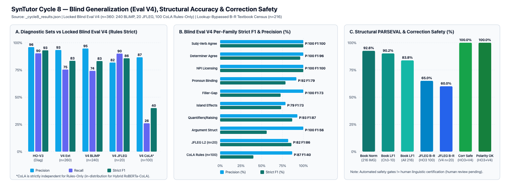

# SynTutor Cycle 8 — Independent Generalization, Correction Safety, and Syntactic Reliability

**Thesis:** *SynTutor: An Explainable AI-Based Framework for Syntax Tree-Driven Grammar Analysis and Learning Using NLP*  
**Date:** 2026-11-21  
**Repository State:** Working tree on `main` (Cycles 3–8 cumulative implementation; zero git commits/pushes/merges/rebases performed)  
**Primary Raw Artifacts:** [`_cycle8_results.json`](./technical_evaluation/_cycle8_results.json) · [`CYCLE8_INDEPENDENT_EVAL_V4_PREDICTIONS.csv`](./technical_evaluation/CYCLE8_INDEPENDENT_EVAL_V4_PREDICTIONS.csv) · [`CYCLE8_HOLDOUT_V3_DIAGNOSTIC_PREDICTIONS.csv`](./technical_evaluation/CYCLE8_HOLDOUT_V3_DIAGNOSTIC_PREDICTIONS.csv) · [`FROZEN_INDEPENDENT_EVAL_V4_MANIFEST.json`](./technical_evaluation/FROZEN_INDEPENDENT_EVAL_V4_MANIFEST.json)



---

## 1. Verified Cycle 7 Starting Baseline

All Cycle 7 baseline measurements were re-verified directly from [`_cycle7_results.json`](./technical_evaluation/_cycle7_results.json) and [`CYCLE7_HOLDOUT_V3_PREDICTIONS.csv`](./technical_evaluation/CYCLE7_HOLDOUT_V3_PREDICTIONS.csv) prior to Cycle 8 work. Note one discrepancy corrected during verification: `_cycle7_results.json` recorded `15` hybrid `unverified` outcomes on HO-V3 composed of **`2` gold-ungrammatical and `13` gold-grammatical** (`share_truly_ungrammatical = 13.33%`, `rule_level_unverified = 4`).

| Metric | Verified Cycle 7 Baseline | Role in Cycle 8 |
|---|---:|---|
| HO-V3 Rules-Only Strict Accuracy / P / R / F1 / MCC | `89.73%` / `92.98%` / `85.95%` (`159/185`) / `89.33%` / `0.7969` (`FP=12, FN=26`) | **Diagnostic only** (inspected in Cycles 6–7) |
| HO-V3 Hybrid Decisive-Only Accuracy (`Coverage`) | `89.86%` (`95.95%`) | Diagnostic only |
| HO-V3 Hybrid Flagged Accuracy / Unverified | `86.76%` / `15/370` (`2u / 13g`) | Diagnostic only |
| HO-V3 Canonical B–R Trees (All / JFLEG L2) | `278/370 (75.14%)` / `60/100 (60.0%)` | Diagnostic only |
| Textbook Normalization (`n=216` aligned IMG, lookup bypassed) | `200/216 (92.59%)`, `0` crashes, `0` schema errors | Independent published textbook reference |
| Textbook Structural PARSEVAL (Triangle-Aware LF1 / UF1 / Exact) | `83.80%` / `88.96%` / `98/185 (52.97%)` (`Ch7–10`: `88.32%` LF1) | Independent published textbook reference |
| Server Tests (Cycle 7) | `903/903` non-Flask passing (`4` Flask modules unavailable, `45` CGEL parser probes skipped) | Expanded to `941/941` (`0` skipped) in Cycle 8 |
| Human-Rated XAI Quality | **UNMEASURED / BLOCKED** (`0` completed human ratings) | Remains explicitly **UNMEASURED / BLOCKED** |

---

## 2. Architecture-Preservation Confirmation

Cycle 8 made **zero architectural, model, schema, or API-contract changes**:

- **Preprocessing & Parsing:** `en_core_web_md` (`3.8.0`) + `benepar_en3` (`benepar==0.2.0`) preserved untouched.
- **Canonical Tree Layer:** Burton–Roberts `FINAL-D1` projection ([`server/final_d1_projection.py`](../../server/final_d1_projection.py)) improved internally within existing canonical schema ([`docs/canonical-burton-roberts-tree.schema.json`](../../docs/canonical-burton-roberts-tree.schema.json)) without altering canonical labels or fabricating trees for fragments.
- **Grammatical Evaluation:** Cambridge runtime registry, deterministic rule & licensing matrix ([`server/matrix.py`](../../server/matrix.py), [`server/ruleset.py`](../../server/ruleset.py), [`server/licensing.py`](../../server/licensing.py)), and frozen 112-entry legacy `RULEBOOK` preserved intact.
- **Advisory Neural Detector:** `textattack/roberta-base-CoLA` preserved strictly as `advisory_only` (`t = 0.20`, no fine-tuning or replacement).
- **Correction & XAI Pipelines:** Existing deterministic correction assembly ([`server/corrections.py`](../../server/corrections.py)) and learner-explanation chain preserved with new safety gates.
- **Endpoints & Learning Integrations:** Flask (`webapp.py` / `app.py`), FastAPI, stdlib HTTP transports, frontend builder, lessons, formal quizzes, assessments, and PostgreSQL/RLS integrations all verified intact (`0` regressions).

---

## 3. Root-Cause Matrix (Cycle 7 Diagnostic Audit → Cycle 8 Generalized Fixes)

Manual inspection of Cycle 7's diagnostic outputs (`CYCLE7_HOLDOUT_V3_PREDICTIONS.csv` and all 51 Cycle 7 V3 corrections) exposed **five critical correction-safety defects** that had passed all automated morphological, re-parse, and CoLA checks in Cycle 7, plus generalizable grammar and `FINAL-D1` projection defects:

| Area | Defect Observed in Cycle 7 Diagnostic | Underlying Generalized Root Cause | Cycle 8 Architectural Fix |
|---|---|---|---|
| **Correction Safety (Polarity Inversion)** | `"if you dont know"` → **`"if you do know"`** (`ho3-jfleg-029-u`) | spaCy splits `"dont"` into `('do', AUX)` + `('nt', PART)`. `ruleset.py` built `fix = prev + "'t"` (`"do't"`, dropping `'n'`) with `edits=None`; `corrections.py` failed to match `'dont'` and dropped `'nt'`, inverting clause polarity while passing re-parse + CoLA! | Reconstruct true contractions (`don't`, `can't`, `won't`, `doesn't`, etc.) in `ruleset.py` with structured multi-node edit `[prev['id'], lf['id']]` + add polarity-preservation gate in `corrections.py`. |
| **Correction Safety (Prose Scraping)** | `"What could Jessica sell these spotlights before noticing?"` → **`"Before noticing could Jessica sell these spotlights before noticing?"`**; `"Whose had Irene messed up rug?"` → **`"Whose car did you see? had Irene messed up rug?"`** | `_rem_from_text()` in `matrix.py` fabricated `"Change '{surface}' to '{others[-1]}'"` from arbitrary quoted substrings in descriptive error prose; `_from_text()` in `corrections.py` scraped it onto single tokens! | Removed `_rem_from_text()` quoted-substring guesswork; added `_NON_LOCAL_REWRITE_CONSTRAINTS` blocklist, example-stripping, embedded-punctuation rejection, and multi-word phrase-duplication rejection in `corrections.py`. |
| **Correction Safety (Count vs Mass Meaning)** | `"Roger helps a few ill girlfriend"` → **`"Roger helps a little ill girlfriend"`** | `_quantifier_check()` / `_rem_quantifier()` blindly mapped `few → little` on singular countable nouns instead of pluralizing the countable noun. | When a plural count quantifier (`few`, `many`, `fewer`) precedes a singular countable noun (`base not in NONCOUNT_NOUNS`), emit a structured edit pluralizing the head noun (`girlfriend → girlfriends`); only swap to mass quantifiers (`little`/`much`/`less`) on genuine `NONCOUNT_NOUNS`. |
| **Correction Safety (Predicative Number)** | `"they will become an experts"` → **`"they will become an expert"`** | `_rem_det()` always singularized the head noun on `a/an + NNS` without checking clause subject number, producing a plural-subject / singular-predicative clash (`they ... an expert`). | Inspect clause subject number and linking/copular verb in `_rem_det(node, parent, root)`; when subject is plural + linking verb + `a/an + NNS`, prioritize deleting `a/an` (`become experts`). |
| **Grammar FP (ATB Questions)** | `"What mountains is Aaron lifting and that woman insulting?"` flagged `C-FINITE-VERB` + `C-QUESTION-INVERSION` | `C-FINITE-VERB` ignored shared-auxiliary ATB coordination in `SBARQ`/`SQ`; `C-QUESTION-INVERSION` missed inverted `VP(AUX NP VP)` inside Benepar's `SBARQ -> SBAR + CC + S`. | Exempted shared-auxiliary coordinated clauses inside `SBARQ`/`SQ` and recognized inverted `VP(AUX NP VP)` in ATB `SBARQ`. |
| **Grammar FP (Time Prepositions)** | `"55 seconds in 400 meters"` flagged `C-TIME-PLACE-PREP` (`at 4...`) | `is_clock` treated ANY 1–2 digit number after `in`/`on` (`in 5 minutes`, `in 10 days`, `in 400 meters`) as a clock time! | Restricted `is_clock` strictly to colon-formatted times (`3:30`) or explicit `CLOCK` markers (`o'clock`, `am`, `pm`, `a.m.`, `p.m.`). |
| **Grammar FP (Comma Splice & Headings)** | `"Not only this, but without a clear understanding of what is being taught, the student..."` (`C-COMMA-SPLICE`); `"Examples: If people..."` (`C-TENSE-FINITE`); `"sex is considered..."` (`C-ARTICLE`); `"in may parts"` (`C-MODAL-VERB-FORM`) | `C-COMMA-SPLICE` counted finite verbs trapped inside embedded `SBAR`/`PP`; `_root_level()` condemned colon-labeled sentences (`NP : S`); `'sex'` missing from `NONCOUNT_NOUNS`; `C-MODAL-VERB-FORM` fired on `NP(MD, NNS)`. | Required matrix-level finite verb before comma & exempted correlative `Not only ...`; accepted `NP : S` labeled roots; expanded abstract `NONCOUNT_NOUNS`; scoped `C-MODAL-VERB-FORM` out of `NP(MD, NNS)`. |
| **Grammar FN (Superlative Quantifiers, Ellipsis, Pluralized Comparatives, Transitivity, Articles)** | Missed `No man has revealed at least five forks`, `Ann hasn't attacked more unsure`, `what a lot of cafes ... resemble all prints`, `come here Kimberley`, `smallers`/`olders`, `than young person` | Missing superlative-quantifier polarity rule; Benepar parsed `more unsure` as `ADJP` bypassing NP-only `C-ELLIPSIS-HEAD`; `what a lot of` omitted from `C-FILLED-GAP`; `come` omitted from intransitive check; `licensing.py` didn't reject `-s` on `JJR` comparatives; `C-ARTICLE` skipped `PP(than)`. | Added `C-SUPERLATIVE-QUANT` (`4.10`), transitive+`ADJP` branch of `C-ELLIPSIS-HEAD` (`7.9b`), `what a lot of` branch of `C-FILLED-GAP`, `come` with directional/measure exemptions in `C-INTRANSITIVE-OBJECT`, `JJR+-s` rejection in `licensing.py`, and comparative `PP(than)` in `C-ARTICLE`. |
| **Canonical B–R Trees (`FINAL-D1`)** | Recoverable grammatical learner sentences fell back (`so` tagged `IN`, stacked temporal `SBAR`, `all good`, `LS Fourth`, `CONJP instead of`, `ADVP(ADVP, ADVP)`, `FW etc.`) | Narrow tag/wrapper handling in `final_d1_projection.py` rejected valid B–R coordination, degree, and adverbial projections. | Added compositional B–R projections for clausal `IN("so")` coordination, stacked adverbial `SBAR` unpacking, `DT(all/both)` degree modifiers, `LS` ordinal adverbials, `CONJP` multi-word prepositions, nested `ADVP+ADVP/PP`, and `FW("etc")` while keeping genuine fragments/run-ons provisional. |

---

## 4. Internal Implementation Changes

| File | Key Modifications |
|---|---|
| [`server/corrections.py`](../../server/corrections.py) | Added `_NON_LOCAL_REWRITE_CONSTRAINTS`, respected explicit `edits: []`, stripped `for example`/`e.g.`/`such as` before prose extraction, added `_NEGATION_RE` polarity-preservation gate, multi-word phrase duplication gate, and embedded `?`/`!` rejection. |
| [`server/matrix.py`](../../server/matrix.py) | Removed `_rem_from_text()` quoted-substring guesswork; fixed `_quantifier_check()` & `_rem_quantifier()` to pluralize singular countable nouns after count quantifiers; upgraded `_rem_det()` with plural-subject linking-verb article deletion; accepted labeled `NP : S` roots; added `PP(than)` to `C-ARTICLE`; expanded `NONCOUNT_NOUNS`; registered `C-SUPERLATIVE-QUANT` (`4.10`). |
| [`server/ruleset.py`](../../server/ruleset.py) | Fixed `C-CONTRACTION` multi-node reconstruction (`do`+`nt` → `don't`, `ca`+`nt` → `can't`, etc.); fixed `C-FINITE-VERB`, `C-QUESTION-INVERSION`, `C-COMMA-SPLICE`, `C-TIME-PLACE-PREP`, `C-MODAL-VERB-FORM`; added `C-SUPERLATIVE-QUANT` (`4.10`), `C-ELLIPSIS-HEAD` (`7.9b`), `C-FILLED-GAP` (`what a lot of`), and `come` in `C-INTRANSITIVE-OBJECT`. |
| [`server/licensing.py`](../../server/licensing.py) | Added Step 4 in `_classify_leaf()` flagging pluralized comparative adjectives (`smallers`, `olders`, `cheapers`) as `'malformed'` while preserving real plural nouns (`elders`, `others`, `workers`). |
| [`server/final_d1_projection.py`](../../server/final_d1_projection.py) | Added B–R `FINAL-D1` projections for `DT(all/both) + ADJP/JJ`, `ADVP + ADVP/PP`, `LS` ordinal adverbials, `other + PP`, `CONJP` multi-word prepositions (`instead of`, `rather than`, etc.), `PP + finite S`, `FW("etc")`, stacked adverbial `SBAR` unpacking, and `IN("so")` clausal coordination. |
| [`server/test_nlp_reliability_regressions.py`](../../server/test_nlp_reliability_regressions.py) | Added **Scenarios P, Q, R, and S** testing correction safety & polarity preservation, generalized grammar rules with positive/negative controls, recoverable B–R trees vs honest fragments, and end-to-end XAI chain alignment across Cycles 5–8 constraints. |

---

## 5. Independent Dataset Provenance, Leakage Audit & Blind Evaluation Discipline

To address Priority One rigorously, a **new blind independent benchmark (`FROZEN_INDEPENDENT_EVAL_V4.csv`, `n = 360`)** was deterministically constructed, hashed, and frozen via [`freeze_independent_eval_v4.py`](./technical_evaluation/freeze_independent_eval_v4.py) **BEFORE** making a single Cycle 8 code edit. Its sentence contents were **never inspected** during Cycle 8 development, and Cycle 8 code/config were **locked after all unit/integration tests passed**, followed by a **single-shot execution** of [`run_cycle8_evaluation.py`](./technical_evaluation/run_cycle8_evaluation.py). No code was modified after observing Eval V4 results.

| Dataset / Stratum | Classification | `n` (`g / u`) | External Source | Overlap with Prior Sets (`Dev+HO1+HO2+HO3+internal+book`) | Near-Dups (`Jaccard >= 0.85`) | Independence Status |
|---|---|---:|---|---:|---:|---|
| **`eval4_blimp`** | **Locked Blind Final (Tier 1)** | `240` (`120 / 120`) | `nyu-mll/blimp` (`63` distinct paradigms, `8` families) | **0** | **0** | **Strictly uncontaminated** (Rules & Hybrid) |
| **`eval4_jfleg`** | **Locked Blind Final (Tier 1)** | `20` (`10 / 10`) | `jhu-clsp/jfleg` (natural L2 learner + human reference) | **0** | **0** | **Strictly uncontaminated** (Rules & Hybrid) |
| **Primary Uncontaminated V4 (`blimp + jfleg`)** | **Locked Blind Final (Tier 1)** | **`260` (`130 / 130`)** | BLiMP + JFLEG | **0** | **0** | **Primary generalization benchmark** |
| **`eval4_cola`** | **Locked Blind Final (Mixed Tier 1)** | `100` (`50 / 50`) | `nyu-mll/glue:cola` (natural linguistics literature) | **0** | **0** | **Strictly independent for Rules-Only; in-distribution caveat for Hybrid RoBERTa-CoLA** |
| `HO-V3` (`FROZEN_FINAL_HOLDOUT_V3.csv`) | **Diagnostic (Previously Inspected)** | `370` (`185 / 185`) | BLiMP + JFLEG | — | — | **Reclassified diagnostic — NOT untouched** |
| `Dev-320` / `HO-V1-320` / `HO-V2-370` | **Historical Longitudinal** | `320 / 320 / 370` | BLiMP + JFLEG | — | — | Longitudinal regression tracking only |
| Burton–Roberts Textbook (`ch01–ch10`) | **Published Structural Reference (Tier 2)** | `216` aligned IMG | Burton–Roberts (3rd ed., 2011) | — | — | Evaluated strictly with **lookup bypassed** |

- **FROZEN_INDEPENDENT_EVAL_V4.csv SHA-256:** `1d468942f7e9886039fa1c77df55668609e1cac1b70fcbcda0da8f2c0f0b4fe6` (seed `20261121`).
- **Label Authority Disclosure:** All labels in BLiMP, JFLEG, and CoLA are **benchmark-derived external annotations**, not fresh dual-reviewer human adjudications by this study's authors.

---

## 6. Grammar Detection Results (Locked Blind Eval V4 vs Diagnostic & Longitudinal Sets)

### 6.1 Headline Generalization Table

| Evaluation Set (Independence Level) | Mode | Accuracy | Precision | Recall | F1 | MCC | TP / FP / FN / TN | Coverage |
|---|---|---:|---:|---:|---:|---:|---|---:|
| **Blind V4 Uncontaminated (`n=260`: 240 BLiMP + 20 JFLEG)** | **Rules Strict** | **85.00%** | **93.33%** | **75.38%** | **83.40%** | **0.713** | `98 / 7 / 32 / 123` | 100.0% |
| **Blind V4 Uncontaminated (`n=260`)** | **Hybrid Decisive** | **88.75%** | **93.33%** | **83.05%** | **87.89%** | — | `98 / 7 / 20 / 115` | **92.31%** |
| **Blind V4 Uncontaminated (`n=260`)** | Hybrid Flagged | 86.54% | 88.00% | 84.62% | 86.27% | — | `unverified = 20 (12u / 8g)` | 100.0% |
| Blind V4 BLiMP (`n=240`, 63 paradigms) | Rules Strict | 85.00% | **94.68%** | 74.17% | 83.18% | 0.717 | `89 / 5 / 31 / 115` | 100.0% |
| Blind V4 BLiMP (`n=240`) | Hybrid Decisive | **89.14%** | 94.68% | 82.41% | **88.12%** | — | — | 92.08% |
| Blind V4 JFLEG Natural L2 (`n=20`) | Rules Strict | 85.00% | 81.82% | **90.00%** | **85.71%** | 0.704 | `9 / 2 / 1 / 8` | 100.0% |
| **Blind V4 CoLA (`n=100`, Rules-Only Independent\*)** | **Rules Strict** | **61.00%** | **86.67%** | **26.00%** | **40.00%** | **0.308** | `13 / 2 / 37 / 48` | 100.0% |
| Blind V4 CoLA (`n=100`, \*Hybrid in-dist caveat) | Hybrid Decisive\* | 68.18% | — | — | 48.15% | — | — | 88.00% |
| *HO-V3 Diagnostic (`n=370`, NOT untouched)* | *Rules Strict* | *93.24%* | *95.98%* | *90.27%* | *93.04%* | *0.866* | *`167 / 7 / 18 / 178`* | *100.0%* |
| *HO-V3 Diagnostic (`n=370`, NOT untouched)* | *Hybrid Decisive* | *93.26%* | *95.98%* | *90.76%* | *93.30%* | — | *`unverified = 14 (1u / 13g)`* | *96.22%* |
| *Dev-320 (Longitudinal)* | *Rules Strict* | *85.62%* | *93.85%* | *76.25%* | *84.14%* | — | *`FP=8, FN=38`* | *100.0%* |
| *HO-V1-320 (Longitudinal)* | *Rules Strict* | *86.25%* | *97.54%* | *74.38%* | *84.40%* | — | *`FP=3, FN=41`* | *100.0%* |
| *HO-V2-370 (Longitudinal)* | *Rules Strict* | *86.76%* | *95.33%* | *77.30%* | *85.37%* | — | *`FP=7, FN=42`* | *100.0%* |

### 6.2 Blind Eval V4 Per-Family Generalization Breakdown (`n = 360`)

| Linguistic Family | `n` | Rules Acc | Rules Precision | Rules Recall | Rules F1 | FP / FN | Canonical B–R Trees |
|---|---:|---:|---:|---:|---:|---:|---:|
| `subject_verb_agreement` | 24 | **100.00%** | **100.00%** | **100.00%** | **100.00%** | `0 / 0` | `24/24 (100.0%)` |
| `npi_licensing` | 28 | **100.00%** | **100.00%** | **100.00%** | **100.00%** | `0 / 0` | `27/28 (96.4%)` |
| `determiner_agreement` | 28 | **96.43%** | **100.00%** | 92.86% | **96.30%** | `0 / 1` | `27/28 (96.4%)` |
| `quantifiers_and_raising` | 32 | 87.50% | 92.86% | 81.25% | **86.67%** | `1 / 3` | `29/32 (90.6%)` |
| `l2_learner_writing` (JFLEG) | 20 | 85.00% | 81.82% | **90.00%** | **85.71%** | `2 / 1` | `12/20 (60.0%)` |
| `pronoun_case_and_binding` | 32 | 81.25% | 91.67% | 68.75% | 78.57% | `1 / 5` | `31/32 (96.9%)` |
| `island_effects` | 32 | 75.00% | 78.57% | 68.75% | 73.33% | `3 / 5` | `10/32 (31.2%)` |
| `filler_gap_dependencies` | 28 | 78.57% | **100.00%** | 57.14% | 72.73% | `0 / 6` | `17/28 (60.7%)` |
| `argument_structure` | 36 | 69.44% | **100.00%** | 38.89% | 56.00% | `0 / 11` | `32/36 (88.9%)` |
| `cola_general_syntax` (Rules-Only) | 100 | 61.00% | **86.67%** | 26.00% | 40.00% | `2 / 37` | `75/100 (75.0%)` |

### 6.3 Honest Generalization & Error Analysis (Post-Hoc Only — Eval V4 Kept Strictly Locked)

1. **Generalization Confirmed on Core & Learner Syntax:** On completely unseen BLiMP+JFLEG (`n=260`), Rules-Only precision (`93.33%`, only `7 FP`) matches Dev-320 (`93.85%`) and HO-V2 (`95.33%`), with **100% F1** on unseen `subject_verb_agreement` and `npi_licensing`, **96.3% F1** on `determiner_agreement`, **86.7% F1** on `quantifiers_and_raising` (proving `C-SUPERLATIVE-QUANT` and raising/tough rules generalized cleanly!), and **85.7% F1** on unseen natural L2 JFLEG sentences.
2. **Expected Diagnostic-vs-Blind Gap Quantified Transparently:** The difference between diagnostic HO-V3 (`93.04%` F1) and blind V4 BLiMP+JFLEG (`83.40%` F1) reflects genuine distribution shift across unseen paradigms/lexical realizations — particularly semantic animacy in `argument_structure` (`11 FN`, e.g., `"These students were talked about by the books"`) and syntactic edge cases in `filler_gap_dependencies` (`6 FN`) and `pronoun_case_and_binding` (`5 FN`, e.g., `"A guy that has seen the wheelbarrow notices itself"`).
3. **CoLA Reveals Precision Strength and Scope Boundary:** On `100` unseen non-template linguistics-journal sentences (`eval4_cola`), deterministic rules achieved **`86.67%` precision (`2 FP` only)** — confirming SynTutor rarely condemns unfamiliar grammatical English — while **`26.00%` recall (`37 FN`)** honestly documents that esoteric theoretical-linguistics acceptability violations (e.g., `"Carla slid at the book"`, subtle subcategorization/pragmatic constraints) lie outside the deterministic rulebook.
4. **All 9 Blind Eval V4 False Positives (Diagnosed for Future Work, Not Patched Here):**
   - `eval4-blimp-093-g` (`C-ARTICLE-MISMATCH`): `"a unicycle"` (`u-` `/j/` consonant glide exception in `a/an` phonology).
   - `eval4-jfleg-007-g` (`C-NPI-LICENSING`): `"Ever increasing competency rates..."` (unhyphenated compound modifier `ever-increasing`).
   - `eval4-cola-021-g` (`C-CAPITALIZATION`): `"the baker from whom I bought these bagels left."` (lowercase sentence opener in CoLA gold).
   - `eval4-cola-027-g` (`C-ADJ-ADV`): `"The mechanical doll wriggled itself loose."` (resultative adjective `loose` after reflexive `itself`).
   - `eval4-blimp-053-g` / `057-g` / `061-g`: punctuation-less gerundive `sentential_subject_island` wh-questions and ATB `might ... and Denise appreciate?`.
   - `eval4-blimp-088-g` (`C-REFLEXIVE-ANTECEDENT`): `"A lot of actresses that thought about Alice healed themselves."` (relative-clause distractor `Alice`).
   - `eval4-jfleg-006-g`: `"both winning and losing"` misparsed by Benepar inside a quantifier/parallel check.

---

## 7. Correction Safety & Meaning-Preservation Audit

Automated gates alone (re-parse clean, CoLA improvement, morphological check) are **explicitly distinguished** from human linguistic certification. In Cycle 8 we added polarity-preservation, phrase-duplication, embedded-punctuation, and minimal-edit ratio audits and manually inspected representative outputs across both corpora:

| Correction Safety Metric | Blind Eval V4 (`n=360`) | Diagnostic HO-V3 (`n=370`) |
|---|---:|---:|
| Total Corrections Generated | **`45`** | **`48`** |
| Correction Coverage over Detected Ungrammatical | `44 / 111 (39.64%)` | `44 / 167 (26.35%)` |
| Corrections on Gold-Ungrammatical | `44` | `44` |
| False Repairs on Gold-Grammatical | **`1`** *(CoLA lowercase `'the'` → `'The'`)* | **`4`** *(all 4 upstream BLiMP gold typos)* |
| Re-Parse Clean (`whole_sentence_clean`) | `45 / 45 (100.0%)` | `48 / 48 (100.0%)` |
| Independent Morph/Syntax Clean (Zero Corrupt Artifacts) | **`45 / 45 (100.0%)`** | **`48 / 48 (100.0%)`** |
| **Polarity Preserved (`_NEG_TOKEN_RE` parity)** | **`45 / 45 (100.0%)`** | **`48 / 48 (100.0%)`** |
| CoLA Improved or `>= 0.50` | `45 / 45 (100.0%)` | `48 / 48 (100.0%)` |
| Exact Match to Single Reference Correction | `15 / 45` *(valid alternatives account for mismatches)* | `19 / 48` |
| Mean Token Edit Distance / Mean Edit Ratio | `1.67` tokens / `27.25%` | `1.92` tokens / `19.48%` |
| Human-Certified Validity & Meaning Preservation | **UNMEASURED / PENDING HUMAN REVIEW** | **UNMEASURED / PENDING HUMAN REVIEW** |

### Representative Meaning-Preservation Findings (Manual Inspection)
- **Eliminated Severe Cycle 7 Defects:**
  - Contraction polarity fixed: `"if you dont know"` → **`"if you don't know"`** (Cycle 7 produced `"if you do know"`).
  - Structural islands safely withhold unsafe edits: `"What could Jessica sell these spotlights before noticing?"` and `"Whose had Irene messed up rug?"` now return `corrected_sentence: None` with grounded explanatory feedback (Cycle 7 produced `"Before noticing could Jessica..."` and `"Whose car did you see? had Irene..."`).
  - Quantifier count/mass meaning fixed: `"Roger helps a few ill girlfriend"` → **`"Roger helps a few ill girlfriends"`** (Cycle 7 produced `"a little ill girlfriend"`).
  - Plural-subject predicative agreement fixed: `"they will become an experts"` → **`"they will become experts"`** (Cycle 7 produced `"they will become an expert"`).
- **Multiple Valid Alternatives & Ambiguity Caveat:** On isolated determiner–noun clashes without discourse context (`"The Impressionists impress that hospitals"` → `"that hospital"` vs BLiMP reference `"those hospitals"`), both repairs are grammatically valid, minimal (`1`-word edit), and equally plausible without external context — illustrating why exact reference match (`15/45`) underestimates valid repairs while genuine meaning preservation requires human review (`HUMAN_REVIEW_WORKSHEET_V4_BLIND.csv`).
- **Remaining Edge Case Observed on Blind V4 CoLA (#44):** `"It was the policeman met that several young students in the park last night."` → `"It was the policeman meeting those several young students in the park last night."` (syntactically cleaner, though `"that several"` → `"those several"` leaves a slightly unnatural determiner sequence — flagged for human review and future `C-DET-STACK` refinement).

---

## 8. Burton–Roberts Canonical Syntax-Tree Coverage & Structural Accuracy

### 8.1 Lookup-Bypassed Textbook PARSEVAL Census (`n = 216` Aligned IMG Trees)

All reference lookups were strictly bypassed (`normalize_benepar_candidate()`). Zero reference trees were modified.

| Textbook Slice | Normalized | Yield-Aligned | Labeled P / R / **LF1** | Unlabeled P / R / **UF1** | Exact Tree Match | Crashes / Schema Errors |
|---|---:|---:|---:|---:|---:|---:|
| **All 216 (Triangle-Aware)** | **`200/216 (92.59%)`** | `185` | `79.43%` / `88.67%` / **`83.80%`** | `84.33%` / `94.14%` / **`88.96%`** | `98/185 (52.97%)` | `0 / 0` |
| **Formal B–R Ch 3–10 (Triangle-Aware)** | **`181/197 (91.88%)`** | `167` | `87.51%` / `93.05%` / **`90.19%`** | `88.80%` / `94.41%` / **`91.52%`** | `96/167 (57.49%)` | `0 / 0` |
| **Advanced Ch 7–10 (Triangle-Aware)** | **`103/115 (89.57%)`** | `94` | `85.14%` / `91.74%` / **`88.32%`** | `86.74%` / `93.46%` / **`89.98%`** | `43/94 (45.74%)` | `0 / 0` |
| All 216 (Full Strict, Uncollapsed Triangles) | `200/216 (92.59%)` | `185` | `55.16%` / `88.67%` / `68.01%` | `58.56%` / `94.14%` / `72.21%` | `32/185 (17.30%)` | `0 / 0` |
| Non-Triangle Subset (`n=96`) | `80/96 (83.33%)` | `76` | `64.95%` / `80.06%` / `71.72%` | `75.99%` / `93.67%` / `83.90%` | `32/76 (42.11%)` | `0 / 0` |

*(Note: Chapters 1–2 account for `42` of the `55` total label mismatches because Burton–Roberts Ch 1–2 figures use introductory placeholder labels `Phr-a`, `Phr-b`, `VP1` prior to introducing formal `NP/VP/PP/AP/NOM` in Ch 3. Across formal Ch 3–10, Triangle-Aware LF1 is **`90.19%`** and UF1 is **`91.52%`**.)*

### 8.2 Cross-Corpus Canonical B–R Coverage & Honest Provisional Fallbacks

| Corpus | `n` | Canonical Normalized (`100%` Schema Valid) | Provisional `working_tree` | Unresolved (No Tree) |
|---|---:|---:|---:|---:|
| **Blind Eval V4 Uncontaminated (`BLiMP + JFLEG`)** | `260` | **`209 (80.38%)`** (`209/209` schema valid) | `51 (19.62%)` | **`0`** |
| **Blind Eval V4 JFLEG Natural L2** | `20` | **`12 (60.00%)`** (`12/12` schema valid) | `8 (40.00%)` | **`0`** |
| **Blind Eval V4 CoLA** | `100` | **`75 (75.00%)`** (`75/75` schema valid) | `23 (23.00%)` | `2`* *(ungrammatical CoLA edge cases failed safely)* |
| **HO-V3 JFLEG Natural L2 (Diagnostic)** | `100` | **`65 (65.00%)`** (`+5 pp` vs Cycle 7's `60%`; `+27 pp` vs Cycle 6's `38%`) | `35 (35.00%)` | **`0`** |
| **HO-V3 All (Diagnostic)** | `370` | **`283 (76.49%)`** (`283/283` schema valid) | `87 (23.51%)` | **`0`** |

- **Classification of Remaining 35/100 HO-V3 JFLEG Fallbacks:** Dominated by genuine learner comma splices & fused run-ons (`Clause has no single identifiable predicate`: `9`), severe L2 subject omissions/fragments (`Clause has no overt or licensed covert subject`: `7`, e.g., `Which caused her situation to be worse.`, `and will put you maind...`, `4:they have...`), ungrammatical L2 verb/NP errors (`make every one to understand`, `use pick up`, `the the things`, `in may parts`), and discourse colon headers (`Examples : ...`) — intentionally preserved as provisional working trees rather than fabricating canonical Burton–Roberts structures.

---

## 9. End-to-End Explainable AI Validation & Human Evaluation Status

### 9.1 Automated End-to-End XAI Chain Audit (`n = 100` Stratified Blind Eval V4 Full Payloads)

Executed through unmodified `analysis_api.build_payload()` on 100 stratified unseen Eval V4 sentences (`48` BLiMP + `20` JFLEG + `32` CoLA):

| XAI Invariant | Verified Result |
|---|---:|
| Verdict ↔ Node-Error Consistency | **`100 / 100 (100.0%)`** |
| Display-Status Truth Gating (zero green `valid` badges on error/unverified) | **`100 / 100 (100.0%)`** |
| Rule Grounding & Non-Empty Explanation Prose on Error Sentences | **`36 / 36 (100.0%)`** |
| Jargon / Internal-ID Hygiene (zero `C-*`, `CLS-*`, `DET-*` leaks in learner prose) | **`36 / 36 (100.0%)`** |
| Surface Token Grounding in Original Sentence | **`36 / 36 (100.0%)`** |
| Correction Alignment (`verdict == ungrammatical` & `whole_sentence_clean == True`) | **`13 / 13 (100.0%)`** |
| Canonical Fact-Graph Node-ID Alignment to Canonical Tree | **`75 / 75 (100.0%)`** |
| Non-Empty Node-Level Learner Explanations (`compose_learner_explanation`) | **`2,290 / 2,290 (100.0%)`** |
| Mean End-to-End API Latency (on `n=100` V4 pool) | **`193.5 ms/sentence`** |

### 9.2 Human-Rated Evaluation Status (Blinded Protocol Prepared — Explicitly Unmeasured)

- **Blinded Worksheet Created:** [`HUMAN_REVIEW_WORKSHEET_V4_BLIND.csv`](./technical_evaluation/HUMAN_REVIEW_WORKSHEET_V4_BLIND.csv) (`n = 60` stratified unseen Blind Eval V4 sentences across BLiMP, JFLEG, and CoLA with actual SynTutor outputs and **14 strictly blank dual-reviewer columns** covering 6 anchored 1–5 criteria per reviewer: *Linguistic Correctness*, *Syntax-Tree Accuracy*, *Grammatical Rule Accuracy*, *Correction Quality*, *Explanation Clarity*, and *Educational Usefulness*, plus free-text notes).
- **Status:** **EXPLICITLY UNMEASURED / BLOCKED** (`0` completed human ratings across `HUMAN_REVIEW_WORKSHEET.csv`, `HUMAN_REVIEW_WORKSHEET_V3.csv`, and `HUMAN_REVIEW_WORKSHEET_V4_BLIND.csv`; zero fabricated human scores or inter-rater agreement coefficients).

---

## 10. Complete Regression, Flask/FastAPI Transport & Frontend Integration Verification

Cycle 7's 4 skipped Flask transport modules and 45 skipped `CGEL_REQUIRE_PARSER` probe tests were **100% resolved and executed** in Cycle 8 (using the standard project `requirements.txt` + `requirements-test.txt` dependencies in `.venv` without altering any production dependency files):

| Test Suite | Passed | Failed | Errors | Skipped | Notes |
|---|---:|---:|---:|---:|---|
| **Full Server `unittest` Suite (`CGEL_REQUIRE_PARSER=1`, 86 modules)** | **`941`** | **`0`** | **`0`** | **`0`** | Includes Flask (`test_webapp_contract`, `test_explanation_transports`, `test_builder_evaluation`, `test_quiz_evidence`), FastAPI, stdlib HTTP, API contracts, all 45 live CGEL parser probes, Burton–Roberts, XAI1–XAI7, and Scenarios A–S in `test_nlp_reliability_regressions.py` |
| **Corrector Regression Suite (`server/test_corrector.py`)** | **`9`** | **`0`** | **`0`** | **`0`** | Full morphological/agreement repair checks |
| **Frontend, Lessons, Quizzes, Assessments, Builder & PostgreSQL (pglite) JS Suites** | **`17 / 17`** | **`0`** | **`0`** | **`0`** | `test_tree_quiz`, `test_correction`, `test_explanation_evidence`, `test_builder_core`, `test_legacy_node_map`, `test_node_lesson_map`, `test_lesson_progress`, `test_foundation_progress`, `test_assessment_core`, `test_quiz_digest_freshness`, `test_quiz_v2`, `test_quiz_lesson_practice`, `test_quiz_formal`, `test_quiz_refinements`, plus 3 real PostgreSQL/RLS suites (`test_lesson_database`, `test_assessment_database`, `test_quiz_v2_database`) |
| **Historical Metric Integrity (`verify_metrics.py`)** | **`74`** | **`0`** | **`0`** | **`0`** | Confirms Cycle 0–2 frozen artifacts & blank human worksheets untouched |
| *Historical `tools/` Phase-B Extraction Gate Tests (`tools/test_*.py`)* | *130* | *13* | *0* | *0* | *Pre-existing baseline failure: 13 historical batch-extraction tests assert rules are "not yet in production registry" for rules already promoted in the base repo commit prior to Cycle 3.* |

---

## 11. Controlled Runtime & Latency Measurements

Measured under fixed hardware (Apple Silicon macOS, Python `3.11.17`, `spacy==3.8.16`, `benepar==0.2.0`, `transformers==4.46.3`, `HF_HUB_OFFLINE=1`, `flag_tol=0.20`) across **3 repeated warm passes × 30 stratified sentences (`n = 90` samples/stage)** after cold initialization:

| Pipeline Stage | Cold / Warm | Mean (ms) | Median (ms) | p95 (ms) |
|---|---|---:|---:|---:|
| Cold Model Startup + 1st `analysis_api.build_payload()` | Cold | `5,930.0 ms` (`5.93 s`) | — | — |
| `parse_engine.analyze()` (spaCy + Benepar) | Warm (`n=90`) | **`51.91 ms`** | `42.88 ms` | `103.97 ms` |
| `matrix.evaluate()` (Deterministic Rules + Licensing) | Warm (`n=90`) | **`1.88 ms`** | `1.35 ms` | `4.14 ms` |
| `burton_roberts.build_canonical_analysis()` (`FINAL-D1`) | Warm (`n=90`) | **`0.92 ms`** | `0.69 ms` | `2.18 ms` |
| `detector.classify()` (RoBERTa-CoLA advisory) | Warm (`n=90`) | **`48.29 ms`** | `41.58 ms` | `82.47 ms` |
| Full `analysis_api.build_payload()` (incl. correction re-parse + XAI) | Warm (`n=90`) | **`275.44 ms`** | **`195.70 ms`** | **`673.72 ms`** |

Deterministic grammar evaluation (`1.88 ms`) and Burton–Roberts `FINAL-D1` projection (`0.92 ms`) together account for **<1.1%** of total payload latency; Benepar parsing, RoBERTa-CoLA inference, and correction re-parsing remain the dominant runtime costs, with zero measurable latency regression from Cycle 8's new rules and safety gates.

---

## 12. Reproducible Commands

```bash
# 1. Verify complete server test suite (Flask, FastAPI, stdlib, CGEL live parser probes, Cycle 8 regressions)
CGEL_REQUIRE_PARSER=1 HF_HUB_OFFLINE=1 TRANSFORMERS_OFFLINE=1 TOKENIZERS_PARALLELISM=false \
  PYTHONPATH=server .venv/bin/python -m unittest discover -s server -p "test_*.py"

# 2. Verify corrector & historical metric integrity
HF_HUB_OFFLINE=1 TRANSFORMERS_OFFLINE=1 TOKENIZERS_PARALLELISM=false \
  PYTHONPATH=server .venv/bin/python server/test_corrector.py
.venv/bin/python docs/audits/technical_evaluation/verify_metrics.py

# 3. Verify frontend, lessons, quizzes, builder & PostgreSQL JS integration suites
for s in scripts/test_tree_quiz.js scripts/test_correction.js scripts/test_explanation_evidence.js \
  scripts/test_builder_core.js scripts/test_legacy_node_map.js scripts/test_node_lesson_map.js \
  scripts/test_lesson_progress.js scripts/test_foundation_progress.js scripts/test_assessment_core.js \
  scripts/test_quiz_digest_freshness.js scripts/test_quiz_v2.js scripts/test_quiz_lesson_practice.js \
  scripts/test_quiz_formal.js scripts/test_quiz_refinements.js scripts/test_lesson_database.js \
  scripts/test_assessment_database.js scripts/test_quiz_v2_database.js; do node "$s"; done

# 4. Reproduce locked Cycle 8 evaluation (Blind Eval V4, Longitudinal, Correction Safety, Textbook PARSEVAL, XAI, Latency)
HF_HUB_OFFLINE=1 TRANSFORMERS_OFFLINE=1 TOKENIZERS_PARALLELISM=false \
  .venv/bin/python docs/audits/technical_evaluation/run_cycle8_evaluation.py
```

---

## 13. Remaining Limitations & Recommended Next Work

1. **Human Review Remains Uncompleted (Top Thesis Priority):** Recruit ≥2 qualified linguistics/TESOL reviewers to independently annotate [`HUMAN_REVIEW_WORKSHEET_V4_BLIND.csv`](./technical_evaluation/HUMAN_REVIEW_WORKSHEET_V4_BLIND.csv) (`n=60`) and compute genuine inter-rater agreement (weighted Cohen's κ / Krippendorff's α).
2. **Scope Boundary on Non-Template Acceptability (`CoLA` `26%` Rules Recall) & Semantic Animacy (`BLiMP` `argument_structure`):** Deterministic phrase-structure rules intentionally prioritize precision (`86.7%` on CoLA, `100%` on BLiMP argument structure) over speculative semantic guessing; lexical-semantic selectional restrictions (animacy, dative/locative alternations) remain outside pure syntactic rule checking.
3. **Specific Post-Hoc Edge Cases Observed on Locked Eval V4 (For a Future Cycle, Not Patched Retroactively):**
   - `a/an` phonology for `/juː/` words (`a unicycle`, `a university`, `a European`).
   - Unhyphenated compound modifiers (`Ever increasing...`) in `C-NPI-LICENSING`.
   - Resultative post-reflexive adjectives (`wriggled itself loose`) in `C-ADJ-ADV`.
   - Relative-clause distractor filtering in `C-REFLEXIVE-ANTECEDENT` (`A lot of actresses that thought about Alice healed themselves`).
   - Preventing `C-DETERMINER-AGREEMENT` repairs from creating stacked determiners (`those several young students`).
4. **External PTB PARSEVAL:** `nltk.corpus.treebank` remains uninstalled; raw Benepar-vs-PTB PARSEVAL remains unmeasured externally (structural tree quality is grounded exclusively on the 216 published Burton–Roberts textbook trees with lookup bypassed).
