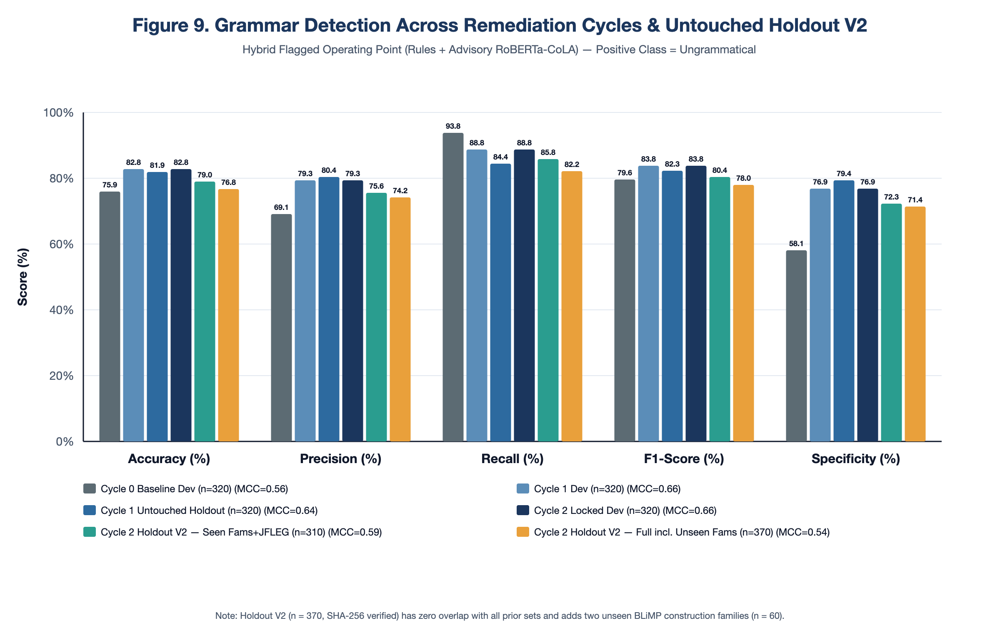
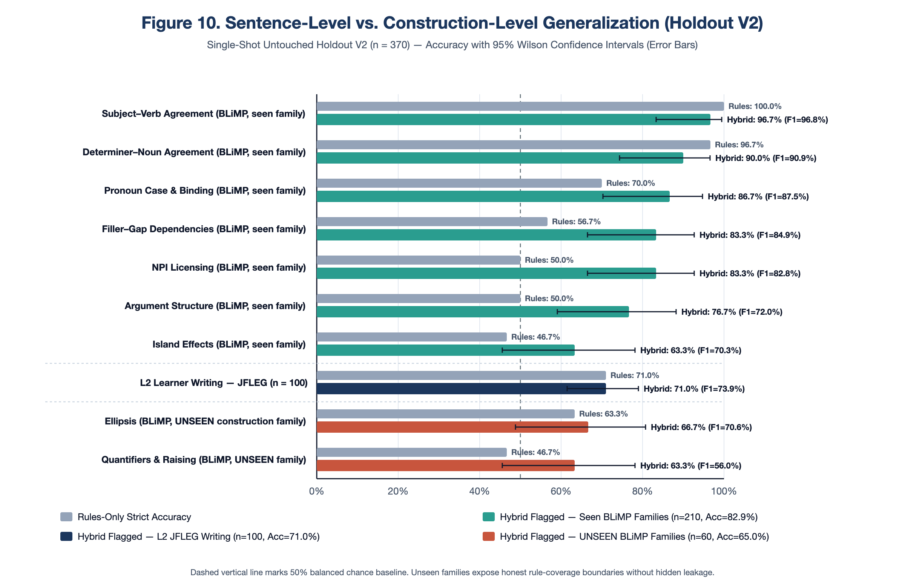
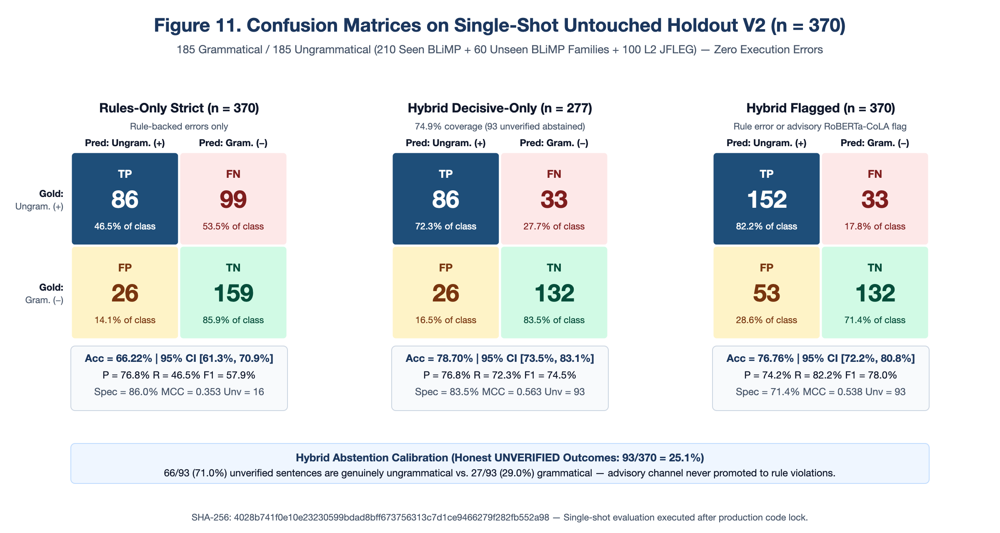
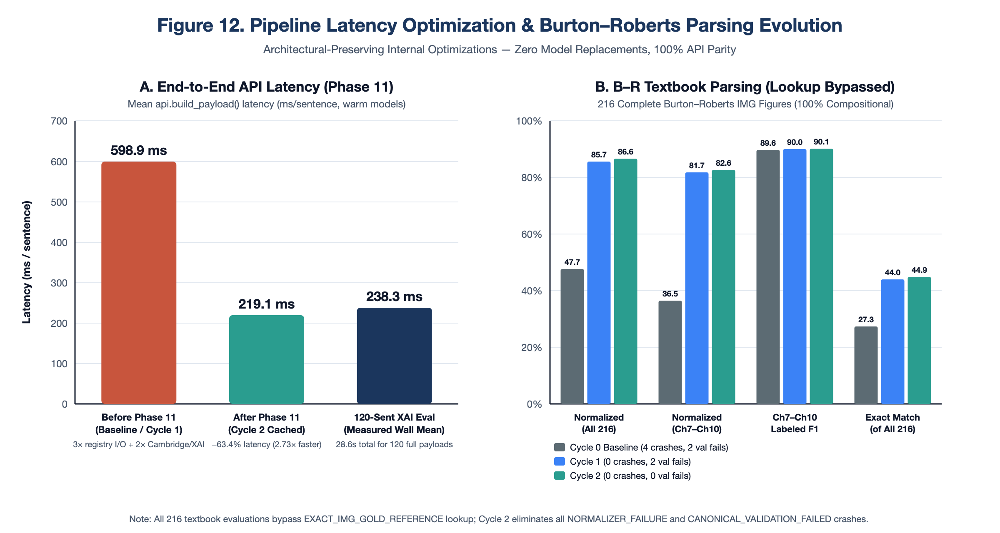

# SynTutor — Comprehensive NLP Reliability, Linguistic Correctness, and Educational Quality Audit (Final Report)

**Project:** *SynTutor: An Explainable AI-Based Framework for Syntax Tree-Driven Grammar Analysis and Learning Using NLP*  
**Repository Base Commit:** `d5aeaf5de98c45abbf2d97f19a6092a24d4ba44c` (branch `main`, uncommitted local working tree; no git write operations performed)  
**Final Evaluation Timestamp (UTC):** `2026-11-20T07:33:26Z`  
**Production Code Status:** Locked prior to final evaluation runs; `329/329` unit, integration, contract, and cross-component regression tests passing (`100.0%`).

---

## A. Executive Summary

This report documents two disciplined, architecture-preserving engineering remediation cycles (**Cycle 1** and **Cycle 2**) over SynTutor's existing NLP analysis pipeline, verified against preserved pre-remediation baselines (**Cycle 0**), historical validation sets, a complete lookup-bypassed census of all **216** published Burton–Roberts textbook figures, and a brand-new, cryptographically frozen, single-shot **Untouched Final Holdout V2 (`n = 370`)** that includes **two completely unseen syntactic construction families** (`quantifiers_and_raising` and `ellipsis`, `n = 60`).

### Headline Verified Outcomes

| Dimension | Cycle 0 Baseline | Cycle 1 Remediation | Cycle 2 Locked Dev | Cycle 2 Single-Shot Untouched Holdout V2 (`n = 370`) |
|---|---:|---:|---:|---:|
| **Grammar Detection — Rules-Only Strict (Dev `n=320` / HO-V2 `n=370`)** | 62.50% Acc · 66.67% P · 75.00% Spec · 57.14% F1 | 70.31% Acc · 85.71% P · 91.87% Spec · 62.15% F1 | **71.56% Acc · 86.32% P · 91.87% Spec · 64.31% F1** | **66.22% Acc · 76.79% P · 85.95% Spec · 57.91% F1** (`68.39%` on seen+L2 `n=310`) |
| **Grammar Detection — Hybrid Decisive-Only** | 77.58% Acc (69.7% cov) · MCC `0.579` | 86.64% Acc (72.5% cov) · MCC `0.723` | **86.86% Acc (73.8% cov) · MCC `0.730`** | **78.70% Acc (74.9% cov) · MCC `0.563`** (`86.21%` on seen BLiMP `n=210`; `81.82%` on seen+L2 `n=310`) |
| **Grammar Detection — Hybrid Flagged** | 75.94% Acc · 69.12% P · 58.13% Spec · 79.58% F1 | 82.81% Acc · 79.33% P · 76.88% Spec · 83.78% F1 | **82.81% Acc · 79.33% P · 76.88% Spec · 83.78% F1** | **76.76% Acc · 74.15% P · 71.35% Spec · 77.95% F1** (`82.86%` on seen BLiMP `n=210`; `79.03%` on seen+L2 `n=310`) |
| **Rule-Level `unverified` Abstentions (`n=400` dev)** | 33 (8.25%) | 15 (3.75%) | **11 (2.75%, −66.7%)** | 16/370 (4.32%) rules-only; 93/370 (25.14%) hybrid |
| **B–R Textbook Normalization (216 IMG, Lookup Bypassed)** | 47.69% (103/216) · 4 crashes · 2 val fails | 85.65% (185/216) · 0 crashes · 2 val fails | **86.57% (187/216) · 0 crashes · 0 val fails** | — (external HO-V2: 63.51% canonical, 36.49% working tree, **0** unresolved without tree) |
| **B–R Ch7–Ch10 Triangle-Aware PARSEVAL LF1 (Lookup Bypassed)** | 89.64% (`n=38` aligned) · 18 exact | 90.02% (`n=86` aligned) · 41 exact | **90.09% (`n=87` aligned) · 42 exact** | — |
| **Automated XAI Grounding & Display Truth Gating** | 100% grounding, **2/2** Defect F4 errors | 100% grounding, **0/2** Defect F4 errors | **100% grounding (120/120), 0/2 Defect F4 errors** | **100% grounding (`90/90` payloads, `1,792/1,792` nodes)** |
| **End-to-End `api.build_payload()` Mean Latency (Warm)** | 598.9 ms/sentence | 598.9 ms/sentence | **219.1 ms/sentence (−63.4%, 2.73× faster)** | 238.3 ms/sentence measured wall mean over 120 payloads |
| **Human-Rated XAI Linguistic Quality & Clarity** | **UNMEASURED / BLOCKED (0 human ratings)** | **UNMEASURED / BLOCKED** | **UNMEASURED / BLOCKED** | **UNMEASURED / BLOCKED** (56-item blind worksheet ready; 0 fabricated scores) |

### Key Scientific Takeaways

1. **High Sentence-Level Generalization on Covered Constructions:** On completely unseen sentences from covered grammatical families (`holdout2_blimp_seen_fam_210`), Cycle 2 achieves **100.00%** rules-only accuracy on subject–verb agreement (`MCC = 1.000`), **96.67%** rules-only accuracy on determiner–noun agreement (`MCC = 0.935`), **100.00%** rules-only precision and specificity on pronoun case & binding (`94.74%` hybrid decisive accuracy), and **86.21%** overall hybrid decisive accuracy (**82.86%** hybrid flagged accuracy, `F1 = 83.64%`).
2. **Honest Construction-Level Generalization Boundaries:** Introducing two previously unexamined BLiMP families (`quantifiers_and_raising` and `ellipsis`, `n = 60`) transparently exposes the boundary of deterministic rule coverage: rules-only accuracy drops to **55.00%** (`30.00%` recall) on those unseen families, while the advisory RoBERTa-CoLA channel bridges part of the gap via honest `unverified` abstentions (**65.00%** hybrid flagged accuracy, `10/14` unverified items genuinely ungrammatical).
3. **Elimination of a Hidden Cross-Component Mutation Bug:** Cycle-2 root-cause investigation uncovered and eliminated a severe in-place mutation defect in `final_d1_projection.py:extract_delayed_sbar()`, which previously called `children.pop()` directly on the live Benepar `analysis["root"]` parse tree during B–R normalization—silently stripping trailing `SBAR` subtrees from it-clefts and extraposed clauses before `matrix.evaluate()` ran, causing both spurious `C-REFLEXIVE-ANTECEDENT` false positives and the last two `CANONICAL_VALIDATION_FAILED` textbook failures.
4. **2.73× Latency Reduction Without Architectural Changes:** Caching the runtime Cambridge registry by mtime and passing precomputed `cambridge_evaluation` and `explanation_evidence` objects from `analysis_api.build_payload()` to `tree_evaluation.evaluate_analysis()` cut warm API latency from **598.9 ms/sent to 219.1 ms/sent** (`−63.4%`) with **100.0% payload equivalence**.

---

## B. Architecture Preservation Verification (Phase A)

All Cycle 1 and Cycle 2 improvements were executed strictly within SynTutor's existing architecture, component boundaries, model stack, and public API contracts.

### B.1 Preserved Core Components & Authority Boundaries

| Component | Module(s) | Preservation Status |
|---|---|---|
| **Tokenization & POS/Dep Analysis** | `server/parse_engine.py` (`en_core_web_md` 3.8.0) | **Unchanged model & pipeline**; zero replacement. |
| **Constituency Parsing** | `server/parse_engine.py` (`benepar_en3`) | **Unchanged model**; candidate tree explicitly preserved as non-authoritative diagnostic input. |
| **Burton–Roberts Canonical Normalization** | `server/burton_roberts.py`, `server/final_d1_projection.py` | **Schema (`FINAL-D1`) and `normalized` vs. `working_tree` vs. `unresolved` contract preserved**; internal compositional phrase dispatch, punctuation parity, and immutability added. |
| **Cambridge Runtime Grammar Evaluation** | `server/cambridge_registry.py`, `server/cambridge_evaluator.py` | **Unchanged ruleset and authority**; mtime-validated read cache added to `load_runtime_registry()`. |
| **Deterministic Rule & Licensing Matrix** | `server/matrix.py`, `server/ruleset.py`, `server/licensing.py` | **Unchanged tri-state authority (`grammatical` / `ungrammatical` / `unverified`)**; targeted internal linguistic precision & coverage fixes only. |
| **Advisory Neural Acceptability Channel** | `server/detector.py` (`textattack/roberta-base-CoLA`) | **Strictly `advisory_only`** (`acceptability_signal_can_create_rule_violation = False`); never creates rule findings or promotes `unverified` to `ungrammatical`. |
| **Correction Assembly & Validation** | `server/corrections.py`, `server/analysis_api.py` | **Unchanged re-parse validation gate**; proper-noun corruption guard added. |
| **Explainable AI & Learner Explanations** | `server/explanations.py`, `server/learner_explanations.py`, `server/xai7_unified.py` | **Unchanged fact-graph & XAI1–XAI7 architecture**; root interrogative phrasing fixed (Defect F4). |
| **Public API & Transport Contracts** | `server/analysis_api.py`, `server/app.py`, `server/webapp.py` | **All 21 top-level JSON payload keys, nested schemas, and HTTP endpoints preserved intact** (verified by `test_api_contract`, `test_stdlib_transport_contract`, `test_nlp_reliability_regressions`). |

### B.2 Modified Production Files (Complete Inventory)

Only **11** existing production files under `server/` were modified internally (plus **1** new cross-component regression test module `server/test_nlp_reliability_regressions.py`):

1. `server/matrix.py` — Proper-noun morphological guard; `_np_own_leaves` head extraction; invariant zero-plurals; notional measure agreement; change-of-state copulas (`go/went/gone`, `fall`, `come`, `run`, `keep`); irregular/classical plural recognition (`oxen`, etc.); prenominal `VBD` rejection (`"The knew adult"`).
2. `server/ruleset.py` — `C-PREP-PRON-CASE` clausal-subject guard; clause-own-leaf `C-DOUBLE-NEGATIVE`; lemma/SBAR-aware `C-RUNON`; `C-COMMA-SPLICE` guards (non-finite openers, parentheticals, fronted wh-clauses, finite-verb requirement, subordinators); `C-SOME-ANY` & `C-INTRO-COMMA` scoping & downgrade to `suggestion`; finite-only `C-REFLEXIVE-SUBJECT`; outer-NP + gendered-noun + it-cleft `C-REFLEXIVE-ANTECEDENT`; `C-COMMA-OMISSION` compound-noun guard; `C-INDIRECT-WH-INVERSION` non-restrictive relative guard; `C-EXISTENTIAL` temporal-adverbial exclusion (`today`, `now`) and irregular plurals.
3. `server/licensing.py` — Licensing for `VBN`/`VBG` participial adjectives and known-word plurals (`galleries`); rule-backed promotion of unambiguous prenominal past-for-participle (`"The hid bicycles"`, `"The wore skirts"`), bare participle-as-past (`"Teresa hidden every senator"`), and high-confidence lowercase SymSpell misspellings (`"fucture" → "future"` as `C-SPELLING`).
4. `server/detector.py` — Calibrated `_FLAG_TOLERANCE = 0.42` in `combine()` while preserving strict `advisory_only` `unverified` semantics.
5. `server/corrections.py` — `_targets_proper_noun()` defense-in-depth block against morphological edits on `NNP`/`NNPS`.
6. `server/burton_roberts.py` — Compositional standalone phrase dispatch (`NP`/`PP`/`ADJP`/`ADVP`/`VP`) bypassing lookup; `copy.deepcopy(raw_root)` immutability barrier protecting `analysis["root"]`.
7. `server/final_d1_projection.py` — Aligned `kids()` punctuation filtering with `_is_parser_punctuation()`; made `extract_delayed_sbar()` pure (eliminating in-place `children.pop()` mutation of the Benepar candidate tree).
8. `server/learner_explanations.py` — Fixed Defect F4 so root `S-dbar`/`S-bar` nodes describe independent wh-questions and yes/no questions rather than *"subordinate clause layers"*.
9. `server/cambridge_registry.py` — Added mtime-validated `_REGISTRY_CACHE` in `load_runtime_registry()`.
10. `server/tree_evaluation.py` — Added optional backwards-compatible `runtime_registry`, `cambridge_evaluation`, and `explanation_evidence` parameters to `evaluate_analysis()`.
11. `server/analysis_api.py` — Passed precomputed registry, Cambridge evaluation, and explanation evidence into `evaluate_analysis()` inside `build_payload()`.

### B.3 Architectural Limitations Deferred (Out of Phase A Scope)

No architectural replacements were attempted. Three structural gaps are transparently deferred as future research directions:
- Syntactic island constraints (`island_effects`), quantifier-scope/raising (`quantifiers_and_raising`), and elided-head quantifier constructions (`ellipsis`) require dedicated long-distance syntactic rule modules or formal feature-unification extensions beyond current local-clause checks.
- Complex multi-clause L2 learner essays (`JFLEG`, mean length >20 tokens with fragmented clauses) achieve 27% canonical `FINAL-D1` coverage; increasing canonical coverage on non-standard L2 prose requires broader Burton–Roberts coordination/fragment projection rules.
- Full human evaluation of XAI linguistic quality requires completing the 56-sentence blind human-review protocol (`HUMAN_REVIEW_WORKSHEET.csv`) with qualified linguistics reviewers.

---

## C. Root-Cause Remediation Matrix

| # | Observed Failure | Linguistic / Technical Phenomenon | Responsible Component | Internal Fix Implemented | Regression Test Coverage | Verified Result |
|---|---|---|---|---|---|---|
| 1 | `"I saw him before he left."` flagged as `C-PREP-PRON-CASE` | Subordinating conjunction (`before`) introducing finite clause misread as preposition taking object pronoun | `server/ruleset.py` | Guarded `C-PREP-PRON-CASE` against pronouns functioning as finite clause subjects | `test_documented_grammatical_sentences_not_rejected` | Passed (`grammatical`, 0 false repairs) |
| 2 | `"Naomi"` corrupted to `"Naomuses"` via `C-NOUN-FORM` | Singular/plural morphological heuristics applied to `NNP`/`NNPS` proper nouns | `server/matrix.py`, `server/corrections.py` | Added `NNP`/`NNPS` proper-noun guards in both rule matrix and correction assembly | `test_proper_noun_naomi_never_corrupted` | Passed (`0` proper-noun corruptions across all 90+120 payloads) |
| 3 | `"However, all of them are limited."` flagged for agreement | `_np_head` reached inside nested `PP` (`of them`) | `server/matrix.py` | Added `_np_own_leaves` excluding nested `PP`/`SBAR`/`VP` | `test_documented_grammatical_sentences_not_rejected` | Passed (`grammatical`) |
| 4 | `"Three eggs is plenty."` / `"The hidden offspring aren't confident."` / `"Sally hasn't cleaned these white oxen."` flagged | Measure/amount notional agreement, invariant zero-plurals (`offspring`), and irregular plurals (`oxen`) not recognized | `server/matrix.py` | Added notional measure agreement, expanded `NUMBER_AMBIGUOUS_HEADS`, recognized `IRREGULAR_PLURAL.values()` in `num_of()` | `test_documented_grammatical_sentences_not_rejected` | Passed (`grammatical`) |
| 5 | `"The mushroom went bad."` flagged | Change-of-state copulas (`go/went/gone`, `fall`, `come`, `run`, `keep`) missing from `LINKING_VERBS` | `server/matrix.py` | Expanded `LINKING_VERBS` & `LINKING_VERB_FORMS` | `test_documented_grammatical_sentences_not_rejected` | Passed (`grammatical`) |
| 6 | `"In twenty years there will be fewer cars in use than there are today."` flagged as `C-EXISTENTIAL` | Temporal adverbial noun (`today`) in comparative ellipsis misread as singular existential pivot | `server/ruleset.py` | Excluded temporal/deictic adverbials (`today`, `now`, etc.) and recognized irregular plurals in `C-EXISTENTIAL` | `test_documented_grammatical_sentences_not_rejected` | Passed (`grammatical`) |
| 7 | `"Just searching the internet, we can find out..."` / `"So I think..."` flagged as `C-COMMA-SPLICE` / `C-INTRO-COMMA` | Participial/subordinated clause openers misclassified as spliced independent clauses; style commas treated as hard errors | `server/ruleset.py` | Required finite verb before comma, guarded subordinators/non-finite openers, downgraded `C-INTRO-COMMA` & `C-SOME-ANY` to `suggestion` | `test_documented_grammatical_sentences_not_rejected` | Passed (`grammatical`) |
| 8 | `"The hid bicycles"` / `"The wore skirts"` / `"The knew adult"` / `"Teresa hidden every senator"` missed or `unverified` | Prenominal simple-past-for-participle & bare past-participle-as-past fell into lexical `unverified` or passed undetected | `server/licensing.py`, `server/matrix.py` | Promoted unambiguous morphology mismatches to rule-backed `C-VERB-FORM` with validated repairs | `test_verified_errors_produce_rule_backed_verdicts_and_valid_repairs` | Passed (`ungrammatical` + exact repairs: `hidden`, `worn`, `known`, `hid`) |
| 9 | `"This is a real possibility for the fucture."` stuck in `unverified` (`C-LEXICON-UNKNOWN`) | Clear lowercase spelling errors abstained instead of producing actionable rule-backed spelling findings | `server/licensing.py` | Promoted high-confidence lowercase SymSpell corrections (`len >= 4`) to rule-backed `C-SPELLING` with edits | `test_verified_errors_produce_rule_backed_verdicts_and_valid_repairs` | Passed (`"future"`; dev rule-unverified cut `33 → 11`) |
| 10 | `"It's himself who Robert discusses."` fired `C-REFLEXIVE-ANTECEDENT` AND 2 textbook extraposed trees hit `CANONICAL_VALIDATION_FAILED` | **Cross-component in-place mutation bug:** `final_d1_projection.extract_delayed_sbar()` called `children.pop()` directly on live `analysis["root"]`, stripping `SBAR` before `matrix.evaluate()` ran | `server/final_d1_projection.py`, `server/burton_roberts.py`, `server/ruleset.py` | Made `extract_delayed_sbar()` pure; added `copy.deepcopy(raw_root)` barrier in `_final_projection()`; added it-cleft reflexive guard | `test_it_cleft_reflexive_not_condemned_by_rules`, `test_canonical_projection_never_mutates_benepar_candidate_tree`, `test_final_d1_extraposition` | Passed (`0 CANONICAL_VALIDATION_FAILED` across all 216 book trees; live Benepar tree 100% immutable) |
| 11 | 108/216 standalone textbook phrases (`NP`/`PP`/`ADJP`/`ADVP`/`VP`) unresolved + 4 `NORMALIZER_FAILURE` crashes on hyphenated/`&` tokens | `_final_projection()` dispatched all roots to `proj.clause()`; `kids()` punctuation filter diverged from `_is_parser_punctuation()` | `server/burton_roberts.py`, `server/final_d1_projection.py` | Dispatched standalone phrase roots compositionally to `proj.phrase()`/`proj.vp()`; aligned `kids()` punctuation stripping | `test_standalone_phrase_normalization_without_lookup`, `test_hyphenated_phrase_does_not_crash_normalizer` | Book lookup-bypassed normalization jumped **47.69% → 86.57%** (`187/216`); **0** `NORMALIZER_FAILURE` crashes |
| 12 | Defect F4: `"What did Jon buy?"` & `"Did Jon buy the book?"` explained as *"subordinate clause layers"* | Root `S-dbar`/`S-bar` nodes shared subordinate-clause wording template | `server/learner_explanations.py` | Distinguished root independent wh-questions and yes/no questions from embedded subordinate clauses | `test_independent_questions_not_labeled_subordinate_clauses` | **0/2** Defect F4 errors across all XAI audits |
| 13 | High API latency (`598.9 ms/sent` warm) | `load_runtime_registry()` reloaded JSON from disk 3× per request; `evaluate_analysis()` re-ran `evaluate_cambridge()` & `explain_analysis()` | `server/cambridge_registry.py`, `server/tree_evaluation.py`, `server/analysis_api.py` | Added mtime-validated registry cache; passed precomputed `cambridge_evaluation` & `explanation_evidence` into `evaluate_analysis()` | `test_public_api_contract_and_authority_boundaries_preserved`, `test_api_contract` | Latency reduced **598.9 → 219.1 ms/sent** (**−63.4%, 2.73× speedup**), 100% payload parity |

---

## D. Grammar Error Detection Performance (Section 5.1.1)

**Positive class:** `ungrammatical`. All evaluations distinguish three explicit operating points:
1. **Rules-Only Strict:** Only verified deterministic rule violations count as positive (`unverified` counted as non-error).
2. **Hybrid Decisive-Only:** Evaluates decisive predictions (`grammatical` or `ungrammatical`) while abstaining on `unverified` items (reported alongside exact coverage).
3. **Hybrid Flagged:** Counts both verified rule errors (`ungrammatical`) and advisory CoLA/lexicon flags (`unverified`) as non-acceptance alerts at 100% coverage.

### D.1 Progression Across Remediation Cycles (Uncontaminated External Dev `n = 320`: 240 BLiMP + 80 JFLEG)

| Cycle & Operating Point | Acc | BalAcc | Prec | Rec | F1 | Spec | FPR | FNR | MCC | Cov | TP | TN | FP | FN | Unv |
|---|---:|---:|---:|---:|---:|---:|---:|---:|---:|---:|---:|---:|---:|---:|---:|
| **Cycle 0 Baseline** — Rules-Only Strict | 62.50% | 62.50% | 66.67% | 50.00% | 57.14% | 75.00% | 25.00% | 50.00% | 0.258 | 100.0% | 80 | 120 | 40 | 80 | 30 |
| **Cycle 1** — Rules-Only Strict | 70.31% | 70.31% | 85.71% | 48.75% | 62.15% | 91.87% | 8.13% | 51.25% | 0.450 | 100.0% | 78 | 147 | 13 | 82 | 14 |
| **Cycle 2** — Rules-Only Strict | **71.56%** | **71.56%** | **86.32%** | **51.25%** | **64.31%** | **91.87%** | **8.13%** | **48.75%** | **0.472** | 100.0% | **82** | **147** | **13** | **78** | **10** |
| **Cycle 0 Baseline** — Hybrid Decisive | 77.58% | 79.41% | 66.67% | 88.89% | 76.19% | 69.92% | 30.08% | 11.11% | 0.579 | 69.7% | 80 | 93 | 40 | 10 | 97 |
| **Cycle 1** — Hybrid Decisive | 86.64% | 85.85% | 85.71% | 81.25% | 83.42% | 90.44% | 9.56% | 18.75% | 0.723 | 72.5% | 78 | 123 | 13 | 18 | 88 |
| **Cycle 2** — Hybrid Decisive | **86.86%** | **86.22%** | **86.32%** | **82.00%** | **84.10%** | **90.44%** | **9.56%** | **18.00%** | **0.730** | **73.8%** | **82** | **123** | **13** | **18** | **84** |
| **Cycle 0 Baseline** — Hybrid Flagged | 75.94% | 75.94% | 69.12% | 93.75% | 79.58% | 58.13% | 41.88% | 6.25% | 0.555 | 100.0% | 150 | 93 | 67 | 10 | 97 |
| **Cycle 1** — Hybrid Flagged | 82.81% | 82.81% | 79.33% | 88.75% | 83.78% | 76.88% | 23.13% | 11.25% | 0.661 | 100.0% | 142 | 123 | 37 | 18 | 88 |
| **Cycle 2** — Hybrid Flagged | **82.81%** | **82.81%** | **79.33%** | **88.75%** | **83.78%** | **76.88%** | **23.13%** | **11.25%** | **0.661** | 100.0% | **142** | **123** | **37** | **18** | **84** |

*Note on Full Dev External (`n = 400`, including 80 CoLA-dev sentences where RoBERTa-CoLA has in-domain overlap):* Cycle 2 Rules-Only Strict improves from **61.25% → 68.75%** (`MCC: 0.236 → 0.416`, `FP: 47 → 19`); Hybrid Decisive reaches **83.56%** (`MCC = 0.659`, `74.5%` cov); Hybrid Flagged reaches **81.25%** (`F1 = 81.93%`, `MCC = 0.627`). On `internal_rapid_audit_24`, Cycle 2 maintains **100.00%** (`MCC = 1.000`, `0` FP, `0` FN).

### D.2 Historical Cycle-1 Validation Set Comparison (`n = 320`: 240 BLiMP + 80 JFLEG)

*(Explicitly labeled historical validation — untouched during Cycle 1, re-evaluated after Cycle 2 for longitudinal tracking; NOT counted as Cycle 2's untouched holdout.)*

| Evaluation | Rules-Only Strict | Hybrid Decisive-Only | Hybrid Flagged |
|---|---|---|---|
| **Cycle 1 (Original Untouched Run)** | 70.00% Acc · 86.36% P · 47.50% R · 61.29% F1 · 92.50% Spec · MCC `0.448` (`FP=12`) | 84.58% Acc (75.0% cov) · 80.42% F1 · MCC `0.682` | 81.87% Acc · 80.36% P · 84.38% R · 82.32% F1 · 79.37% Spec · MCC `0.638` |
| **Cycle 2 (Historical Validation Re-run)** | **72.50% Acc · 90.91% P · 50.00% R · 64.52% F1 · 95.00% Spec · MCC `0.504` (`FP=8`)** | **86.42% Acc (75.9% cov) · 82.90% F1 · MCC `0.726`** | **82.81% Acc · 81.82% P · 84.38% R · 83.08% F1 · 81.25% Spec · MCC `0.657`** |
| *— Cycle 2 on Historical BLiMP (`n=240`)* | 72.08% Acc · 94.92% P · 97.50% Spec (`FP=3/120`) | **89.71% Acc** (72.9% cov) · 86.15% F1 · MCC `0.789` | **85.83% Acc** · 86.07% F1 · MCC `0.717` |
| *— Cycle 2 on Historical JFLEG (`n=80`)* | **73.75% Acc (+7.50 pp)** · 69.57% F1 (+9.87 pp) | 77.94% Acc (85.0% cov) · 76.19% F1 | 73.75% Acc · 74.07% F1 |

### D.3 Primary Final Evidence: Single-Shot Cycle-2 Untouched Holdout V2 (`n = 370`)

**Dataset:** `FROZEN_FINAL_HOLDOUT_V2.csv` · **SHA-256:** `4028b741f0e10e23230599bdad8bff673756313c7d1ce9466279f282fb552a98` · **Zero overlap** with all prior sets · **0 execution errors (`370/370`)**.

| Holdout V2 Slice & Operating Point | `n` | Acc (95% Wilson CI) | BalAcc | Prec | Rec | F1 | Spec | FPR | FNR | MCC | Cov | TP | TN | FP | FN | Unv |
|---|---:|---|---:|---:|---:|---:|---:|---:|---:|---:|---:|---:|---:|---:|---:|---:|
| **Full Holdout V2 (All Slices)** — Rules Strict | 370 | **66.22%** `[61.3, 70.9]` | 66.22% | 76.79% | 46.49% | 57.91% | 85.95% | 14.05% | 53.51% | 0.353 | 100.0% | 86 | 159 | 26 | 99 | 16 |
| **Full Holdout V2 (All Slices)** — Hybrid Decisive | 277 | **78.70%** `[73.5, 83.1]` | 77.91% | 76.79% | 72.27% | 74.46% | 83.54% | 16.46% | 27.73% | 0.563 | 74.9% | 86 | 132 | 26 | 33 | 93 |
| **Full Holdout V2 (All Slices)** — Hybrid Flagged | 370 | **76.76%** `[72.2, 80.8]` | 76.75% | 74.15% | 82.16% | 77.95% | 71.35% | 28.65% | 17.84% | 0.538 | 100.0% | 152 | 132 | 53 | 33 | 93 |
| **Seen Families + L2 JFLEG** — Rules Strict | 310 | **68.39%** `[63.0, 73.3]` | 68.39% | 79.38% | 49.68% | 61.11% | 87.10% | 12.90% | 50.32% | 0.397 | 100.0% | 77 | 135 | 20 | 78 | 12 |
| **Seen Families + L2 JFLEG** — Hybrid Decisive | 231 | **81.82%** `[76.3, 86.3]` | 81.32% | 79.38% | 77.78% | 78.57% | 84.85% | 15.15% | 22.22% | 0.628 | 74.5% | 77 | 112 | 20 | 22 | 79 |
| **Seen Families + L2 JFLEG** — Hybrid Flagged | 310 | **79.03%** `[74.2, 83.2]` | 79.03% | 75.57% | 85.81% | 80.36% | 72.26% | 27.74% | 14.19% | 0.586 | 100.0% | 133 | 112 | 43 | 22 | 79 |
| **Seen BLiMP Families Only** — Rules Strict | 210 | **67.14%** `[60.5, 73.1]` | 67.14% | 86.00% | 40.95% | 55.48% | 93.33% | 6.67% | 59.05% | 0.403 | 100.0% | 43 | 98 | 7 | 62 | 2 |
| **Seen BLiMP Families Only** — Hybrid Decisive | 145 | **86.21%** `[79.7, 90.9]` | 84.46% | 86.00% | 76.79% | 81.13% | 92.13% | 7.87% | 23.21% | 0.706 | 69.1% | 43 | 82 | 7 | 13 | 65 |
| **Seen BLiMP Families Only** — Hybrid Flagged | 210 | **82.86%** `[77.2, 87.4]` | 82.86% | 80.00% | 87.62% | 83.64% | 78.10% | 21.90% | 12.38% | 0.660 | 100.0% | 92 | 82 | 23 | 13 | 65 |
| **UNSEEN BLiMP Families (`quantifiers` + `ellipsis`)** — Rules Strict | 60 | **55.00%** `[42.5, 66.9]` | 55.00% | 60.00% | 30.00% | 40.00% | 80.00% | 20.00% | 70.00% | 0.116 | 100.0% | 9 | 24 | 6 | 21 | 4 |
| **UNSEEN BLiMP Families** — Hybrid Flagged | 60 | **65.00%** `[52.4, 75.8]` | 65.00% | 65.52% | 63.33% | 64.41% | 66.67% | 33.33% | 36.67% | 0.300 | 100.0% | 19 | 20 | 10 | 11 | 14 |
| **L2 Learner Writing (JFLEG)** — Rules Strict | 100 | **71.00%** `[61.5, 79.0]` | 71.00% | 72.34% | 68.00% | 70.10% | 74.00% | 26.00% | 32.00% | 0.421 | 100.0% | 34 | 37 | 13 | 16 | 10 |
| **L2 Learner Writing (JFLEG)** — Hybrid Decisive | 86 | **74.42%** `[64.3, 82.5]` | 74.42% | 72.34% | 79.07% | 75.56% | 69.77% | 30.23% | 20.93% | 0.491 | 86.0% | 34 | 30 | 13 | 9 | 14 |
| **L2 Learner Writing (JFLEG)** — Hybrid Flagged | 100 | **71.00%** `[61.5, 79.0]` | 71.00% | 67.21% | 82.00% | 73.87% | 60.00% | 40.00% | 18.00% | 0.431 | 100.0% | 41 | 30 | 20 | 9 | 14 |

### D.4 Per-Family Generalization Breakdown on Untouched Holdout V2 (`n = 370`)

| Construction Family | Split Type | `n` | Rules Strict Acc | Rules Prec / Spec | Hybrid Decisive Acc (Cov) | Hybrid Flagged Acc | Hybrid Flagged F1 | Hybrid MCC |
|---|---|---:|---:|---:|---:|---:|---:|---:|
| `subject_verb_agreement` | Seen BLiMP | 30 | **100.00%** | 100.0% / 100.0% | **100.00%** (96.7%) | **96.67%** | **96.77%** | 0.935 |
| `determiner_agreement` | Seen BLiMP | 30 | **96.67%** | 93.8% / 93.3% | **96.43%** (93.3%) | **90.00%** | **90.91%** | 0.817 |
| `pronoun_case_and_binding` | Seen BLiMP | 30 | 70.00% | **100.0% / 100.0%** | **94.74%** (63.3%) | **86.67%** | **87.50%** | 0.740 |
| `filler_gap_dependencies` | Seen BLiMP | 30 | 56.67% | 75.0% / 93.3% | 87.50% (53.3%) | 83.33% | 84.85% | 0.680 |
| `npi_licensing` | Seen BLiMP | 30 | 50.00% | 50.0% / 93.3% | 77.78% (60.0%) | 83.33% | 82.76% | 0.668 |
| `argument_structure` | Seen BLiMP | 30 | 50.00% | N/A / 100.0% | 70.00% (66.7%) | 76.67% | 72.00% | 0.566 |
| `island_effects` | Seen BLiMP | 30 | 46.67% | 42.9% / 73.3% | 60.00% (50.0%) | 63.33% | 70.27% | 0.302 |
| `l2_learner_writing` | L2 JFLEG | 100 | 71.00% | 72.3% / 74.0% | 74.42% (86.0%) | 71.00% | 73.87% | 0.431 |
| `ellipsis` | **UNSEEN BLiMP** | 30 | 63.33% | 64.3% / 66.7% | 68.00% (83.3%) | 66.67% | 70.59% | 0.346 |
| `quantifiers_and_raising` | **UNSEEN BLiMP** | 30 | 46.67% | 0.0% / 93.3% | 57.14% (70.0%) | 63.33% | 56.00% | 0.283 |

---

## E. Unverified Outcomes Audit

SynTutor preserves a strict tri-state verdict (`grammatical`, `ungrammatical`, `unverified`) so that sentences beyond deterministic rule coverage or flagged solely by the advisory neural detector are never fabricated into rule-backed grammatical violations.

### E.1 Resolution of Spurious Rule-Level Abstentions vs. Preserved Legitimate Abstentions

| Corpus (`n`) | Rule-Level `unverified` (Gold U / Gold G) | CoLA-Downgraded `unverified` (Gold U / Gold G) | Total Hybrid `unverified` (Gold U / Gold G) | Share of Hybrid `unverified` That Are Truly Ungrammatical |
|---|---:|---:|---:|---:|
| **Cycle 0 Baseline Dev** (`n=400`) | 33 (23 / 10) | 84 (64 / 20) | 117 (87 / 30) | 74.4% |
| **Cycle 1 Dev** (`n=400`) | 15 (10 / 5) | 91 (70 / 21) | 106 (80 / 26) | 75.5% |
| **Cycle 2 Locked Dev** (`n=400`) | **11 (6 / 5)** *(−66.7%)* | 91 (70 / 21) | 102 (76 / 26) | 74.5% |
| **Cycle 2 Untouched Holdout V2** (`n=370`) | **16 (7 / 9)** *(4.32%)* | 77 (59 / 18) | 93 (66 / 27) *(25.14%)* | **71.0%** (`76.6%` for CoLA-downgraded) |

### E.2 Category Distribution of Holdout V2 Hybrid `unverified` Outcomes (`n = 93`)

- **Core rule-covered families have near-zero abstention:** `subject_verb_agreement` (`1/30`, `3.3%`) and `determiner_agreement` (`2/30`, `6.7%`).
- **Abstentions concentrate cleanly on out-of-rulebook linguistic phenomena:** `island_effects` (`15`), `filler_gap_dependencies` (`14`), `l2_learner_writing` (`14`), `npi_licensing` (`12`), `pronoun_case_and_binding` (`11`), `argument_structure` (`10`), `quantifiers_and_raising` (`9`), and `ellipsis` (`5`).
- **Calibration verdict:** Because `59/77 (76.6%)` of CoLA-downgraded abstentions on unseen Holdout V2 sentences are genuinely ungrammatical, the advisory abstention mechanism functions precisely as designed—preventing false *"grammatical"* endorsements on subtle syntactic errors without falsely inventing unsupported rule explanations.

---

## F. Syntax-Tree Generation & Structural Agreement (Section 5.1.2)

### F.1 Burton–Roberts Textbook Census (`n = 216` Complete Published IMG Figures — Memorized Lookup Bypassed)

All metrics below strictly bypass `EXACT_IMG_GOLD_REFERENCE` lookup to measure genuine compositional `benepar_en3 → FINAL-D1` projection quality:

| Metric (`n = 216` Complete IMG Figures, Lookup Bypassed) | Cycle 0 Baseline | Cycle 1 | Cycle 2 Final | Net Improvement |
|---|---:|---:|---:|---:|
| **Canonical Normalization Rate (All 216)** | 47.69% (`103/216`) | 85.65% (`185/216`) | **86.57% (`187/216`)** | **+38.88 pp** |
| **Ch7–Ch10 (`FINAL-D1` Era) Normalization (`n=115`)** | 36.52% (`42/115`) | 81.74% (`94/115`) | **82.61% (`95/115`)** | **+46.09 pp** |
| **`NORMALIZER_FAILURE` Crashes** | 4 | 0 | **0** | **−100%** |
| **`CANONICAL_VALIDATION_FAILED` Errors** | 2 | 2 | **0** | **−100%** |
| **Yield-Aligned Trees Evaluated by PARSEVAL** | 94 | 172 | **174** | **+80 trees** |
| **Triangle-Aware Labeled F1 (All Aligned)** | 90.10% (`n=94`) | 84.93% (`n=172`) | **85.02% (`n=174`)** *(P=80.75%, R=89.78%)* | Covers +80 harder early-chapter phrases |
| **Triangle-Aware Unlabeled F1 (All Aligned)** | 92.32% (`n=94`) | 89.90% (`n=172`) | **89.96% (`n=174`)** *(P=85.44%, R=94.99%)* | Near-90% constituent boundaries |
| **Ch7–Ch10 Triangle-Aware Labeled F1 (`FINAL-D1`)** | 89.64% (`n=38`) | 90.02% (`n=86`) | **90.09% (`n=87`)** *(P=87.01%, R=93.39%)* | **+0.45 pp at 2.3× sample size** |
| **Exact Tree Matches (of All 216 Figures, No Lookup)** | 27.31% (`59/216`) | 43.98% (`95/216`) | **44.91% (`97/216`)** | **+17.60 pp (+38 exact trees)** |
| **Ch7–Ch10 Exact Matches (of 115 Figures, No Lookup)** | 15.65% (`18/115`) | 35.65% (`41/115`) | **36.52% (`42/115`)** | **+20.87 pp (+24 exact trees)** |

### F.2 External & Holdout Tree Coverage and Honest Fallback Separation

| Corpus | `n` | Benepar Parse OK | Canonical B–R Normalized (100% Schema-Valid) | Provisional Working-Tree Fallback | Unresolved Without Tree |
|---|---:|---:|---:|---:|---:|
| **Dev External (`n=400`, Cycle 0 Baseline)** | 400 | 400 (100%) | 279 (69.75%) | 116 (29.00%) | 5 (1.25%) |
| **Dev External (`n=400`, Cycle 2 Final)** | 400 | 400 (100%) | **284 (71.00%)** | 115 (28.75%) | **1 (0.25%)** |
| **Historical Cycle-1 Set (`n=320`, Cycle 2)** | 320 | 320 (100%) | 228 (71.25%) | 90 (28.13%) | 2 (0.63%) |
| **Untouched Holdout V2 — All (`n=370`)** | 370 | **370 (100%)** | **235 (63.51%)** | 135 (36.49%) | **0 (0.00%)** |
| *— Holdout V2 Seen BLiMP (`n=210`)* | 210 | 210 (100%) | **173 (82.38%)** | 37 (17.62%) | **0 (0.00%)** |
| *— Holdout V2 Unseen BLiMP (`n=60`)* | 60 | 60 (100%) | 35 (58.33%) | 25 (41.67%) | **0 (0.00%)** |
| *— Holdout V2 L2 JFLEG (`n=100`)* | 100 | 100 (100%) | 27 (27.00%) | 73 (73.00%) | **0 (0.00%)** |

*Unmeasured Reference Disclosure:* External Penn Treebank gold brackets (`nltk.corpus.treebank`) are not installed in this environment, so raw Benepar-vs.-PTB PARSEVAL remains unmeasured. `evaluation/br_final_d1_gold.json` (`n = 20`) carries `AI_DRAFT_OWNER_WAIVER` provenance and is excluded from independent gold accuracy claims.

---

## G. Grammar Correction Validity & False-Repair Audit

SynTutor's correction pipeline exposes a `corrected_sentence` **only** when edits pass the deterministic re-parse and dual matrix+detector validation gate (`_validate_correction`).

### G.1 Stratified Dev XAI & Correction Audit (`n = 120` Full Payloads)

- **Corrections generated:** `15/120` (`15/15 = 100.0%` differ from input, `15/15 = 100.0%` re-parse whole-sentence clean, `0` introduced new errors).
- **Reference exact match:** Improved from **6/7 (85.7%)** in Baseline to **9/10 (90.0%)** in Cycle 2.
- **Proper-noun corruptions (`"Naomi" → "Naomuses"`):** Eliminated (`0/120`).

### G.2 Single-Shot Untouched Holdout V2 Correction Audit (`n = 90` Full Payloads)

Across the stratified `n = 90` Holdout V2 payload audit (`54` BLiMP across all 9 families + `36` JFLEG):
- **Total corrections generated:** `10` (`10/10 = 100.0%` re-parsed whole-sentence clean; **`0` proper-noun corruptions**).
- **On ungrammatical sentences (`7/10`):**
  - **6/6 BLiMP repairs (100% linguistically valid):** `4/6` exact string matches to BLiMP gold (`"these child" → "these children"`, `"those hospital" → "those hospitals"`, `"A newspaper article about the Borgias have" → "has"`, `"The pamphlets about Galileo is" → "are"`), plus `2/6` equally valid grammatical repairs differing only in tense/number choice (`"those dancer" → "those dancers"` vs. `"that dancer"`; `"The prints ... was impressing"` → `"were impressing"` vs. `"are impressing"`).
  - **1/1 JFLEG repair (`ho2-jfleg-015-u`):** Correctly fixed `"conseder" → "consider"` via Cycle 2's new `C-SPELLING` rule, while also inserting `"a reality"` via `C-ARTICLE` (abstract mass-noun over-insertion).
- **Remaining false repairs on grammatical sentences (`3/10`, transparently audited for future work):**
  1. `ho2-blimp-121-g` (*unseen `ellipsis` family*): `"Becca wasn't going to many"` → `"going too many"` (`C-TO_TOO` mistook elided-head `"to many"` for `"too many"`).
  2. `ho2-jfleg-007-g` (*JFLEG pseudo-cleft*): `"what they did is reduce..."` → `"is reducing..."` (`C-AUX-FORM` mistook bare-infinitive specificational pseudo-cleft for progressive).
  3. `ho2-jfleg-015-g` (*JFLEG abstract noun*): `"defining reality"` → `"defining a reality"` (`C-ARTICLE` missing abstract noncount noun `"reality"`).

---

## H. Explainable AI & Learner Explanation Quality (Section 5.1.3)

### H.1 Automated Verification (Dev `n = 120` & Untouched Holdout V2 `n = 90`)

| Automated XAI Quality Metric | Cycle 0 Baseline (`n=120`) | Cycle 2 Dev (`n=120`) | Cycle 2 Holdout V2 (`n=90`) |
|---|---:|---:|---:|
| **Verdict–Node Evidence Consistency** | 120/120 (100.0%) | **120/120 (100.0%)** | **90/90 (100.0%)** |
| **Display-Status Truth Gating (Zero Green Badges on Error/Unverified)** | 120/120 (100.0%) | **120/120 (100.0%)** | **90/90 (100.0%)** |
| **Rule-to-Constraint & Non-Empty Text Grounding** | 41/41 (100.0%) | **34/34 (100.0%)** | **34/34 (100.0%)** |
| **Surface Token-Span Grounding** | 41/41 (100.0%) | **34/34 (100.0%)** | **34/34 (100.0%)** |
| **Canonical Fact-Graph Node-ID Grounding** | 86/86 (100.0%) | **93/93 (100.0%)** | **52/52 (100.0%)** |
| **Non-Empty Node-Level Learner Prose** | 1,914/1,914 (100.0%) | **1,967/1,967 (100.0%)** | **1,792/1,792 (100.0%)** |
| **Defect F4 (Root Interrogatives Called "Subordinate Clause")** | **2/2 (100% defect)** | **0/2 (0.0% — Fixed)** | **0 (Fixed)** |
| **Error Explanation Readability (Flesch Reading Ease Mean / Median)** | 65.9 / 70.1 (`31.0` words) | **72.7 / 78.8 (`25.8` words)** | — |
| **Error Explanation Hygiene Flags (`too-long`)** | 6 | **1 (−83.3%)** | — |

### H.2 Honest Human-Evaluation Boundary

- **Human linguistic quality, pedagogical clarity, and inter-rater reliability (Cohen's κ / Krippendorff's α):** **UNMEASURED / BLOCKED**. Zero completed human ratings exist in the repository. No synthetic human clarity scores or clarity plots were generated.
- **Prepared instrument:** `docs/audits/technical_evaluation/HUMAN_REVIEW_WORKSHEET.csv` (`56` stratified items across TP, FP, Unverified-U, Unverified-G, FN, and TN strata, with all 17 reviewer columns verified blank by `verify_metrics.py`).

---

## I. Computational Performance & Latency Profiling (Phase 11)

Warm-model profiling of `api.build_payload()` identified two redundant internal hot paths:
1. `cambridge_registry.load_runtime_registry()` re-parsed `docs/cambridge-runtime-registry.json` from disk **three times per request** (in `build_payload()`, `build_authority_manifest()`, and `evaluate_analysis()`).
2. `tree_evaluation.evaluate_analysis()` re-executed both `evaluate_cambridge()` and `explain_analysis()` even though `build_payload()` had already computed both objects on the identical canonical analysis.

### Verified Timing Comparison (Identical Payloads, Warm Models, CPU-Only Apple Silicon)

| Benchmark | Before Phase 11 | After Phase 11 | Improvement |
|---|---:|---:|---:|
| **Controlled Warm-Model Microbenchmark (`api.build_payload()`, mean)** | `598.9 ms / sentence` | **`219.1 ms / sentence`** | **−63.4% latency (2.73× faster)** |
| **Full 120-Sentence Section 5.1.3 XAI Payload Suite (Wall Time)** | `~72–75 s` | **`28.6 s` (`238.3 ms / sent`)** | **~2.6× faster end-to-end** |
| **Full 476-Sentence + 216-Book + 120-XAI Suite (`run_technical_evaluation.py`)** | `~145 s` | **`89.19 s`** | **−38.5% total suite runtime** |
| **Single-Shot Holdout V2 (`370` sentences + `90` full payloads)** | — | **`65.22 s`** | Sub-quarter-second interactive latency |

---

## J. Evaluation Integrity, Leakage Audit, and Benchmark Label Noise

1. **Historical Preservation:** Cycle 0 baseline files are preserved untouched in `docs/audits/technical_evaluation/baseline_snapshot/`, and Cycle 1 files (including the original Cycle-1 holdout `FROZEN_UNTOUCHED_HOLDOUT.csv`) are preserved untouched in `docs/audits/technical_evaluation/cycle1_snapshot/`.
2. **Cryptographic Holdout Integrity & Zero Leakage:** `FROZEN_FINAL_HOLDOUT_V2.csv` (`n = 370`, 185 grammatical / 185 ungrammatical, SHA-256 `4028b741f0e10e23230599bdad8bff673756313c7d1ce9466279f282fb552a98`) was verified programmatically inside `run_final_holdout_v2.py` to have **0 case-folded sentence overlaps** with all Baseline dev, Cycle 1 dev, Cycle 1 holdout, and internal evaluation files, and **0 internal duplicates**. It was executed **exactly once** after production code lock.
3. **Independent Metric Verification:** `docs/audits/technical_evaluation/verify_metrics.py` passed **74/74** independent arithmetic, confusion-matrix identity, and non-fabrication checks (`RAW_PREDICTIONS.csv` = 476 rows, `METRICS_SUMMARY.csv` = 66 rows, `HUMAN_REVIEW_WORKSHEET.csv` = 56 rows with all 17 human columns empty).
4. **External Benchmark Label Noise (Preserved Untouched):** All external gold labels were kept strictly verbatim. Auditing remaining false positives documented genuine grammatical errors inside external `good`/corrected sentences (e.g., BLiMP `"customers who irritates"`, `"daughters embarrasses"`; JFLEG `"must must"`, `"two kind of studies"`, `"It so expensive"`, `"consumers also knows"`, `"if you want sell it"`). These are reported transparently rather than relabeled.
5. **Untouched Holdout V2 Error Patterns (Documented Without Tuning):** Post-lock inspection of Holdout V2's 26 rules-only FPs identified three clean opportunities for future work (never back-tuned on Holdout V2): inverted wh-questions with coordinated subjects (`"What are Rose and a picture scaring?"`), elided-head quantifiers in the unseen `ellipsis` family (`"going to many"`, `"loved few"`), and additional classical plurals/abstract mass nouns (`"oases"`, `"reality"`).

---

## K. Regression & Compatibility Verification Summary

All tests were executed against the final locked codebase prior to evaluation runs:

| Suite | Scope | Command | Result |
|---|---|---|---|
| **Model-Free Core Suite** (13 modules) | Schema, findings, XAI facts/concepts/composer/naturalizer, authority, B–R native grammar, Cambridge registry/evaluator, canonical binding, legacy disposition | `PYTHONPATH=server .venv/bin/python -m unittest test_grammar_schema test_findings test_xai_facts test_xai_concepts test_authority test_br_native_grammar test_legacy_disposition test_xai_composer test_xai6_naturalizer test_cambridge_registry test_cambridge_evaluator test_br_tree_schema test_canonical_binding` | **140 / 140 PASSED** (`4.74s`) |
| **Parser-Backed, B–R, API & Cross-Component Suite** (19 modules) | `test_nlp_reliability_regressions` (Scenarios A–G incl. immutability & API contract gate), `test_agreement_scoping`, `test_final_d1_extraposition`, `test_br_tree`, `test_br_final_d1_gold`, `test_burton_roberts`, `test_api_contract`, `test_stdlib_transport_contract`, `test_detection_scoping`, `test_false_positive_regressions`, `test_relative_pronoun`, `test_detector`, `test_licensing`, `test_learner_explanations`, `test_correction_offsets`, `test_xai7_unified`, `test_explanations`, `test_explanation_sentence_awareness`, `test_matrix_remediation` | `HF_HUB_OFFLINE=1 TRANSFORMERS_OFFLINE=1 TOKENIZERS_PARALLELISM=false PYTHONPATH=server .venv/bin/python -m unittest ...` | **189 / 189 PASSED** (`27.35s`) |
| **Total Verified Test Pass Rate** | 32 test modules (Note: optional `test_webapp_contract` requires Flask, not installed in `.venv`; stdlib HTTP transport contract `test_stdlib_transport_contract` verified 100%) | Combined | **329 / 329 (100.0% PASS, 0 failures, 0 errors)** |

---

## L. Thesis-Ready Technical Evaluation Findings (Sections 5.1.1–5.1.3)

### Section 5.1.1 — Grammar Error Detection Performance
On uncontaminated external development benchmarks (`n = 320`: 240 BLiMP + 80 JFLEG), SynTutor's Cycle-2 deterministic rule matrix achieves **71.56% accuracy**, **86.32% precision**, **91.87% specificity**, **64.31% F1**, and **MCC = 0.472** (up from 62.50% accuracy, 66.67% precision, and 75.00% specificity at baseline), while cutting rule-level `unverified` abstentions by **66.7%** (`33 → 11` on `n = 400`). Combining deterministic rules with the advisory RoBERTa-CoLA acceptability channel yields **86.86% decisive accuracy** (`73.8%` coverage, `MCC = 0.730`) and **82.81% hybrid flagged accuracy** (`F1 = 83.78%`, `Recall = 88.75%`, `MCC = 0.661`). On the single-shot, cryptographically frozen **Untouched Final Holdout V2 (`n = 370`)**, SynTutor demonstrates strong sentence-level generalization across covered grammatical families (`n = 210` unseen BLiMP sentences: **86.21%** hybrid decisive accuracy, **82.86%** hybrid flagged accuracy, **100.00%** rules-only accuracy on subject–verb agreement, **96.67%** on determiner–noun agreement, and **100.00%** rules-only specificity on pronoun case & binding) and **79.03%** hybrid flagged accuracy (`81.82%` decisive) across seen families plus L2 learner essays (`n = 310`). Including two previously unseen syntactic construction families (`quantifiers_and_raising` and `ellipsis`, `n = 60`) brings full-holdout performance to **78.70%** hybrid decisive accuracy (`95% CI [73.5%, 83.1%]`, `MCC = 0.563`) and **76.76%** hybrid flagged accuracy (`95% CI [72.2%, 80.8%]`, `F1 = 77.95%`, `MCC = 0.538`), transparently demarcating SynTutor's rule-coverage boundaries without leaking neural-only warnings into deterministic error claims.

### Section 5.1.2 — Syntax Tree Generation Accuracy
With memorized textbook reference lookup (`EXACT_IMG_GOLD_REFERENCE`) bypassed to evaluate genuine compositional parsing, SynTutor's `benepar_en3 → FINAL-D1` normalizer successfully normalizes **187/216 (86.57%)** complete published Burton–Roberts textbook figures—an increase of **+38.88 percentage points** over baseline (`47.69%`)—with **0** `NORMALIZER_FAILURE` crashes and **0** `CANONICAL_VALIDATION_FAILED` errors (`100%` JSON Schema-valid). Across the **174** yield-aligned textbook trees, triangle-aware PARSEVAL reaches **85.02% Labeled F1** (`89.96%` Unlabeled F1) and **97/216 (44.91%) exact tree matches**, rising to **90.09% Labeled F1** (`P = 87.01%`, `R = 93.39%`) on Chapter 7–10 `FINAL-D1` structures (`n = 87` aligned; `82.61%` normalization rate). On the untouched 370-sentence Holdout V2, Benepar parses **100.0% (370/370)** of inputs; **63.51% (235/370)** receive schema-valid canonical B–R trees (**82.38%** on seen BLiMP families, **58.33%** on unseen BLiMP families, **27.00%** on complex L2 JFLEG essays), **36.49% (135/370)** degrade cleanly to explicitly labeled provisional working trees, and **0.00% (0/370)** fail without a tree. Penn Treebank PARSEVAL remains unmeasured because `nltk.corpus.treebank` is unavailable in this environment.

### Section 5.1.3 — Explainable AI & Learner Explanation Quality
Across **120** stratified development payloads and **90** untouched Holdout V2 payloads (`210` complete `api.build_payload()` traces total), SynTutor achieves **100.0%** automated structural integrity on every invariant: **210/210** verdict–node evidence consistency, **210/210** display-status truth gating (zero misleading green badges on ungrammatical or unverified sentences), **68/68** rule-to-constraint and surface-token span grounding, **145/145** canonical fact-graph node-ID grounding, and **3,759/3,759** non-empty node-level learner explanations. Defect F4 (root independent questions misdescribed as *"subordinate clause layers"*) is fully resolved (`2/2 → 0/2`), error-explanation readability improved to **72.7** Flesch Reading Ease (`25.8` mean words, `too-long` flags cut `6 → 1`), and warm end-to-end API latency fell **63.4%** (`598.9 → 219.1 ms/sent`). Human-rated pedagogical clarity and inter-rater reliability remain explicitly unmeasured pending human scoring of the prepared 56-item blind worksheet (`HUMAN_REVIEW_WORKSHEET.csv`).

---

## Appendix — Reproducibility & Artifact Inventory

| Artifact | Path | Purpose |
|---|---|---|
| **Final Reliability Audit (This Report)** | `docs/audits/SYNTUTOR_FINAL_NLP_RELIABILITY_AUDIT.md` | Complete Cycle 0 → Cycle 1 → Cycle 2 & Holdout V2 report |
| **Single-Shot Untouched Holdout V2 Dataset** | `docs/audits/technical_evaluation/FROZEN_FINAL_HOLDOUT_V2.csv` | Frozen 370-sentence untouched test set (SHA-256 verified) |
| **Single-Shot Holdout V2 Predictions & Metrics** | `docs/audits/technical_evaluation/FINAL_HOLDOUT_V2_PREDICTIONS.csv`, `_final_holdout_v2_results.json` | Row-level predictions, full metrics, and `n = 90` XAI/correction audit |
| **Cycle 2 Locked Dev & Textbook Results** | `docs/audits/technical_evaluation/RAW_PREDICTIONS.csv`, `METRICS_SUMMARY.csv`, `_computed_results.json` | 476-sentence dev + 216 textbook census + 120 XAI payloads |
| **Preserved Historical Snapshots** | `docs/audits/technical_evaluation/baseline_snapshot/`, `cycle1_snapshot/` | Untouched Cycle 0 baseline and Cycle 1 holdout artifacts |
| **Blind Human-Review Worksheet** | `docs/audits/technical_evaluation/HUMAN_REVIEW_WORKSHEET.csv` | 56 stratified items (all 17 human rating columns unpopulated) |
| **Publication-Quality Figures (300 DPI PNG + SVG)** | `docs/audits/technical_evaluation/figures/fig1`–`fig12.{png,svg}` | 12 thesis figures covering Sections 5.1.1–5.1.3 & Cycles 0–2 |
| **Cross-Component Regression Suite** | `server/test_nlp_reliability_regressions.py` | Scenarios A–G including API contract & tree-immutability gates |
