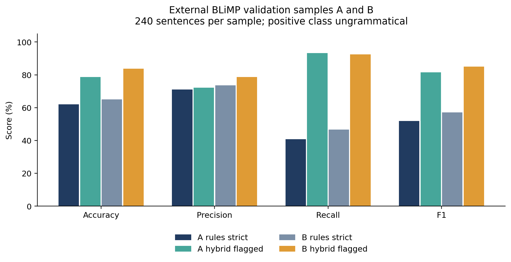
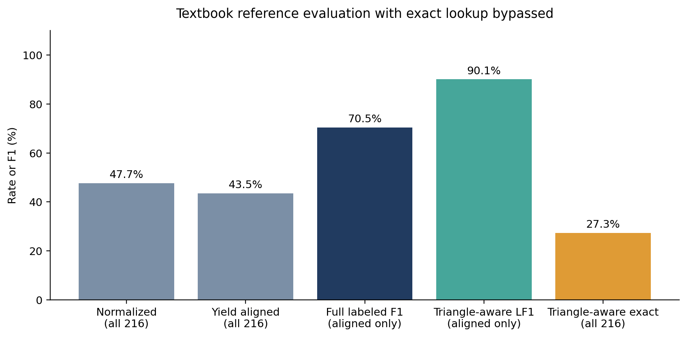
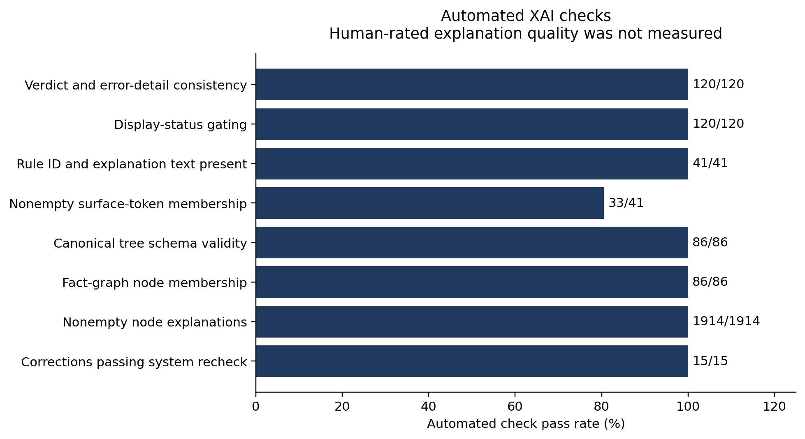

# SynTutor Technical Evaluation

Evaluation date: 20 November 2026. Production snapshot: `5f582552504fb2d584fa02f4dfa55f1a704e3be1`. Evaluation snapshot: `dbfa208341c99cb4fa522736a01ded20d41d7aa6`.

Verified execution: https://github.com/ybcole/SynTutor/actions/runs/44694848877

## 5.1 Model Evaluation

The technical evaluation replaced the earlier 100% development-regression figures as the primary evidence with measured external-benchmark performance, comparison against published textbook trees, and an automated audit of explanation consistency. Grammar detection, tree structure, explanation delivery, and user perceptions were analyzed separately. Successful execution, a valid data structure, and a linguistically correct result were not treated as equivalent outcomes.

The evaluated production implementation was fixed at GitHub commit 5f58255. The evaluation and its scoring corrections were recorded at commit dbfa208341c9. Automated verification confirmed that the production modules, grammar resources, benchmark files, evaluation corpora, and textbook reference trees were unchanged relative to the production commit. Raw predictions, tree-level records, explanation-audit records, dependency versions, and file hashes were preserved with the evaluation. The earlier supplied post-remediation figures were excluded from the final findings because their corresponding production changes were not available in the committed repository.

The first evaluation included 400 external inputs: 240 BLiMP sentences, 80 JFLEG source/reference sentences, and 80 CoLA acceptability sentences. Fifty-two internal minimal-pair inputs and 24 internal audit examples were kept separate. A second, sentence-disjoint sample contained 240 BLiMP sentences and 80 JFLEG sentences. The two samples had already been examined before the reproducibility run; absence of sentence overlap and a matching file hash do not establish that they were historically untouched. They are therefore reported as external validation samples rather than newly unseen final tests.

BLiMP (Warstadt et al., 2020) supplied the primary grammaticality comparison because it provides externally specified acceptable and unacceptable minimal pairs. JFLEG (Napoles et al., 2017) supplied a secondary source-versus-human-reference comparison: its original sentences may contain fluency, spelling, or grammatical issues, so assigning every source sentence an ungrammatical label is a proxy and cannot establish pure grammatical-error accuracy. CoLA was reported separately because the hybrid detector was fine-tuned on CoLA. Internal examples were diagnostic material and were not merged into the primary BLiMP scores.

### 5.1.1 Grammar Error Detection

Ungrammatical was the positive reference class. Under strict scoring, a positive prediction required an explicit ungrammatical verdict. Under hybrid non-acceptance scoring, both ungrammatical and unverified verdicts were counted as flagged. The latter measures whether an input is withheld from acceptance; it does not mean that a specific grammatical error has been identified or explained. Decisive-only results exclude unverified cases and are reported with their coverage, rather than substituted for full-sample performance.

Table 5.1a. External BLiMP Grammar Evaluation by Operating Mode

| Sample and mode | Accuracy % | Precision % | Recall % | F1 % |
| --- | --- | --- | --- | --- |
| BLiMP A rules strict | 62.08 | 71.01 | 40.83 | 51.85 |
| BLiMP A hybrid flagged | 78.75 | 72.26 | 93.33 | 81.45 |
| BLiMP B rules strict | 65.00 | 73.68 | 46.67 | 57.14 |
| BLiMP B hybrid flagged | 83.75 | 78.72 | 92.50 | 85.06 |

Note. Each sample contains 240 sentences, balanced between 120 grammatical and 120 ungrammatical inputs. A and B identify sentence-disjoint validation samples, not a before-and-after intervention. Each consists of 15 minimal pairs from each of eight selected linguistic families. Scores describe these selected subsets rather than the complete BLiMP benchmark.

Table 5.1b. Confusion Counts for the Second Validation Sample

| Sample and mode | TP | TN | FP | FN |
| --- | --- | --- | --- | --- |
| BLiMP B rules strict | 56 | 100 | 20 | 64 |
| BLiMP B hybrid flagged | 111 | 90 | 30 | 9 |
| Combined B rules strict | 79 | 131 | 29 | 81 |
| Combined B hybrid flagged | 145 | 116 | 44 | 15 |

On the second BLiMP sample, strict rules achieved 65.00% accuracy and 57.14% F1. The hybrid non-acceptance rule achieved 83.75% accuracy and 85.06% F1, with recall of 92.50% and specificity of 75.00%. The difference reflects the additional uncertain sentences flagged by the neural channel. The hybrid issued 65 unverified verdicts out of 240; its decisive-only accuracy was 83.43% on 175/240 inputs (72.92% coverage). These conditional results do not describe all inputs.

For comparison with the supplied evaluation files, the combined second sample of 320 BLiMP and JFLEG inputs yielded 65.63% strict-rules accuracy and 81.56% hybrid non-acceptance accuracy. These aggregates retain JFLEG's proxy-label limitation and are secondary to the BLiMP-only results. They are not evidence of universal English accuracy.

Table 5.1c. BLiMP Sample A F1 by Linguistic Family

| Linguistic family | Rules F1 % | Hybrid flagged F1 % |
| --- | --- | --- |
| Argument structure | 11.76 | 75.86 |
| Determiner agreement | 96.55 | 93.75 |
| Filler gap dependencies | 28.57 | 78.95 |
| Island effects | 31.58 | 76.92 |
| Npi licensing | 11.76 | 77.42 |
| Pronoun case and binding | 68.57 | 75.68 |
| Subject verb agreement | 85.71 | 83.33 |
| Verb forms | 0.00 | 90.91 |

Category results show where the deterministic explanation channel succeeds and where the hybrid relies on uncertainty. A neural rejection without a matched deterministic rule was retained as unverified. Consequently, a higher hybrid flagging recall cannot establish that the system can provide a correct rule-level explanation for every rejected sentence. False positives and false negatives were retained as observed outcomes rather than removed after inspection.

Figure 5.5. Grammar evaluation on two sentence-disjoint BLiMP validation samples

### 5.1.2 Syntax Tree Generation

Tree evaluation compared the Benepar-to-Burton–Roberts projection with 216 complete textbook reference figures transcribed in the repository (Burton-Roberts, 2011). The exact textbook lookup was bypassed so that a stored answer could not be returned as a predicted parse. Because these textbook resources were already available during system development, this is a source-reference structural comparison rather than a novel test of general-domain parsing. The transcriptions were not independently re-adjudicated by human linguists during this evaluation.

Labeled constituent F1 compared both spans and category labels; unlabeled F1 compared spans. Empty elements and punctuation were excluded under the documented scoring convention, and unary constituent multiplicity was retained. Full scoring counted all evaluated constituents. Triangle-aware scoring masked predicted descendants strictly inside a reference triangle, where the textbook intentionally leaves phrase structure unexpanded. Both were reported to show the effect of the textbook convention. Span F1 was computed only for normalized predictions with matching terminal sequences. Normalization, alignment, and exact matches across all reference inputs were therefore also reported.

Table 5.2. Structural Agreement with Textbook Trees with Lookup Bypassed

| Reference slice | Total | Aligned | LF1 % | UF1 % | Exact of total |
| --- | --- | --- | --- | --- | --- |
| All references full | 216 | 94 | 70.46 | 72.20 | 6/216 |
| All references triangle-aware | 216 | 94 | 90.10 | 92.32 | 59/216 |
| No reference triangles | 83 | 13 | 73.45 | 84.75 | 6/83 |
| Chapters 7–10 triangle-aware | 115 | 38 | 89.64 | 90.94 | 18/115 |

Of the 216 reference inputs, 103 (47.69%) produced a normalized canonical tree, and 94 had matching terminal sequences for span scoring. Full labeled F1 was 70.46%; triangle-aware labeled F1 was 90.10%. Triangle-aware exact agreement occurred for 59/94 aligned outputs (62.77%), or 59/216 inputs overall (27.31%). Reporting only the aligned-output rate would conceal failures to normalize or align.

The reference-only non-triangle subset contained 83 inputs. Membership was determined from each reference tree before considering parser success, correcting the earlier scorer's inclusion of unresolved triangle references in this subset. Its 13 aligned outputs achieved 73.45% labeled F1. The earlier before-and-after non-triangle comparison was withdrawn because its subset size depended on parser success. Likewise, F1 values calculated on different aligned subsets were not interpreted as a controlled improvement comparison.

Lookup-enabled fixture matches and schema validity were kept as engineering checks. Neither was described as independent parsing accuracy. No external Penn Treebank evaluation was performed in this study, and the adapter-generated draft reference set was excluded from linguistic-accuracy claims.

Figure 5.6. Textbook tree coverage and structural agreement with lookup bypassed

### 5.1.3 Explainable AI Performance

The complete API pipeline was evaluated on 120 selected inputs: 60 external inputs, 36 internal minimal-pair inputs, and 24 internal audit examples. The automated checks examined the relation between verdicts and error details, display-status gating, the presence of rule identifiers and explanation text, source-token membership requiring a nonempty surface for each error and no excess token occurrences, canonical-tree schema validity, fact-graph node membership, explanation non-emptiness, and correction rechecking. These properties test internal consistency and delivery; they do not independently establish linguistic truth, clarity, or usefulness.

Table 5.3. Automated Explanation Consistency and Delivery Checks

| Automated criterion | Passed / assessed | Rate |
| --- | --- | --- |
| Verdict and error-detail consistency | 120/120 | 100.00% |
| Display-status gating | 120/120 | 100.00% |
| Rule ID and explanation text present | 41/41 | 100.00% |
| Nonempty surface-token membership | 33/41 | 80.49% |
| Canonical tree schema validity | 86/86 | 100.00% |
| Fact-graph node membership | 86/86 | 100.00% |
| Nonempty node explanations | 1914/1914 | 100.00% |
| Corrections passing system recheck | 15/15 | 100.00% |

All 120 of the 120 full-payload executions completed successfully, with 41 error-bearing inputs and 1914 generated node explanations. The audit found 2 root-question explanations containing the phrase 'subordinate clause' among 2 inspected root questions, and 37 repeated explanation occurrences within sentences. These diagnostic observations were preserved even when the automated consistency checks passed.

Of 15 generated corrections in the 120-input audit, 15 passed the system's own recheck. Among the 7 generated corrections with a supplied reference, 6 exactly matched it. This conditional agreement describes only generated corrections with references; it is not a correction-success rate for all erroneous inputs, and a different wording may also be acceptable. Passing the same system's recheck is not independent evidence that a repair is correct.

The additional 60-input validation audit generated 4 corrections, including 1 on reference-grammatical inputs. This count was reported separately because a false repair can still pass the system's internal recheck. The source worksheet contained no completed independent human ratings; no percentage of human-approved explanation accuracy, clarity, or inter-rater agreement was reported. The two English professionals' ISO-based ratings in Section 5.2 describe perceptions and were not converted into sentence-level correctness labels.

The structural and grammar results provide descriptive evidence about the evaluated implementation and selected materials. H01 and H02 were not accepted or rejected through these measurements: H01 lacks a prespecified accuracy null and inferential comparison across complexity levels, while H02 requires a comparative measure of linguistically unsound feedback. Automated consistency checks alone do not supply those tests. The remaining limitations are substantive outcomes of the evaluation, rather than reasons to report provisional perfect performance.

Figure 5.7. Automated XAI consistency checks with their assessed denominators

## Evaluation references

Burton-Roberts, N. (2011). Analysing sentences: An introduction to English syntax (3rd ed.). Pearson.

Napoles, C., Sakaguchi, K., & Tetreault, J. (2017). JFLEG: A fluency corpus and benchmark for grammatical error correction. In Proceedings of EACL 2017, Volume 2, Short Papers (pp. 229–234). Association for Computational Linguistics. https://aclanthology.org/E17-2037/

Warstadt, A., Parrish, A., Liu, H., Mohananey, A., Peng, W., Wang, S.-F., & Bowman, S. R. (2020). BLiMP: The benchmark of linguistic minimal pairs for English. Transactions of the Association for Computational Linguistics, 8, 377–392. https://doi.org/10.1162/tacl_a_00321
