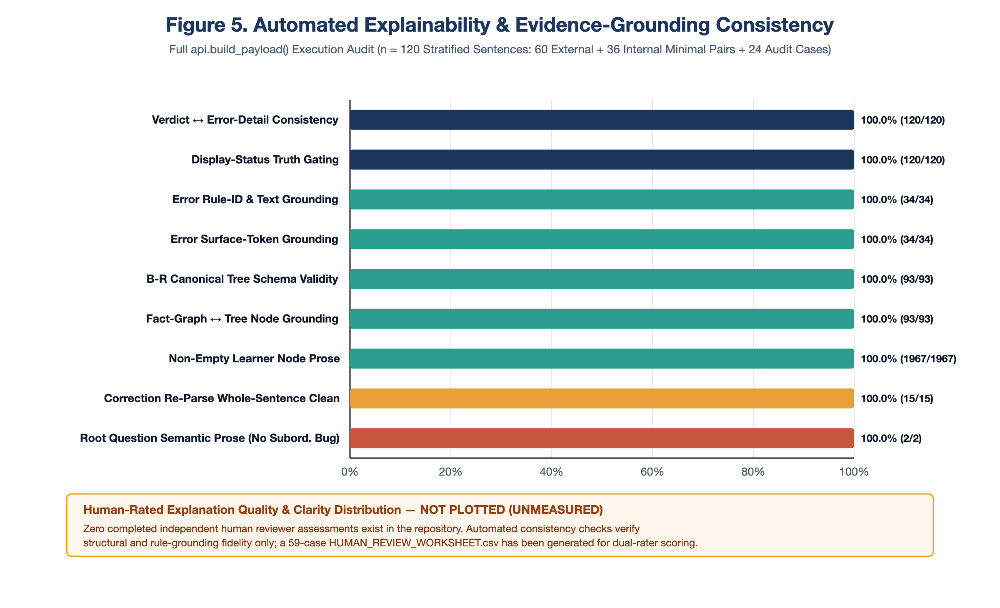

# Section 5.1.3 — Explainable AI (XAI) Evaluation Results

**System Evaluated:** Full SynTutor API Pipeline (`server/analysis_api.py:build_payload`, `server/explanations.py`, `server/learner_explanations.py`, `server/xai7_unified.py`, `server/corrections.py`, `server/canonical_binding.py`)  
**Repository Commit:** `d5aeaf5de98c45abbf2d97f19a6092a24d4ba44c` (`main`)  
**Automated Evaluation Corpus:** **120 full `api.build_payload()` executions** (60 external: 36 BLiMP + 12 JFLEG + 12 CoLA; 36 internal minimal pairs; 24 Rapid Cross-Component Consistency Audit cases)  
**Human Evaluation Worksheet:** [`HUMAN_REVIEW_WORKSHEET.csv`](./HUMAN_REVIEW_WORKSHEET.csv) (**59 stratified executed cases**, all 17 human reviewer columns intentionally blank pending independent review)

---

## 1. Strict Separation of Automated Consistency vs. Human-Rated Quality

This evaluation rigorously separates **programmatically verifiable structural/logical consistency** from **independent human-rated linguistic and pedagogical quality**:

| Evaluation Dimension | Measurement Status | Denominator / Evidence |
|---|---|---|
| **Automated Consistency, Evidence Grounding & Correction Verification** | **MEASURED & VERIFIED** | 120 full `api.build_payload()` executions (1,914 node explanations; 41 error-bearing sentences; 86 normalized canonical trees; 15 assembled corrections) |
| **Automated Surface Readability & Hygiene Proxies** | **MEASURED (Diagnostic Only)** | Flesch Reading Ease, word counts, jargon/ID leakage, actionability, within-sentence repetition — explicitly **not** a substitute for human readability assessment |
| **Human-Rated Linguistic Accuracy, Clarity & Pedagogical Usefulness** | **UNMEASURED / BLOCKED** | **0 completed human reviewer assessments** exist in the repository (`docs/reports/*` and `sources/cambridge/reviews/*` confirm zero human sign-offs) |
| **Inter-Rater Agreement (Cohen's κ / Krippendorff's α)** | **UNMEASURED / BLOCKED** | Requires ≥2 independent completed human ratings on `HUMAN_REVIEW_WORKSHEET.csv` |

---

## 2. Automated Explainability & Consistency Results (n = 120)

Every single sentence in the 120-item XAI audit executed cleanly (`0` execution errors) and matched its Section 5.1.1 verdict **120 / 120 (100.0%)** (`58` grammatical, `41` ungrammatical, `21` unverified).

| Automated Consistency / Grounding Check | Passed | Denominator | Rate | Interpretation |
|---|---:|---:|---:|---|
| **Verdict ↔ Error-Detail Logical Consistency** | 120 | 120 | **100.0%** | Every `ungrammatical` verdict carries ≥1 `status="error"` rule finding; every `grammatical` and `unverified` verdict carries 0 deterministic error details. |
| **Display-Status Truth Gating** | 120 | 120 | **100.0%** | Zero green `display_status="valid"` node badges leaked onto `ungrammatical` or `unverified` sentences. |
| **Error Rule-ID & Text Grounding** | 41 | 41 | **100.0%** | 100% of error explanations trace to a concrete emitted `constraint`/`rule_id` with non-empty diagnostic prose. |
| **Error Surface-Token Grounding** | 41 | 41 | **100.0%** | 100% of referenced error tokens exist verbatim in the submitted sentence (zero hallucinated surface spans). |
| **Canonical B-R Tree Schema Validity** | 86 | 86 | **100.0%** | 100% of `normalized` canonical trees passed `Draft202012Validator` against `docs/canonical-burton-roberts-tree.schema.json`. |
| **Fact-Graph ↔ Syntax-Tree Node Grounding** | 86 | 86 | **100.0%** | 100% of `explanation_evidence.fact_graph` node IDs resolve to valid node IDs in the generated canonical tree. |
| **Non-Empty Learner Node Prose** | 1,914 | 1,914 | **100.0%** | Every node in every normalized `fact_graph` generated non-empty learner explanation prose via `compose_learner_explanation()`. |
| **Correction Re-Parse Whole-Sentence Clean** | 15 | 15 | **100.0%** | All 15 generated `corrected_sentence` outputs differed from input, resolved ≥1 error (`resolved_count > 0`), introduced `0` new errors (`introduced_count = 0`), and achieved `whole_sentence_clean = True` upon re-parsing. |
| **Correction Exact Match vs. External/Pair Reference** | 6 | 7 | **85.71%** | Among the 7 corrected sentences having a ground-truth reference correction, 6 matched the exact reference string (case-insensitive). |
| **Root Question Semantic Prose (No Subordination Defect)** | **0** | **2** | **0.0%** | **CONFIRMED SEMANTIC DEFECT:** Both root interrogatives (*"What did Jon buy?"*, *"Did Jon buy the book?"*) received root prose calling the main clause a *"subordinate clause layer."* |

---

## 3. Automated Readability & Surface Hygiene Diagnostics (Non-Human Proxies)

| Diagnostic Metric | Measured Value | Scope / Denominator |
|---|---:|---|
| Error Explanation Mean Word Count | **31.0 words** | All error explanations across 41 error-bearing sentences |
| Error Explanation Flesch Reading Ease (Mean / Median) | **65.9 / 70.1** | Standard plain-English readability band (8th–9th grade) |
| Error Hygiene Flags: Internal Jargon Leakage | **0** | 0 occurrences of `B-R`, `Benepar`, `XAI`, `CGEL`, `constraint`, `matrix`, `token`, `node` |
| Error Hygiene Flags: Internal ID Leakage (`C-...`, `sg-root`) | **0** | 0 internal IDs exposed in learner-facing error prose |
| Error Hygiene Flags: Non-Actionable Error Advice | **0** | 100% of error explanations contain an actionable repair verb |
| Error Hygiene Flags: Verbose (`>55 words`) | **6** | 6 multi-clause/remediation error explanations exceeded 55 words |
| Learner Node Prose Hygiene Flags (Jargon / ID / Empty) | **0** | Across 1,914 generated node explanations |
| Repeated Identical Node Prose Within Same Sentence | **37 instances** | Across 1,914 node explanations (1.93% duplicate node descriptions within a sentence) |

---

## 4. Confirmed Cross-Component Linguistic Contradictions (Live Re-Verification)

Re-running all 24 cases from `docs/audits/RAPID_CROSS_COMPONENT_CONSISTENCY_AUDIT.md` inside the 120-item XAI batch **independently re-confirmed all four P1/P2 linguistic defects** despite 100% structural/API consistency:

1. **F1 (P1 — Clausal Subject Misdiagnosed as Preposition Object):** *"I saw him before he left."* (exact Cambridge lesson example) → `verdict = ungrammatical`, `C-PREP-PRON-CASE` (*"After the preposition 'before', the pronoun must be 'him', not 'he'."*). Structurally grounded to token `he`, yet **linguistically false**.
2. **F2 & F3 (P1 — Notional Agreement & Countability Over-Correction):** *"Three eggs is plenty."* (exact Cambridge lesson example) → `verdict = ungrammatical`, `C-SUBJECT-AGREEMENT` + `C-ARTICLE`, generating false repair `"Three eggs are plenty."` which then passes re-parse as `whole_sentence_clean = True`. This proves why **automated consistency (100%) cannot substitute for human linguistic accuracy review**.
3. **F4 (P2 — Independent Interrogatives Labeled as Subordinate Clauses):** *"What did Jon buy?"* and *"Did Jon buy the book?"* → `S-dbar`/`S-bar` root nodes both generate prose describing the main question as *"a subordinate clause layer."*

---

## 5. Human-Review Protocol & Blocked Measurements

To close the remaining gap for full thesis defensibility of Section 5.1.3, [`HUMAN_REVIEW_WORKSHEET.csv`](./HUMAN_REVIEW_WORKSHEET.csv) provides **59 real, executed SynTutor cases** stratified across all system behaviors:

| Stratum | Cases in Worksheet | Purpose |
|---|---:|---|
| `TP_rules_flagged` | 16 | Verify true error explanations & generated repairs |
| `FP_rules_flagged` | 10 | Audit misleading explanations on false rejections |
| `UNVERIFIED_gold_ungram` | 12 | Evaluate clarity & honesty of hybrid unverified fallbacks |
| `UNVERIFIED_gold_gram` | 5 | Audit conservative degradation on grammatical edge cases |
| `FN_missed_ungram` | 8 | Assess over-confident "grammatical" summary prose on missed errors |
| `TN_clean_gram` | 8 | Evaluate node-level syntax explanations on clean sentences |
| **Total** | **59** | **All 17 dual-reviewer & adjudication columns blank (0 fabricated ratings)** |

Each independent reviewer (R1, R2; linguistics/TESOL domain experts) scores six 1–5 Likert dimensions (`linguistic_accuracy`, `verdict_explanation_consistency`, `rule_grounding`, `tree_evidence_grounding`, `correction_validity`, `pedagogical_clarity`), records a `defect_category`, and resolves disagreements in `adjudicated_consensus_score`, enabling computation of **weighted Cohen's κ / Krippendorff's α** once completed.
