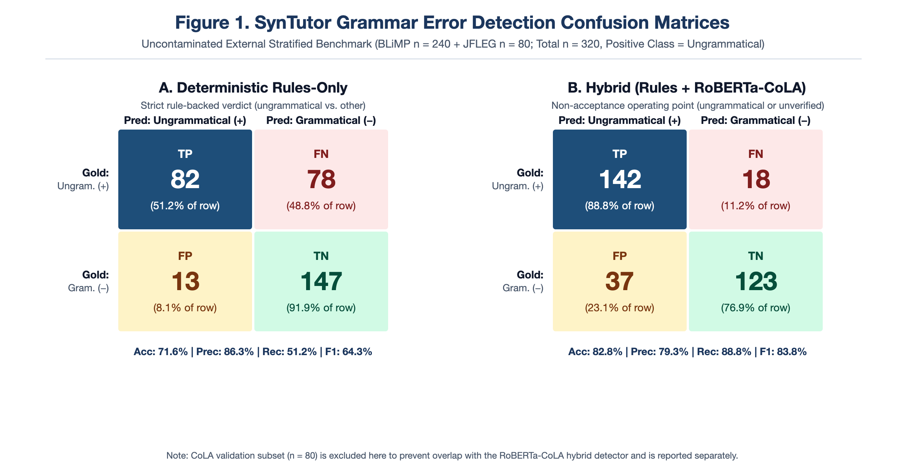
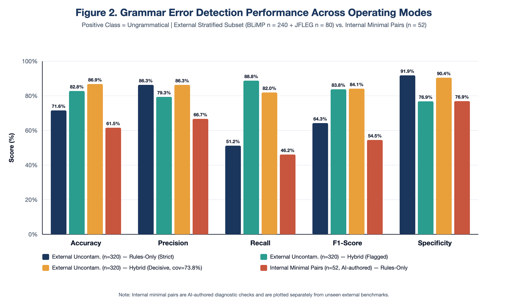
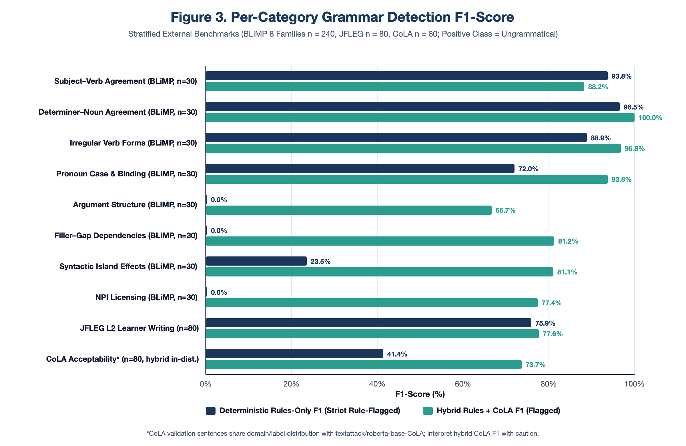

# Section 5.1.1 — Grammar Error Detection Evaluation Results

**System Evaluated:** SynTutor (`server/parse_engine.py`, `server/matrix.py`, `server/ruleset.py`, `server/detector.py`, `server/cambridge_evaluator.py`)  
**Repository Commit:** `d5aeaf5de98c45abbf2d97f19a6092a24d4ba44c` (`main`)  
**Positive Class:** *Ungrammatical* (`gold_label == "ungrammatical"`)  
**Raw Predictions:** [`RAW_PREDICTIONS.csv`](./RAW_PREDICTIONS.csv) (476 executed sentences)  
**Verified Metrics Table:** [`METRICS_SUMMARY.csv`](./METRICS_SUMMARY.csv) (independently verified by [`verify_metrics.py`](./verify_metrics.py))

---

## 1. Evaluation Scope & Treatment of Tri-State Verdicts

SynTutor implements a two-channel, tri-state grammaticality architecture:

1. **Deterministic Rules-Only Channel (`matrix.evaluate`):** Applies deterministic phrase-structure and morphosyntactic constraints over Benepar constituency trees (`en_core_web_md` + `benepar_en3`), outputting `grammatical`, `ungrammatical`, or `unverified`.
2. **Production Hybrid Channel (`detector.combine`):** Augments the deterministic matrix with an advisory acceptability classifier (`textattack/roberta-base-CoLA`). Crucially, the neural channel **cannot** fabricate a rule-backed `ungrammatical` verdict; when deterministic rules find no violation but RoBERTa-CoLA rejects the sentence, SynTutor downgrades the verdict to `unverified` (`flagged = True`) rather than condemning the sentence without a rule-level explanation.

Because `unverified` outputs are neither rule-backed error detections nor certifications of grammaticality, every benchmark slice is reported across **three explicit operating points** (with **0 execution errors** across all 476 sentences):

- **Strict Rule-Flagged (`strict_ungrammatical`):** Positive prediction iff `verdict == "ungrammatical"`. All `unverified` outputs are counted as negative predictions (`coverage = 100.0%`). Measures strictly explainable rule-level error detection.
- **Decisive-Only (`decisive_only`):** Excludes `unverified` predictions from the confusion matrix (`pred_pos` iff `ungrammatical`, `pred_neg` iff `grammatical`) and reports exact **Evaluation Coverage** = $(TP+TN+FP+FN)/N$.
- **Non-Acceptance / Flagged (`non_grammatical_flagged`):** Positive prediction iff `verdict in {"ungrammatical", "unverified"}` (i.e., SynTutor refuses to certify the sentence as grammatical; `coverage = 100.0%`). Directly measures the hybrid false-acceptance prevention objective defined in `server/eval_minimal_pairs.py`.

### Dataset Stratification & Contamination Separation

- **Primary Uncontaminated External Subset (`n = 320`):** Deterministic stratified sample of **BLiMP (`n = 240` of 2,010**; 8 grammatical families × 15 minimal pairs) + **JFLEG (`n = 80` of 400**; 40 L2 learner sentences + 40 human corrections). Neither channel was trained on BLiMP or JFLEG.
- **External CoLA Stratified Subset (`n = 80` of 400; 40 grammatical / 40 ungrammatical):** Reported **separately** because the hybrid detector (`textattack/roberta-base-CoLA`) was fine-tuned on CoLA (in-distribution caveat for Hybrid mode; uncontaminated for Rules-Only mode).
- **Internal Repository Diagnostic Sets (`n = 76`):** Full census of `evaluation/minimal_pairs.json` (**n = 52**, AI-authored) and `docs/audits/RAPID_CROSS_COMPONENT_CONSISTENCY_AUDIT.md` (**n = 24**). Strictly separated from external test benchmarks.

---

## 2. Overall Classification Metrics & Confusion Matrices

### 2.1 Primary Uncontaminated External Stratified Subset (BLiMP n = 240 + JFLEG n = 80; Total n = 320)

| Mode | Operating Point | n | Eval | Unverified | Exec Err | Coverage | TP | TN | FP | FN | Accuracy | Precision | Recall | F1 | Specificity |
|---|---|---:|---:|---:|---:|---:|---:|---:|---:|---:|---:|---:|---:|---:|---:|
| **Rules-Only** | Strict Rule-Flagged | 320 | 320 | 30 | 0 | 100.0% | 80 | 120 | 40 | 80 | **62.50%** | **66.67%** | **50.00%** | **57.14%** | **75.00%** |
| **Rules-Only** | Decisive-Only | 320 | 290 | 30 | 0 | 90.62% | 80 | 112 | 40 | 58 | **66.21%** | **66.67%** | **57.97%** | **62.02%** | **73.68%** |
| **Rules-Only** | Non-Grammatical Flagged | 320 | 320 | 30 | 0 | 100.0% | 102 | 112 | 48 | 58 | **66.87%** | **68.00%** | **63.75%** | **65.81%** | **70.00%** |
| **Hybrid (Rules + CoLA)** | Strict Rule-Flagged | 320 | 320 | 97 | 0 | 100.0% | 80 | 120 | 40 | 80 | **62.50%** | **66.67%** | **50.00%** | **57.14%** | **75.00%** |
| **Hybrid (Rules + CoLA)** | Decisive-Only | 320 | 223 | 97 | 0 | 69.69% | 80 | 93 | 40 | 10 | **77.58%** | **66.67%** | **88.89%** | **76.19%** | **69.92%** |
| **Hybrid (Rules + CoLA)** | Non-Grammatical Flagged | 320 | 320 | 97 | 0 | 100.0% | 150 | 93 | 67 | 10 | **75.94%** | **69.12%** | **93.75%** | **79.58%** | **58.13%** |

### 2.2 Per-Benchmark & Internal Diagnostic Breakdown

| Dataset (Provenance) | Mode & Operating Point | n | Eval | Unver. | Cov. | TP | TN | FP | FN | Acc. | Prec. | Rec. | F1 | Spec. |
|---|---|---:|---:|---:|---:|---:|---:|---:|---:|---:|---:|---:|---:|---:|
| **BLiMP Stratified** (External, 240/2,010) | Rules-Only (Strict) | 240 | 240 | 22 | 100.0% | 49 | 100 | 20 | 71 | 62.08% | 71.01% | 40.83% | **51.85%** | 83.33% |
| **BLiMP Stratified** (External, 240/2,010) | Hybrid (Decisive-Only) | 240 | 154 | 86 | 64.17% | 49 | 77 | 20 | 8 | 81.82% | 71.01% | 85.96% | **77.78%** | 79.38% |
| **BLiMP Stratified** (External, 240/2,010) | Hybrid (Flagged) | 240 | 240 | 86 | 100.0% | 112 | 77 | 43 | 8 | 78.75% | 72.26% | 93.33% | **81.45%** | 64.17% |
| **JFLEG Stratified** (External L2, 80/400) | Rules-Only (Strict) | 80 | 80 | 8 | 100.0% | 31 | 20 | 20 | 9 | 63.75% | 60.78% | 77.50% | **68.13%** | 50.00% |
| **JFLEG Stratified** (External L2, 80/400) | Hybrid (Decisive-Only) | 80 | 69 | 11 | 86.25% | 31 | 16 | 20 | 2 | 68.12% | 60.78% | 93.94% | **73.81%** | 44.44% |
| **JFLEG Stratified** (External L2, 80/400) | Hybrid (Flagged) | 80 | 80 | 11 | 100.0% | 38 | 16 | 24 | 2 | 67.50% | 61.29% | 95.00% | **74.51%** | 40.00% |
| **CoLA Stratified*** (External, 80/400; hybrid in-dist.) | Rules-Only (Strict) | 80 | 80 | 3 | 100.0% | 12 | 33 | 7 | 28 | 56.25% | 63.16% | 30.00% | **40.68%** | 82.50% |
| **CoLA Stratified*** (External, 80/400; hybrid in-dist.) | Hybrid (Flagged) | 80 | 80 | 20 | 100.0% | 29 | 30 | 10 | 11 | 73.75% | 74.36% | 72.50% | **73.42%** | 75.00% |
| **All External Combined** (400/2,810) | Rules-Only (Strict) | 400 | 400 | 33 | 100.0% | 92 | 153 | 47 | 108 | 61.25% | 66.19% | 46.00% | **54.28%** | 76.50% |
| **All External Combined** (400/2,810) | Hybrid (Flagged) | 400 | 400 | 117 | 100.0% | 179 | 123 | 77 | 21 | 75.50% | 69.92% | 89.50% | **78.51%** | 61.50% |
| **Internal Minimal Pairs** (AI-authored, 52/52) | Rules-Only (Strict) | 52 | 52 | 4 | 100.0% | 12 | 20 | 6 | 14 | 61.54% | 66.67% | 46.15% | **54.55%** | 76.92% |
| **Internal Minimal Pairs** (AI-authored, 52/52) | Hybrid (Flagged) | 52 | 52 | 9 | 100.0% | 20 | 19 | 7 | 6 | 75.00% | 74.07% | 76.92% | **75.47%** | 73.08% |
| **Internal Rapid Audit** (24/24) | Rules-Only / Hybrid | 24 | 24 | 0 | 100.0% | 3 | 19 | 2 | 0 | 91.67% | 60.00% | 100.0% | **75.00%** | 90.48% |

---

## 3. Per-Category Grammatical Performance (BLiMP 8 Families, n = 30 Each)

| Grammatical Category (n = 30: 15 good / 15 bad) | Rules TP / FP / FN | Rules Prec. | Rules Rec. | Rules F1 | Hybrid Flagged TP / FP / FN | Hybrid Flagged Prec. | Hybrid Flagged Rec. | Hybrid Flagged F1 | Hybrid Decisive Cov. |
|---|---:|---:|---:|---:|---:|---:|---:|---:|---:|
| **Determiner–Noun Agreement** | 14 / 0 / 1 | **100.0%** | **93.33%** | **96.55%** | 15 / 2 / 0 | 88.24% | 100.0% | 93.75% | 90.00% |
| **Subject–Verb Agreement** | 15 / 5 / 0 | 75.00% | **100.0%** | **85.71%** | 15 / 6 / 0 | 71.43% | 100.0% | 83.33% | 96.67% |
| **Pronoun Case & Binding** | 12 / 8 / 3 | 60.00% | 80.00% | **68.57%** | 14 / 8 / 1 | 63.64% | 93.33% | 75.68% | 93.33% |
| **Syntactic Island Effects** | 3 / 1 / 12 | 75.00% | 20.00% | **31.58%** | 15 / 9 / 0 | 62.50% | 100.0% | 76.92% | 33.33% |
| **Filler–Gap Dependencies** | 3 / 3 / 12 | 50.00% | 20.00% | **28.57%** | 15 / 8 / 0 | 65.22% | 100.0% | 78.95% | 43.33% |
| **Argument Structure** | 1 / 1 / 14 | 50.00% | 6.67% | **11.76%** | 11 / 3 / 4 | 78.57% | 73.33% | 75.86% | 60.00% |
| **NPI Licensing** | 1 / 1 / 14 | 50.00% | 6.67% | **11.76%** | 12 / 4 / 3 | 75.00% | 80.00% | 77.42% | 53.33% |
| **Irregular Verb Forms (Past Participle)** | 0 / 1 / 15 | 0.00% | 0.00% | **0.00%** | 15 / 3 / 0 | 83.33% | 100.0% | 90.91% | 43.33% |

---

## 4. Categorized Error Analysis (False Positives & False Negatives)

### 4.1 False Positive Taxonomy (47 Rules-Only FPs Across External n = 400)

Top constraints driving deterministic false positives on gold-grammatical external sentences:

| Fired Constraint | External FP Count | Root Cause & Concrete Executed Example |
|---|---:|---|
| `C-RUNON` / `C-COMMA-SPLICE` | 16 (9 + 7) | Over-eager clause-boundary heuristics flagging valid finite complements without overt *that* or multi-clause JFLEG/BLiMP sentences (e.g., `blimp-007-g`: *"An alumnus doubts every sweater flattens."*; `blimp-056-g`: *"Donald can imagine those college campuses are boring themselves."*). |
| `C-ARTICLE` | 7 | Bare singular noun/countability over-firing on non-count, idiomatic, or parser-tagged `NN` nouns (also confirmed on Cambridge lesson example *"Three eggs is plenty."*). |
| `C-DOUBLE-NEGATIVE` / `C-SOME-ANY` | 11 (6 + 5) | Prescriptive polarity rules misfiring on grammatical negative clauses containing *some* (e.g., `blimp-008-g`: *"Some analyses weren't astounding this actress."*). |
| `C-SUBJECT-AGREEMENT` / `C-RELATIVE-AGREE` | 5 (4 + 1) | Irregular/zero-plural nouns (e.g., `blimp-031-g`: *"The hidden offspring aren't confident."*) and notional agreement (*"Three eggs is plenty."*). |
| `C-PRONOUN-CASE` / `C-REFLEXIVE-*` | 7 (4 + 3) | Preposition/gerund-clause boundary confusion (`blimp-053-g`: *"Cheryl is forgetting about herself thinking about Beverly."*; `audit24-20`: *"I saw him before he left."* triggering `C-PREP-PRON-CASE`). |
| `C-TENSE-FINITE` / `C-INTRO-COMMA` / `C-NOUN-FORM` / Other | 16 | Parser attachment errors (e.g., `blimp-005-g`: *"A doctor who researched the Clintons waves."* where *waves* was misparsed as a noun) and JFLEG punctuation/capitalization conventions. |

Additionally, in **Hybrid (Flagged)** mode, RoBERTa-CoLA added **27 extra false positives** on the 320 uncontaminated external sentences (lowering specificity from 75.0% to 58.1%), primarily on semantically unusual but syntactically well-formed BLiMP sentences (e.g., *"Many skirts that stun some waitress are boring themselves."*) and JFLEG human-corrected sentences with residual fluency/punctuation artifacts.

### 4.2 False Negative Taxonomy (Rules-Only vs. Hybrid)

- **Deterministic Rules-Only FN (`n = 80 / 160` on external n = 320; Recall = 50.0%):** Concentrated almost entirely in syntactic phenomena outside SynTutor's core deterministic constraint set:
  - **Irregular past-participle verb/adjective morphology (`15/15` missed by rules):** BLiMP's `irregular_past_participle_verbs` and `irregular_past_participle_adjectives` (e.g., past-tense vs. participle conflation in passive/adjectival frames) were missed by deterministic rules (0% recall) yet caught **15/15 (100%)** by the Hybrid CoLA channel as `unverified`.
  - **Argument structure (`14/15` missed), NPI licensing (`14/15` missed), filler–gap (`12/15` missed), island effects (`12/15` missed):** Deep generative syntax violations beyond local morphosyntactic rules.
  - **Strong deterministic core:** On core pedagogical learner errors that SynTutor explicitly targets—**Determiner–Noun Agreement (93.3% Recall, 100.0% Precision, 96.6% F1)**, **Subject–Verb Agreement (100.0% Recall, 85.7% F1)**, **Pronoun Case & Binding (80.0% Recall, 68.6% F1)**, and **JFLEG L2 Learner Writing (77.5% Recall, 68.1% F1)**—deterministic rules perform strongly.
- **Hybrid Non-Acceptance FN (`n = 10 / 160` on external n = 320; Recall = 93.75%):** Only 10 ungrammatical sentences slipped past *both* rules and RoBERTa-CoLA, primarily selectional-restriction violations (`blimp-063-u`: *"The jackets have praised Raymond."*, `p(acceptable)=0.9203`), subcategorization omissions (`blimp-066-u`: *"Travis is revealing."*), and subtle NPI scope violations (`blimp-119-u`).
