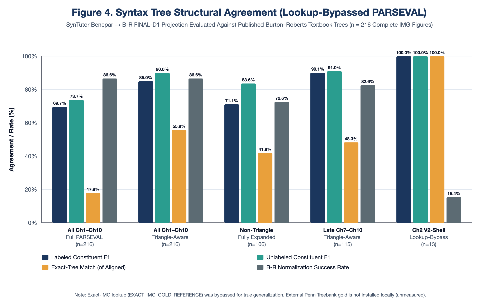

# Section 5.1.2 — Syntax Tree Generation Evaluation Results

**System Evaluated:** SynTutor Constituency Parser & Burton–Roberts Canonical Projection (`server/parse_engine.py`, `server/burton_roberts.py`, `server/final_d1_projection.py`, `docs/canonical-burton-roberts-tree.schema.json`)  
**Repository Commit:** `d5aeaf5de98c45abbf2d97f19a6092a24d4ba44c` (`main`)  
**Reference Data Audit:** Full census of **216 complete IMG-transcribed Burton–Roberts textbook trees** (`web/content/book/ch01.trees.json`–`ch10.trees.json`) + **10 AI-reviewed course worked examples** (`web/content/lessons/course.json`) + **400 external sentences** for generation/schema coverage.

---

## 1. Critical Audit Finding: Lookup Table vs. True Parser-Projection Generalization

Code inspection of [`server/burton_roberts.py`](../../../server/burton_roberts.py#L490-L630) revealed a crucial architectural distinction that **must** be separated in any academically defensible evaluation:

1. **Production Chapter Lookup Path (`build_canonical_analysis(..., chapter=ch)`):** Matches input lexical yield against stored textbook IMG records (`EXACT_IMG_GOLD_REFERENCE`). Across all 216 complete IMG textbook trees, **216/216 (100.0%)** hit `EXACT_IMG_GOLD_REFERENCE` and achieved **216/216 (100.0%)** exact structural match. Because this path retrieves memorized book trees, it measures **source-fixture compliance only**, NOT free-sentence parsing generalization.
2. **True Parser-Projection Path (Lookup Bypassed via `normalize_benepar_candidate(analysis, profile)`):** Invokes SynTutor's actual neural parser (`en_core_web_md` + `benepar_en3`) followed by Burton–Roberts `FINAL-D1` structural projection (`_final_projection`) with **zero textbook lookup**. All primary PARSEVAL metrics reported below measure this genuine, non-circular parser-projection pipeline.
3. **Disqualified & Unmeasured References:**
   - `evaluation/br_final_d1_gold.json` (**n = 20**) is explicitly marked `status: "AI_DRAFT_OWNER_WAIVER"`, `independently_verified: false`, and adapter-generated. It is **disqualified as independent reference gold** (used only to verify normalization coverage: 20/20 normalized).
   - External **Penn Treebank (`nltk.corpus.treebank` / WSJ)** is **not installed locally** (`Resource 'treebank' not found`). Raw Benepar-vs-PTB PARSEVAL is therefore **UNMEASURED / BLOCKED**. SynTutor's own Benepar output is never used as reference gold.

---

## 2. Documented PARSEVAL Scoring Conventions

Structural comparison (`docs/audits/technical_evaluation/run_technical_evaluation.py`) compares constituent tree structures rather than visual renderings under explicit, reproducible conventions:

1. **Tokenization & Punctuation:** Purely punctual tokens are stripped (matching Burton–Roberts phrase markers, which omit terminal punctuation). Lexical leaves are case-folded; trees whose lexical yield fails to align token-for-token with the reference yield are excluded from span-level PARSEVAL and counted separately (`n_yield_aligned` vs. `n_normalized`).
2. **Empty / Gap / Elided Nodes:** Zero-width nodes (`empty=True`, `elided=True`, `gap=True`, `symbol="E"`) do not advance the overt surface-word cursor and are excluded from overt-span PARSEVAL.
3. **Preterminal Exclusion & Unary Chain Preservation:** Standard EVALB/PARSEVAL convention excludes preterminal POS nodes directly dominating a single lexical leaf (e.g., `N -> book`, `V -> dreads`, `ART -> the`). Non-terminal unary projections (e.g., `NP -> NOM` over identical span `(i, j)`) are retained as **multiset entries (`Counter`)** so unary-layer mismatches are scored faithfully rather than collapsed.
4. **Label Normalization:** `Sentence` is normalized to `S`; Chapter 10 verb subcategories `V` with `verb_type ∈ {I, II}` are normalized to `V(I)` / `V(II)`.
5. **Pedagogic Triangle Handling (Two Transparent Views):** Early Burton–Roberts textbook figures intentionally collapse multi-word phrases under unanalyzed triangles (e.g., `NP[triangle]("affectionate cats")`), whereas `FINAL-D1` expands them (`NP -> NOM -> AP/A + NOM -> N`). We report **both**:
   - **Full PARSEVAL (Strict):** Every predicted constituent span scored against every reference span (penalizes valid expansion inside a textbook triangle).
   - **Triangle-Aware PARSEVAL:** Predicted descendants strictly inside a reference multi-word triangle span are masked to the triangle boundary, isolating genuine structural/attachment/label mismatches from pedagogic triangle conventions.
   - **Non-Triangle Fully-Expanded Subset:** Reference trees containing zero multi-word triangles (apples-to-apples full expansion).

---

## 3. Structural PARSEVAL Results (Published Burton–Roberts Textbook Trees, n = 216)

| Evaluation Slice (Lookup Bypassed) | n Total | Normalized (%) | Yield-Aligned | Gold Spans | Pred Spans | Labeled Prec. | Labeled Rec. | **Labeled F1** | **Unlabeled F1** | **Exact Match (of Aligned)** | Exact Match (of Total) |
|---|---:|---:|---:|---:|---:|---:|---:|---:|---:|---:|---:|
| **All Ch1–Ch10 (`FINAL-D1` Full PARSEVAL)** | 216 | 103 (47.69%) | 94 | 548 | 905 | 56.56% | 93.43% | **70.46%** | **72.20%** | 6 (6.38%) | 2.78% |
| **All Ch1–Ch10 (`FINAL-D1` Triangle-Aware)** | 216 | 103 (47.69%) | 94 | 548 | 588 | 87.00% | 93.43% | **90.10%** | **92.32%** | 59 (62.77%) | 27.31% |
| **Non-Triangle Fully-Expanded Subset** | 127 | 14 (11.02%) | 13 | 78 | 99 | 65.66% | 83.33% | **73.45%** | **84.75%** | 6 (46.15%) | 4.72% |
| **Late-Convention Ch7–Ch10 (Full PARSEVAL)** | 115 | 42 (36.52%) | 38 | 231 | 358 | 59.83% | 92.64% | **72.70%** | **73.75%** | 2 (5.26%) | 1.74% |
| **Late-Convention Ch7–Ch10 (Triangle-Aware)** | 115 | 42 (36.52%) | 38 | 231 | 246 | 86.83% | 92.64% | **89.64%** | **90.94%** | 18 (47.37%) | 15.65% |
| **Late-Convention Ch7–Ch10 (Non-Triangle)** | 79 | 6 (7.59%) | 6 | 23 | 24 | 91.67% | 95.65% | **93.62%** | **93.62%** | 2 (33.33%) | 2.53% |
| **Ch2 Native V2-Shell Bypass** | 13 | 2 (15.38%) | 2 | 6 | 6 | 100.0% | 100.0% | **100.0%** | **100.0%** | 2 (100.0%) | 15.38% |
| *Secondary (AI-Reviewed): Course Worked Examples (Triangle-Aware)* | *10* | *6 (60.00%)* | *6* | *26* | *26* | *100.0%* | *100.0%* | *100.0%* | *100.0%* | *6 (100.0%)* | *60.00%* |
| *Production Lookup-Enabled (`EXACT_IMG_GOLD_REFERENCE` — compliance only)* | *216* | *216 (100.0%)* | *216* | *—* | *—* | *—* | *—* | *—* | *—* | *216 (100.0%)* | *100.0%* |

### Chapter-by-Chapter Breakdown (Lookup-Bypassed `FINAL-D1`, Triangle-Aware)

| Chapter | Complete IMG n | Normalized | Yield-Aligned | Labeled Prec. | Labeled Rec. | Labeled F1 | Unlabeled F1 | Exact Matches |
|---|---:|---:|---:|---:|---:|---:|---:|---:|
| Ch 1 (`V1`, generic `Phrase` labels) | 6 | 3 | 3 | 9.09% | 21.43% | 12.77% | 55.32% | 0 |
| Ch 2 (`V2`, S → NP VP) | 13 | 2 | 2 | 100.0% | 100.0% | 100.0% | 100.0% | 2 |
| Ch 3 (`V3`, phrase heads) | 19 | 2 | 2 | 100.0% | 100.0% | 100.0% | 100.0% | 2 |
| Ch 4 (`V4`, verb complementation) | 15 | 14 | 13 | 96.49% | 100.0% | 98.21% | 98.21% | 11 |
| Ch 5 (`V5`, adverbials & VP-adjuncts) | 22 | 19 | 16 | 94.90% | 96.88% | 95.88% | 95.88% | 12 |
| Ch 6 (`V6`, auxiliaries) | 26 | 21 | 20 | 95.35% | 96.85% | 96.09% | 96.09% | 14 |
| Ch 7 (`V7`, NP / DET / NOM — mostly isolated NPs) | 46 | 1 | 1 | 100.0% | 100.0% | 100.0% | 100.0% | 1 |
| Ch 8 (`V8`, subordinate clauses) | 33 | 22 | 18 | 82.64% | 86.86% | 84.70% | 87.54% | 9 |
| Ch 9 (`V9`, wh-questions & movement) | 20 | 9 | 9 | 90.70% | 98.73% | 94.55% | 94.55% | 3 |
| Ch 10 (`V10`, non-finite clauses) | 16 | 10 | 10 | 89.16% | 96.10% | 92.50% | 92.50% | 5 |

---

## 4. Tree Generation & Normalization Coverage on External Benchmarks (n = 400)

| Dataset | Input Sentences | Benepar Parse Success | B-R `FINAL-D1` Normalized | Working-Tree Fallback | Unresolved (No Tree) | JSON Schema Valid (of Normalized) |
|---|---:|---:|---:|---:|---:|---:|
| **BLiMP Stratified** | 240 | **240 (100.0%)** | 194 (80.83%) | 43 (17.92%) | 3 (1.25%) | **194 / 194 (100.0%)** |
| **JFLEG Stratified (L2 Learner)** | 80 | **80 (100.0%)** | 34 (42.50%) | 45 (56.25%) | 1 (1.25%) | **34 / 34 (100.0%)** |
| **CoLA Stratified** | 80 | **80 (100.0%)** | 51 (63.75%) | 28 (35.00%) | 1 (1.25%) | **51 / 51 (100.0%)** |
| **All External Combined** | **400** | **400 (100.0%)** | **279 (69.75%)** | **116 (29.00%)** | **5 (1.25%)** | **279 / 279 (100.0%)** |
| **Internal Minimal Pairs** | 52 | **52 (100.0%)** | 31 (59.62%) | 21 (40.38%) | 0 (0.00%) | **31 / 31 (100.0%)** |

---

## 5. Structural Mismatch Analysis & Ambiguity vs. Error Distinction

Across the 94 yield-aligned textbook trees (Triangle-Aware), total mismatches decompose cleanly into:

1. **Unresolved Non-Clausal & Unsupported Textbook Inputs (113 / 216 unresolved under lookup-bypassed `FINAL-D1`):**
   - `PROFILE_MAPPING_NOT_APPROVED` (108 cases): Dominated by Chapter 7 (45/46 unresolved) and Chapter 3 (17/19 unresolved) because those textbook figures are **isolated sub-clausal phrases** (e.g., *"they"*, *"beside a stream"*, *"very cheerful"*) whereas `FINAL-D1` free-analysis projection expects full clauses (`S` / `S-bar` / `S-dbar`).
   - `NORMALIZER_FAILURE` (4 cases, e.g., hyphenated tokens failing triangle-word alignment `ValueError: triangle word '-' does not align to source token 1`) and `CANONICAL_VALIDATION_FAILED` (2 cases).
2. **Convention / Label Drift (14 label errors; 26 extra `NOM`/`S-bar`/`S-dbar` unary layers):**
   - In Chapter 1 (`ch1-ex6a..c`, *"Old Sam sunbathed beside a stream"*), textbook figures intentionally use generic pre-theoretical `Phrase` labels while `FINAL-D1` assigns `NP`, `VP`, `PP`, `AP`, `NOM` (explaining Ch1 LF1 = 12.77% vs. UF1 = 55.32%).
   - In `ch4-21` (*"Phil dreads affectionate cats"*), the ONLY difference under triangle-aware scoring is an extra `FINAL-D1` `NOM` unary bar over `[2, 4]` (`affectionate cats`).
3. **Attachment & Clause-Structure Mismatches (40 extra predicted boundaries, 18 missed gold boundaries):**
   - **Legitimate Structural Ambiguity:** `ch5-ex6b` (*"Max discovered rats in his study"*) — PP attachment (*in his study* modifying `VP` vs. `NP` *rats*) and `ch5-55b` (*"Buster admitted everything frankly"*) — sentence-level `S`-adjunct vs. `VP`-adjunct adverbial attachment represent classic, linguistically legitimate attachment alternatives rather than parser crashes.
   - **Demonstrable Projection / Parsing Errors:** Phrasal-verb particle grouping (`ch5-35`: *"he called up the boss"* missing `[1, 3, 'V']`), auxiliary+negation grouping (`ch6-86`: *"Byron would not dance"* missing `[1, 3, 'MOD']`), and multi-clause subordination boundaries in Ch 8 (LF1 = 84.70%).
4. **Yield-Alignment Drops (9 of 103 normalized trees):** Tokenization differences between spaCy contractions/possessives/hyphens and book word lists caused 9 normalized trees to fail exact lexical-yield alignment and be excluded from span PARSEVAL.
