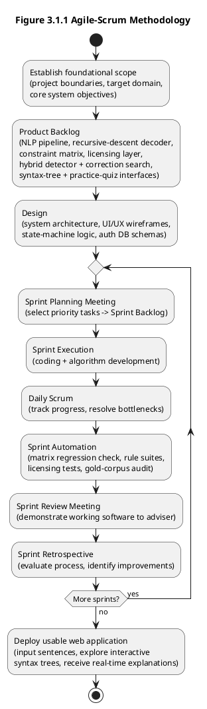
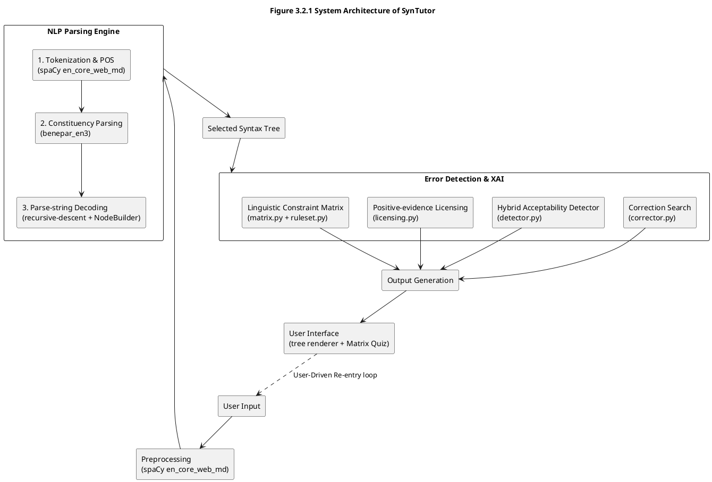
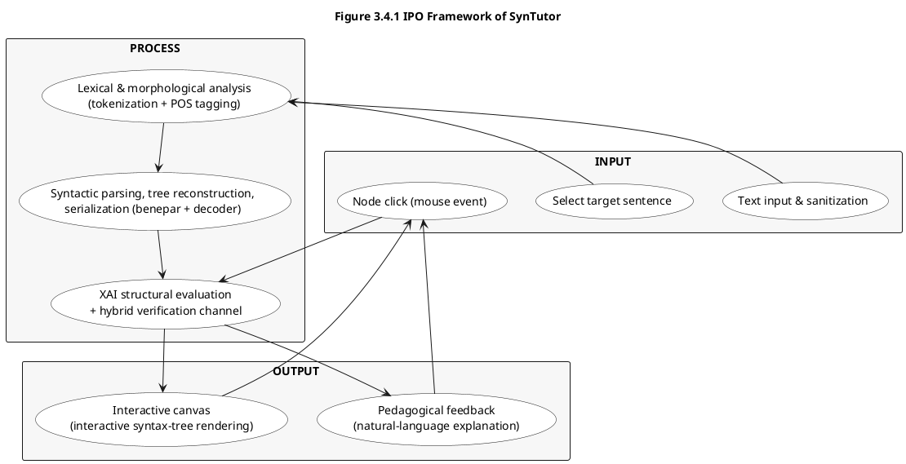
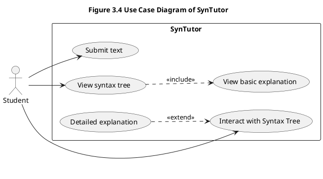
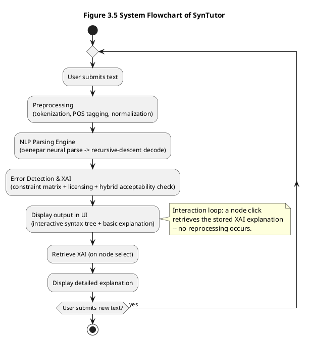
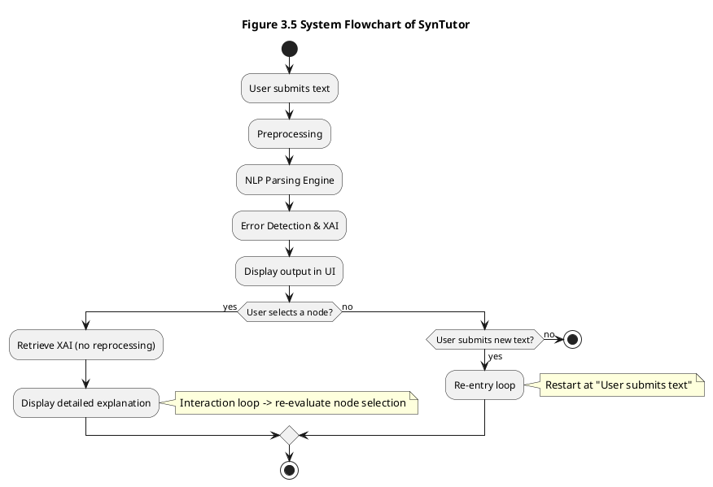

# SynTutor — Diagram Sources (PlantUML / PlantText)

Plain-text PlantUML source for every figure referenced in `docs/thesis.md`.
Paste any block into https://www.planttext.com (or any PlantUML renderer) to generate the image.

Figures covered:

- Figure 3.1.1 — Agile-Scrum Methodology
- Figure 3.2.1 — System Architecture of SynTutor
- Figure 3.4.1 — IPO Framework of SynTutor
- Figure 3.4 — Use Case Diagram of SynTutor
- Figure 3.5 — System Flowchart of SynTutor
- Figure 3.6 — State Diagram of SynTutor

---

## Figure 3.1.1 — Agile-Scrum Methodology



---

## Figure 3.2.1 — System Architecture of SynTutor



---

## Figure 3.4.1 — IPO Framework of SynTutor



---

## Figure 3.4 — Use Case Diagram of SynTutor



---

## Figure 3.5 — System Flowchart of SynTutor



---

## Figure 3.6 — State Diagram of SynTutor

```plantuml
@startuml Figure 3.6 State Diagram of SynTutor
title Figure 3.6 State Diagram of SynTutor

[*] --> Idle

Idle --> Processing : User input of text

state Processing {
  [*] --> Preprocessing
  Preprocessing --> Parsing
  Parsing --> "Syntax tree generated"
  "Syntax tree generated" --> "Explanation computed"
  "Explanation computed" --> "Output ready"
  "Output ready" --> [*]
}

Processing --> Viewing : Output ready

state Viewing {
  Viewing : Interactive syntax tree rendered
  Viewing : Basic UI explanation displayed
}

Viewing --> Exploring : User selects node
Exploring --> Viewing : Back to syntax tree
Viewing --> Processing : User submits new text
Viewing --> [*] : User exits

@enduml
```

---

## Figure 3.5 (alternative) — Explicit Flowchart with Decision Diamonds

Use this variant if you prefer literal decision diamonds instead of the loop shorthand above.


